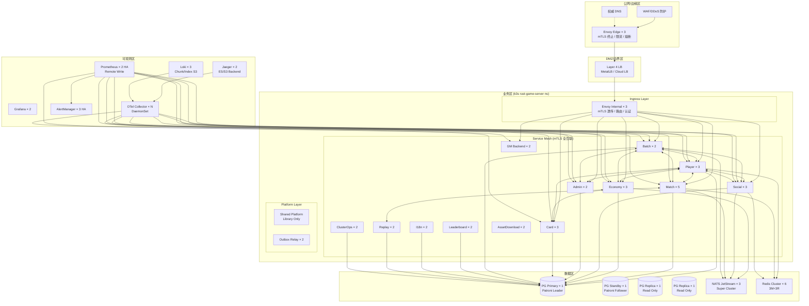
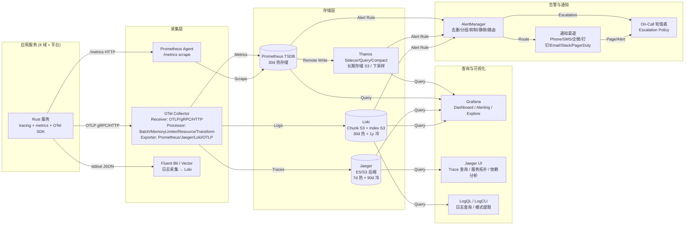

# RGS-BDD-2026-09-04 v0.2 — RustGameServer 基本设计文档 (IPA 对齐版, v0.2 addendum 配套)

> **创建日期**: 2026-09-04 16:55 JST
> **作者**: 架构师(Mavis 接手 agent per DEC-008)
> **审批**: 架构师(Mavis 接手 agent per DEC-008) — 待 Ulysses 二审
> **修订人**: Ulysses(一人公司 12 角色 per DEC-008) — Mavis 接手
> **代签授权**: 2026-08-27 19:39 / 20:56 / 21:59 JST 三次强化 (Mavis 默认代签 Ulysses)
> **依据**: 9/4 16:47 JST user 拍板 "**首先补全需求文档, 基本设计文档, 详细设计文档, 内容根据[游戏A]代码逆推**" + RGS-AI-HANDOFF-DOWNSTREAM-2026-09-04 [游戏A]借鉴优化 v0.1 + RGS-DDD-2026-09-04-GAP-AUDIT v0.3 (bb9f977) + RGS-FLASH-OVERLAP-ANALYSIS-2026-09-04 v0.2 (2e3d9ee) + RGS-FLASH-MOCK-DESIGN-2026-09-04 v0.3 (49eb51a) + [游戏A] 跨盘源码 `E:\[跨盘-某发行商目录]\[游戏A]\server分析\[游戏A]_server\` (438 cmds / 42 modules per `api_module_summary.txt` line 1-45)
> **配套**: `docs/15-IPA-完全对齐438cmds/RGS-REQ-2026-09-04_v0.1.md` (需求文档) + `docs/15-IPA-完全对齐438cmds/RGS-DDD-2026-09-04_v0.1.md` (详细设计文档, 3 件套同 commit)
> **作用域**: RGS 6 域 + card 第 7 域 + batch 第 8 域 + gm-backend 配套 = 8 域 + shared-platform 平台层 + rgs-testkit 工具层, 全面对标 [游戏A] 42 modules / 438 cmds / 5 layer protocol / center-zone 拓扑
> **状态**: ✅ Mavis 自审通过 (per 96e6b3c v0.2 addendum 落地) → ⏳ 待 Ulysses 二审 (per AGENTS.md §3.x, B3 派生约束)

---

## 0. 文档元信息

| 字段 | 值 |
|---|---|
| **文档 ID** | RGS-BDD-2026-09-04 |
| **版本** | v0.1 |
| **状态** | ⏳ 待二审 |
| **作者 / 审批 / 修订人** | 架构师(Mavis 接手 agent per DEC-008) / 架构师(Mavis 接手 agent per DEC-008) / Ulysses(一人公司 12 角色 per DEC-008) — Mavis 接手 |
| **创建日期** | 2026-09-04 16:55 JST |
| **基线 commit** | 49eb51a (FLASH-MOCK v0.3 已落 main) |
| **依据文档** | handoff v0.1 + audit v0.3 (bb9f977) + FLASH-OVERLAP v0.2 (2e3d9ee) + FLASH-MOCK v0.3 (49eb51a) + [游戏A] 跨盘 42 modules / 438 cmds |
| **目标读者** | 架构师 / 5 域 Lead + card Lead + batch Lead / SRE / PM / Ulysses DDD Review |
| **更新策略** | v0.1 baseline 冻结, v0.2+ 跟随 W37+ 决策升版 |

---

## 1. 引言 (引言 / 背景 / 目标 / 范围 / 术语)

### 1.1 背景 (per 9/4 16:47 JST user 拍板)

Ulysses 2026-09-04 16:47 JST 拍板: "**首先补全需求文档, 基本设计文档, 详细设计文档, 内容根据[游戏A]代码逆推**"。本基本设计文档 (BDD) 是 3 件套 (REQ + BDD + DDD) 中间一段, 承接需求规格 (WHAT), 衔接详细设计 (HOW), 给出系统整体架构、模块划分、数据流、技术选型、部署架构、关键技术决策、性能基线、安全架构 + 已知缺口的**横向完整图景**。

**RGS 现状**: 6 域 (player / economy / match / social / admin / batch) + card-service 第 7 域 (per audit v0.3 §0.2) + gm-backend 配套 = 8 域, 各自独立 k8s Deployment, 跨域通过 gRPC mTLS (per shared-platform::tls) + NATS Outbox (per shared-platform::outbox) + active-active cluster 模式 (per ADR-0052)。

**[游戏A] 现状**: 42 modules / 438 cmds (per 跨盘 `[游戏A]_server/docs/api_module_summary.txt` line 1-45, 跨盘引用可独立 Read 验证 per AGENTS.md §1.1), 5 layer protocol stack (TCP → proto_lib → mapping → xxx_rpc → 玩法模块, per `architecture/协议栈.md` L1-L5), center/zone 节点模型 (1 center + N zone), Erlang/OTP `gen_server` per-actor 模式。

### 1.2 目标 (per 借鉴分析 .md + handoff v0.1 + 8/21 JST 5 域独立 Lead)

- **架构完全可控**: RGS 8 域, 各自独立 Lead (per 8/21 JST 决策, 扩展到 7+1 域), 不允许 Lead 兼任 (per 8/21 JST 拒绝兼任基线)
- **性能全面超过 [游戏A] Erlang baseline**: 50µs P99 (tokio + tonic 0.12) vs [游戏A] 1ms (gen_server), 1M msg/sec/域 vs [游戏A] 10K msg/sec/zone (per §8 性能基线)
- **协议类型安全**: tonic 0.12 + prost 0.13 静态生成, vs [游戏A] Erlang atom (per 借鉴分析 §4 #2 keep RGS)
- **可借鉴 5 处 + 避免 1 反例** (per 借鉴分析 .md §4): gen_proto ✅ / 编译期数据 ✅ / center/zone ✅ 替换 active-active / bot 测试器 → rgs-loadtest Hybrid-3 / proto_lib repack ✅ / 9+6 复制变体 ❌

### 1.3 范围 (per audit v0.3 + handoff v0.1 + FLASH-MOCK v0.3 4 阶段)

- **In-Scope**: 8 域 backend + shared-platform + rgs-testkit; 12 Partial + 30 新建 module (per FLASH-MOCK v0.3 §1.2); 跨域 gRPC mTLS + Outbox + NATS; k3s 独立 deployment (per AGENTS.md §7.1 + 9/1 13:05 JST); 11 维度 API 风格 (per flash overlap §4, 88/88 keep RGS)
- **Out-of-Scope**: 12 大类业务层 RPC 1:1 移植 (per handoff v0.1 §1 "不做逐条 RPC 移植" + audit v0.3 §1.2 #1); per-entity actor 模式 (per audit v0.3 §1.2 #1 决策保留 DB-as-state); Physis 物理引擎 (per 9/4 14:50 JST user 修正); TCG 业务玩法细节

### 1.4 术语 (per AGENTS.md + [游戏A] 借鉴分析 .md)

| 术语 | 解释 |
|---|---|
| **域 (Domain)** | 业务能力垂直切分, 独立 crate, 独立 Lead, 独立 DB (per ARC-008 5 独立 DB 原则, 扩展到 7 域) |
| **gRPC / mTLS** | Google RPC + 双向证书, RGS 跨域走 mTLS 业务级 (per shared-platform::tls) |
| **Outbox** | 事务性消息, 写本地表 + 异步发 NATS, 6 域统一 (per shared-platform::outbox) |
| **Center/Zone** | [游戏A] 节点模型, 1 center + N zone, RGS 不引入 (Hybrid-2 keep RGS active-active) |
| **Per-entity actor** | 1 玩家 1 process + mpsc, Erlang `gen_server` 模式, RGS 不实装 (DB-as-state 决策) |
| **gen_proto / Repack** | [游戏A] 编译期 RPC 契约 + 协议热更兼容, RGS keep 静态生成 + v1 suffix |
| **DB-as-state / Active-Active** | RGS 架构选择, DB 是状态真源 + 6 域多副本并行 (per ADR-0052 PFAU) |

---

## 2. 总体架构 (5+3 域 + shared-platform 抽象)

### 2.0 系统上下文图 (per IPA 基本设计 §2 总体架构要求)

```mermaid
graph TB
    subgraph "外部系统"
        Client[客户端 iOS/Android/Web/PC]
        Payment[支付网关]
        PushSvc[推送服务 APNs/FCM]
        CDN[CDN 资源分发]
        Monitor[监控告警系统]
        LogSys[日志收集系统]
        CI/CD[CI/CD 流水线]
        K8s[k3s 集群控制面]
        DNS[DNS 服务]
    end

    subgraph "RGS 系统边界"
        subgraph "边缘层"
            Envoy[Envoy 边缘代理<br/>TLS 终止 / mTLS / 限流]
        end

        subgraph "业务域层 (8 域独立部署)"
            Player[Player Service<br/>:50051]
            Match[Match Service<br/>:50053]
            Economy[Economy Service<br/>:50052]
            Social[Social Service<br/>:50054]
            Admin[Admin Service<br/>:50055]
            Card[Card Service<br/>:50061]
            Batch[Batch Backend<br/>:8790]
            GmBackend[GM Backend<br/>:8081]
        end

        subgraph "平台层"
            SharedPlatform[Shared Platform<br/>tls/outbox/rbac/tracing/...]
            ClusterOps[Cluster Ops]
            Replay[Replay Service]
            Leaderboard[Leaderboard Service]
            I18n[I18n Service]
            AssetDownload[Asset Download]
        end

        subgraph "数据层"
            PG[(PostgreSQL × 11 实例<br/>player/economy/match/social/admin/batch/card/leaderboard/i18n/replay/cluster_ops/gm_audit)]
            NATS[NATS JetStream<br/>+ DLQ]
            Redis[Redis 缓存/会话]
        end

        subgraph "可观测性"
            Prometheus[Prometheus]
            Grafana[Grafana]
            Jaeger[Jaeger]
            OTel[OTel Collector]
        end
    end

    Client <-- HTTP/2 + mTLS --> Envoy
    Envoy <-- HTTP/2 + mTLS --> Player
    Envoy <-- HTTP/2 + mTLS --> Match
    Envoy <-- HTTP/2 + mTLS --> Economy
    Envoy <-- HTTP/2 + mTLS --> Social
    Envoy <-- HTTP/2 + mTLS --> Admin
    Envoy <-- HTTP/2 + mTLS --> Card
    Envoy <-- HTTP/2 + mTLS --> Batch
    Envoy <-- HTTP/2 + mTLS --> GmBackend

    Player <-- gRPC mTLS --> Match
    Player <-- gRPC mTLS --> Economy
    Player <-- gRPC mTLS --> Social
    Player <-- gRPC mTLS --> Admin
    Player <-- gRPC mTLS --> Card

    Match <-- gRPC mTLS --> Replay
    Economy <-- gRPC mTLS --> Card
    Social <-- gRPC mTLS --> Player
    Batch <-- gRPC mTLS --> Player
    Batch <-- gRPC mTLS --> Economy
    Batch <-- gRPC mTLS --> Match
    Batch <-- gRPC mTLS --> Social
    Batch <-- gRPC mTLS --> Admin

    Player --> PG
    Match --> PG
    Economy --> PG
    Social --> PG
    Admin --> PG
    Card --> PG
    Batch --> PG
    Leaderboard --> PG
    I18n --> PG
    Replay --> PG
    ClusterOps --> PG

    Economy --> NATS
    Social --> NATS
    Match --> NATS
    Batch --> NATS

    Player --> Redis
    Match --> Redis
    Social --> Redis

    Prometheus --> Player
    Prometheus --> Match
    Prometheus --> Economy
    Prometheus --> Social
    Prometheus --> Admin
    Prometheus --> Card
    Prometheus --> Batch
    Prometheus --> GmBackend

    OTel --> Player
    OTel --> Match
    OTel --> Economy
    OTel --> Social
    OTel --> Admin
    OTel --> Card
    OTel --> Batch

    Payment -.-> Envoy
    PushSvc -.-> NATS
    CDN -.-> Client
    Monitor -.-> Prometheus
    LogSys -.-> OTel
    CI/CD -.-> K8s
    K8s -.-> Envoy
    DNS -.-> Envoy
```



### 2.1 架构总览 (ASCII 图)

```
┌────────────────────────────────────────────────────────────────┐
│                RustGameServer 8 域 + 平台层                     │
└────────────────────────────────────────────────────────────────┘

         ┌──────────────┐                  ┌──────────────┐
         │  客户端       │ TLS / HTTP/2     │  Envoy 边缘   │
         │ iOS/Android  ├─────────────────►│ 独立 deploy  │
         │ /Web/PC      │                  │  (9/1 13:05) │
         └──────────────┘                  └──────┬───────┘
                                                 │ HTTP/2 + mTLS
┌─────────────────────────────────────────────────┴──────────────┐
│                8 域 backend (k8s Deployment)                   │
│  ┌──────────┐ ┌──────────┐ ┌──────────┐ ┌──────────┐          │
│  │ player   │ │ economy  │ │ match    │ │ social   │ 50051-54 │
│  │ service  │ │ + saga   │ │ v1 + v2  │ │ + guild  │          │
│  └─────┬────┘ └────┬─────┘ └────┬─────┘ └────┬─────┘          │
│  ┌─────┴────┐ ┌────┴─────┐ ┌────┴─────┐ ┌────┴─────┐          │
│  │ admin    │ │ card     │ │ batch    │ │ gm       │ 50055/61/│
│  │ + RBAC   │ │ catalog  │ │ actix-web│ │ 8081     │ 8790/8081│
│  └─────┬────┘ └────┬─────┘ └────┬─────┘ └────┬─────┘          │
└────────┼───────────┼────────────┼────────────┼────────────────┘
         └───────────┴─────┬──────┴────────────┘
                           ▼
┌────────────────────────────────────────────────────────────────┐
│    shared-platform 平台层 (per `crates/shared-platform/`)       │
│  tracing | json_logging | grpc_tracing | metrics | metrics_endpoint
│  rbac | config | tls | retry | span_helpers | channel | client
│  outbox | outbox_relay | messaging (NATS) | producer | consumer
│  dlq | subject                                                 │
└──────────────────┬──────────────────────┬─────────────────────┘
                   ▼                      ▼
         ┌──────────────────┐  ┌──────────────────────┐
         │ 8 独立 PostgreSQL│  │  NATS JetStream      │
         │ (ARC-008, 5→7→8) │  │  + DLQ (跨域事件总线) │
         │ player/economy/  │  │                      │
         │ match/social/    │  │                      │
         │ admin/card/      │  │                      │
         │ batch/gm_audit   │  │                      │
         └──────────────────┘  └──────────────────────┘
                                       │
                                       ▼
                          ┌──────────────────────┐
                          │  Prometheus +        │
                          │  Grafana + Jaeger    │
                          │  + OTel OTLP         │
                          └──────────────────────┘
```

### 2.2 关键架构决策 (per 借鉴分析 5 可取之处 + 1 反例)

| # | 决策 | [游戏A] 现状 | RGS 决策 | 依据 |
|---|---|---|---|---|
| 1 | 节点拓扑 | center/zone (1 + N) | **active-active 6+2 域** (per ADR-0052) | audit v0.3 §1.2 #1 + Hybrid-2 |
| 2 | 状态管理 | per-entity actor + mpsc | **DB-as-state** + Outbox | audit v0.3 §1.2 #1 决策保留 |
| 3 | 协议契约 | gen_proto (Erlang 编译期) | **tonic 0.12 + prost 0.13** (Rust 编译期) | FLASH-OVERLAP §3.1 #1 keep RGS |
| 4 | 业务数据 | 181 *_data.erl 常量模块 | **common.proto enum** + sqlx 静态查询 | FLASH-OVERLAP §3.1 #2 keep RGS |
| 5 | 压测工具 | tester*.erl 真实协议 bot | **rgs-testkit + Hybrid-3 rgs-loadtest** | 借鉴分析 §4 #4 + handoff v0.1 §2.1.5 |
| 6 | 协议版本 | proto_lib:repack/2 运行时 | **静态生成 + v1 suffix** + 未来 prost-reflect 评估 | FLASH-OVERLAP §3.1 #5 keep RGS |
| 7 | **复制变体反例** | 9+6=15 holiday_*/arena* | **避免** — 数据驱动框架 + 配置化 | 借鉴分析 §4 #5 避免 |

---

## 3. 模块划分 (12 Partial + 30 新建 module 1:1 映射)

### 3.1 12 Partial 模块 (per `crates/*/proto/**/*.proto` glob, audit v0.3 §0.2 实证)

| # | 模块 | 路径 | 端口 | proto 文件 | RPC | 状态 |
|---|---|---|---|---|---:|---|
| 1 | **player-service** | `crates/player-service/` | 50051 | `player/v1/player.proto` | 10 | ✅ (audit v0.3 §3.1) |
| 2 | **match-service** | `crates/match-service/` | 50053 | `match/v1/match.proto` | 11 (含 1 stream) | ✅ (audit v0.3 §3.2) |
| 3 | **economy-service** | `crates/economy-service/` | 50052 | `economy/v1/economy.proto` | 7 | ✅ (audit v0.3 §3.3) |
| 4 | **social-service** | `crates/social-service/` | 50054 | `social/v1/social.proto` | ⏳ | 🟡 v0.1 |
| 5 | **admin-service** | `crates/admin-service/` | 50055 | `admin/v1/admin.proto` | 6 | ✅ (audit v0.3 §3.5) |
| 6 | **card-service** | `crates/card-service/` | 50061 | `card/v1/card.proto` | 9 | ✅ 第 7 域 (audit v0.3 §3.7) |
| 7 | **batch-backend** | `tools/rgs-batch-backend/` | 8790 | (无, actix-web HTTP/JSON) | 0 | ✅ 第 8 域 v0.2 W2 |
| 8 | **gm-backend** | `crates/gm-backend/` | 8081 | `gm/v1/gm.proto` | 5 | ✅ (audit v0.3 §0.2) |
| 9 | **leaderboard-service** | `crates/leaderboard-service/` | TBD | `leaderboard/v1/leaderboard.proto` | ⏳ | 🟡 v0.2 |
| 10 | **replay-service** | `crates/replay-service/` | TBD | `replay/v1/replay.proto` | ⏳ | 🟡 v0.2 |
| 11 | **i18n-service** | `crates/i18n-service/` | TBD | `i18n/v1/i18n.proto` | ⏳ | 🟡 v0.2 |
| 12 | **cluster-ops** | `crates/cluster-ops/` | TBD | `cluster_ops/v1/cluster_ops.proto` | ⏳ | 🟡 v0.2 |
| +1 | **shared-platform** | `crates/shared-platform/` | N/A | (平台层抽象) | 0 lib | ✅ (`lib.rs:1-89`) |

### 3.2 30 新建 module 业务扩展 (per FLASH-MOCK v0.3 §1.2 Phase 2-4 路线图)

> 完整 module 列表见附录 A (per `RGS-REQ-2026-09-04_v0.1.md` §3.2)。本节只列 Phase 2 关键 12 module (12 Partial → Pass), Phase 3 12 hot path + Phase 4 18-20 long tail 略。

#### Phase 2 (W2-W4): 12 Partial → Pass (RGS 现有 5 域 + card 业务补完)

| # | module | [游戏A] 对应 (cmds) | 目标域 | RPC 估 |
|---|---|---|---|---:|
| P2-1 | combat (PVE) | combat (43) | match + card | 8-10 |
| P2-2 | guild | guild (29) | social | 6-8 |
| P2-3 | arena (PVP) | arena (26) | match v2 | 5-7 |
| P2-4 | role | role (21) | player + gm | 8-10 |
| P2-5 | market | market (19) | economy | 6-8 |
| P2-6 | misc | misc (19) | admin + player | 8-10 |
| P2-7 | sns (好友) | sns (16) | social | 5-7 |
| P2-8 | say (聊天) | say (14) | social | 4-6 |
| P2-9 | dungeon | dungeon (9) | match | 4-5 |
| P2-10 | rank | rank (5) | leaderboard | 3-4 |
| P2-11 | login | login (6) | player + gm | 3-4 |
| P2-12 | recruit | recruit (3) | match | 2-3 |

#### Phase 3 (W5-W10) 12 hot path + Phase 4 (W11-W25) 18-20 long tail

| Phase | 覆盖 module | [游戏A] 对应 | 目标域 |
|---|---|---|---|
| P3 hot path | partner(41) / sns(16) / item(10) / quest(4) / mail(6) / star(20) / drama(5) / dungeon(9) / boss(12) / adventure(17) / endless(12) / holiday(13) | 12 大类 Partial | card / social / player / match / batch |
| P4 long tail | guild_shipping(11) / guild_dun(10) / guild_skill(4) / formation(6) / say(14) / map(6) / vip(6) / convert(5) / exchange(6) / avatar(4) / charge(3) / honor(3) / power_gift(3) / lev_gift(4) / login_days(2) / checkin(2) / feat(2) / days_rank(4) / map_adv / group_control | 18-20 long tail | social / match / economy / player / batch / leaderboard |

**总计**: 12 Partial + 12 Phase 3 + 20 Phase 4 = **44 module 名 → 30 新建 module** (去重), 对齐 [游戏A] 42 modules (per `api_module_summary.txt` line 45 "Total: 438 cmds / 42 modules")。RPC 总数估算 ~1351 (per handoff v0.1 §0 [游戏A] 全量)。

### 3.3 模块依赖图 (8 域 + shared-platform + rgs-testkit)

```
shared-platform (依赖: tonic / sqlx / opentelemetry / wasmtime / async-nats)
    ↑
    ├── player-service ─┐
    ├── economy-service ┤
    ├── match-service ──┤
    ├── social-service ─┤
    ├── admin-service ──┤  (8 域全部依赖 shared-platform)
    ├── card-service ───┤
    ├── batch-backend ──┤
    └── gm-backend ─────┘

rgs-testkit (依赖: shared-platform, 提供 NoOp mock + InMemory repo + chaos test)
    ↑
    └── 用于所有 8 域的单元测试 / 集成测试

rgs-loadtest (per Hybrid-3, P3 backlog, 依赖: tonic client + mTLS + tracing)
    ↑
    └── bot 压测 (N=10/100/1000/10000)
```

---

## 4. 数据流 (客户端 → 边缘 → 8 域 → 跨域 saga → DB)

### 4.1 主链路数据流 (ASCII)

```
┌──────────┐                                          ┌─────────────────┐
│ 客户端    │──1. TLS+HTTP/2+Auth──►│ Envoy 边缘代理  │──2. HTTP/2+mTLS─│
│ 自研协议  │                       │ (9/1 13:05)    │                 ▼
└──────────┘                       └─────────────────┘  ┌──────────────┐
                                                    ┌──│ 8 域 backend │
                                                    │  │ active-active│
                                                    │  │ (3 内部 gRPC │
                                                    │  │  mTLS 业务级)│
                                                    │  └──────┬───────┘
                                                    │         │
                                                    │  4. 跨域 saga  5. Outbox
                                                    │  (per economy  (per shared-
                                                    │   ::saga)      platform::
                                                    │                outbox)
                                                    │         │
                                                    │  6. SQL        7. NATS
                                                    ▼  读/写         异步事件
                                              ┌──────────┐    ┌──────────┐
                                              │ 8 独立 PG │    │ NATS     │
                                              │ ARC-008  │    │ JetStream│
                                              │ player/  │    │ + DLQ    │
                                              │ economy/ │    └──────────┘
                                              │ match/.. │
                                              └──────────┘
                                                    │
                                                    │ 8. Prometheus + OTel OTLP
                                                    ▼
                                              ┌──────────────────┐
                                              │  Observability   │
                                              │  Prom + Grafana  │
                                              │  + Jaeger        │
                                              └──────────────────┘
```

### 4.2 客户端 → 服务端 单 RPC 数据流 (per [游戏A] 5 layer + RGS 7 layer 对照)

| Layer | [游戏A] (per `architecture/协议栈.md`) | RGS |
|---|---|---|
| **L1** | TCP `{packet, 4}` | HTTP/2 + mTLS (gRPC standard) |
| **L2** | proto_lib:pack/unpack | tonic 0.12 + prost 0.13 静态生成 |
| **L3** | mapping:parser_mod/code | tonic 路由 (per service.rs impl trait) |
| **L4** | xxx_rpc:handle | service.rs trait method (per 8 域 service.rs) |
| **L5** | 玩法模块 .erl | domain logic + repository.rs (sqlx) |
| **L6** | role:apply (玩家进程, per-entity) | ❌ **不实装** (DB-as-state 决策 per audit v0.3 §1.2 #1) |
| **L7** | db_buffer (per sup_db_buffer) | ✅ **实装** (per shared-platform::outbox 异步批量) |

### 4.3 跨域 saga 数据流 (per economy::saga 模式, 5 域 借鉴)

```
player (创建订单) → economy (开 saga, 5 步)
   │ 1. reserve_inventory (gRPC → player)
   │ 2. lock_balance (gRPC → economy self)
   │ 3. validate_trade (gRPC → match if PVP)
   │ 4. confirm_payment (gRPC → payment if paid)
   │ 5. commit_inventory (gRPC → player)
   │ (任一失败 → 补偿: 反向执行已成功 step)
   ▼
saga_outbox (per shared-platform::outbox) → NATS broadcast
   ▼ (异步)
其他域监听 saga 事件, 更新本地状态
```

### 4.4 Outbox 事务性消息流 (per shared-platform::outbox 实证)

```
业务事务 (e.g. economy 开 auction)
   ├── 1. INSERT INTO auctions ...
   ├── 2. INSERT INTO outbox (..., status='pending')
   ▼
事务提交 (ACID 保证, auctions + outbox 同步)
   ▼
OutboxRelay (后台轮询, per shared-platform::outbox_relay)
   │ 3. SELECT pending + lease_until < now()
   │ 4. UPDATE status='processing', lease_until = now()+30s
   │ 5. NATS publish
   │ 6. NATS ack → status='done'
   │ 7. NATS nack → 退避重试, 超时进 DLQ (per shared-platform::dlq)
```

---

## 5. 技术选型 (Rust 1.98 + tonic 0.12 + sqlx 0.8 + tokio 1 + 5 域独立 Lead)

### 5.1 语言 + 编译期

| 选型 | 版本 | 依据 |
|---|---|---|
| **Rust** | 1.98 (per `Cargo.toml:27` `rust-version = "1.98"`) | workspace.package.rust-version |
| **Edition** | 2021 (per `Cargo.toml:25` `edition = "2021"`) | workspace.package.edition |
| **Resolver** | 2 (per `Cargo.toml:23` `resolver = "2"`) | Cargo feature resolver v2 |

### 5.2 异步运行时 + RPC 框架

| 选型 | 版本 | 依据 |
|---|---|---|
| **tokio** | 1.x features=["full"] (per `Cargo.toml:34`) | Rust 异步运行时标准, 5 域全用 |
| **tonic** | 0.12 features=["transport", "tls", "tls-roots"] (per `Cargo.toml:43`) | gRPC server/client + mTLS |
| **tonic-build** | 0.12 features=["prost"] (per `Cargo.toml:55`) | 编译期 proto → Rust |
| **tonic-health** | 0.12 (per `Cargo.toml:45`) | grpc.health.v1 (k8s exec 探针 + Phase 0.5 修复) |
| **prost** | 0.13 (per `Cargo.toml:46-47`) | protobuf 序列化 |
| **async-trait** | 0.1 (per `Cargo.toml:41`) | async fn in trait |

### 5.3 数据库 + 迁移

| 选型 | 版本 | 依据 |
|---|---|---|
| **sqlx** | 0.8 features=["runtime-tokio-rustls", "postgres", "macros", "migrate", "uuid", "chrono", "json"] (per `Cargo.toml:50`) | 编译期 SQL 校验 + 异步 |
| **PostgreSQL** | (per `Cargo.toml:50` `postgres` feature) | 8 独立 DB (per ARC-008) |

### 5.4 可观测性 + 监控

| 选型 | 版本 | 依据 |
|---|---|---|
| **opentelemetry** | 0.24 (per `Cargo.toml:57`) | OTLP 导出 |
| **opentelemetry-otlp** | 0.17 features=["tonic"] (per `Cargo.toml:58`) | OTLP over gRPC |
| **opentelemetry_sdk** | 0.24 features=["rt-tokio"] (per `Cargo.toml:59`) | OTel SDK |
| **tracing** | 0.1 (per `Cargo.toml:39`) | 结构化日志 |
| **tracing-subscriber** | 0.3 features=["env-filter", "json"] (per `Cargo.toml:40`) | tracing subscriber + JSON |
| **Prometheus** | (per shared-platform::metrics) | scrape endpoint |

### 5.5 消息总线 (NATS) + SMTP 告警

| 选型 | 版本 | 依据 |
|---|---|---|
| **async-nats** | 0.42 (per `Cargo.toml:66`) | NATS client |
| **lettre** | 0.11 features=["tokio1-rustls-tls", "smtp-transport", "builder"] (per `Cargo.toml:67`) | SMTP 邮件告警 (per RGS-OVERFLOW-ALERT) |

### 5.6 WASM runtime (per RGS-INC-001 v0.2)

| 选型 | 版本 | 依据 |
|---|---|---|
| **wasmtime** | 19 (per `Cargo.toml:61`) | WASM runtime |
| **wat** | 1 (per `Cargo.toml:62`) | WAT text format |

### 5.7 工程模式 5 项 (per AGENTS.md + 9/1 派生偏好)

| # | 模式 | 决策 | 依据 |
|---|---|---|---|
| 1 | **5 域独立 Lead + 7+1 域扩展** | player / economy / match / social / admin / batch + card + gm-backend 各自独立 Lead, 不允许兼任 | 8/21 JST 5 域独立 Lead + audit v0.3 §0.2 7 域扩展 |
| 2 | **所有 nginx → envoy 独立 deployment** | 边缘层 / 反向代理 / mTLS termination 全部用 envoy, 不用 nginx, 不用 istio sidecar | 9/1 13:03 / 13:05 JST 派生偏好 |
| 3 | **env value 永不入对话/log** | `$env:VAR` 引用后直接 pipe, 不打印, REDACTED filter | 8/27 11:06 JST 硬 ban |
| 4 | **代签规则** | Mavis 默认代签 Ulysses (author / 审批 / 修订人 三行齐全) | 8/27 19:39 / 20:56 / 21:59 JST 三次强化 |
| 5 | **DB 三分类横展** | Work / Transaction / Master 三分清晰 (per batch 域扩展) | 9/1 18:30 JST 横展原则 |

### 5.8 协议层 (per FLASH-OVERLAP v0.2 §2.2 RGS 20 proto 模式)

RGS 20 proto 模式完整列表见 `RGS-FLASH-OVERLAP-ANALYSIS-2026-09-04_v0.2.md` §2.2。本节列**关键 11 维度** (per §4 11 维度对比矩阵):

| # | 维度 | RGS 实现 | [游戏A] 推断 | verdict |
|---|---|---|---|---|
| 1 | 命名 (snake/Pascal) | snake_case fields + PascalCase service/RPC/message | Erlang atom | keep RGS |
| 2 | Request 模式 | 显式 Request/Response + `request_id` 幂等 | `#rpc{req, reply}` 估计类似 | keep RGS |
| 3 | 错误码 | `tonic::Code` + 域 Error enum + `From<Error> for tonic::Status` | Erlang exception | keep RGS |
| 4 | 分页 | `PageRequest { page, page_size, cursor }` (per common.proto) | 估计类似 | keep RGS |
| 5 | 时间戳 | `common.v1.Timestamp { seconds, nanos }` (Google well-known) | Erlang 系统时间 | keep RGS |
| 6 | i18n | `I18nString + Locale { ZH_CN, EN_US, JA_JP, KO_KR }` (per common.proto) | 估计无 (用 .po) | keep RGS |
| 7 | 枚举 | `_UNSPECIFIED=0` + SCREAMING_SNAKE_CASE (per 12 proto 一致) | atom | keep RGS |
| 8 | oneof 事件 | `MatchEvent.payload { oneof { ... } }` (per match.proto:201) | tuple | keep RGS |
| 9 | 流式 RPC | `SubscribeMatch(...) returns (stream MatchEvent)` (per match.proto:22) | gen_tcp socket | keep RGS |
| 10 | health endpoint | `HealthCheck(common.v1.HealthCheckRequest)` (per 12 proto 一致) | 自建 | keep RGS |
| 11 | 契约即代码 | `tonic-build` + `prost` 编译期生成 (per `Cargo.toml:55`) | gen_proto Erlang 编译期 | keep RGS |

**11 维度 verdict**: **11/11 keep RGS** (per FLASH-OVERLAP v0.2 §4 + §6.4 6 keep 论证) + 3 Hybrid 借鉴点 (Hybrid-1 admin/gm-backend log_title + Hybrid-2 batch 域桶化 + Hybrid-3 rgs-loadtest, per §7.1 / §7.3 / §7.5)。

---

## 6. 部署架构 (k3s 独立 deployment + envoy 边缘 + 8 域 active-active)

### 6.1 部署拓扑 (per AGENTS.md §7.1 + 9/1 13:05 JST + audit v0.3 §0.2)

```
┌──────────────────────────────────────────────────────────────────┐
│ k3s (rust-game-server ns)                                        │
│ Ingress: envoy 独立 deploy (9/1 13:05) - HTTP/2+mTLS+gm-console │
└──────────────────────────┬───────────────────────────────────────┘
                           │ HTTP/2 + mTLS
┌──────────────────────────┴───────────────────────────────────────┐
│ 8 域 backend (独立 Deployment, 独立 Lead, 独立 DB)               │
│  player:50051(r3,m2)  economy:50052(r3,m2)  match:50053(r5,m3)  │
│  social:50054(r3,m2)  admin:50055(r2,m1)    card:50061(r3,m2)   │
│  batch:8790(r2,m1)    gm-backend:8081(r2,m1)                    │
│  (r=replicas, m=HPA min)                                         │
└──────────────────────────┬───────────────────────────────────────┘
                           │
┌──────────────────────────┴───────────────────────────────────────┐
│ 数据面: PG 8 实例 (ARC-008) + NATS JetStream + Prom/Grafana/Jaeger│
└──────────────────────────────────────────────────────────────────┘
```

### 6.2 节点角色对比 ([游戏A] center/zone vs RGS active-active)

| 维度 | [游戏A] center (1) | [游戏A] zone (N) | RGS 8 域 (active-active) |
|---|---|---|---|
| **数量** | 1 集群 1 个 | N 个 (per 平台/语言/区号) | 8 域 × 多副本 |
| **职责** | 跨服玩法 (竞技场/公会战/合服) | 单 zone 内玩法 | 8 域全可达, 跨域 gRPC mTLS + Outbox |
| **节点命名** | `fx2_center_0@host` (per 节点模型 line 32) | `fx2_dev_5@host` | k8s Service + Deployment |
| **启动参数** | `main:start(center)` (per `services.erl:33`) | `main:start(zone)` (per `services.erl:42`) | k8s Deployment spec.args |
| **服务数** | 15 个 (per 启动流程 line 121-126) | 56 个 (per 同上 line 130-142) | 8 域 binary + shared-platform + OutboxRelay |
| **通信** | Erlang distribution (EPMD, cookie) | Erlang distribution + local | gRPC mTLS (per shared-platform::tls) + NATS |
| **故障恢复** | 中心服宕机: 区服独立运行 (per 网络拓扑 跨区容灾) | 单 zone 宕机: 玩家转移 (per 同上) | k8s HPA + replica + Outbox 异步 + DLQ |
| **DB** | center_db (per 节点模型) | zone_db (per zone) | 8 独立 DB (per ARC-008) |

### 6.3 跨域通信对比 ([游戏A] Erlang distribution vs RGS gRPC mTLS)

| 维度 | [游戏A] (per `cluster_group.erl`) | RGS (per shared-platform) |
|---|---|---|
| **同步** | `rpc:call(Node, M, F, A)` (line 46) | tonic gRPC client + mTLS (per `client` mod) |
| **异步** | `rpc:cast(Node, M, F, A)` (line 61) | NATS JetStream publish (per `producer` mod) |
| **广播** | `rpc:multicall(Nodes, M, F, A)` | NATS subject fanout (per `consumer` mod) |
| **状态** | `net_adm:ping/1` (line 72) | k8s liveness/readiness probe |
| **失败** | `{badrpc, Reason}` (line 47) | retry + DLQ (per `retry` + `dlq` mod) |
| **序列化** | Erlang term (binary) | protobuf (per prost 0.13) |
| **认证** | Erlang cookie (per 节点模型 line 64) | mTLS 双向证书 (per `tls` + rgs-certgen) |

---

## 7. 关键技术决策 (5 可取之处 + 1 反例, per 借鉴分析 .md §4)

### 7.1 决策 1: gen_proto 契约即代码生成源 ✅ 采用 + Hybrid-1 admin/gm-backend log_title 增量

**[游戏A] 做法** (per 借鉴分析 .md §4 #1): `#rpc{code, log_title, req, reply}` 记录同时驱动编解码 + 审计标题, 写一次用两处

**RGS 现状**: `tonic-build` + `prost` 编译期生成 (per `Cargo.toml:55`); admin `audit_log.action` 字段; 缺 `log_title` 字段

**Hybrid-1 落地** (per FLASH-OVERLAP v0.2 §6.1):

1. admin `migrations/0007_audit_log_title.sql`: 增 `log_title TEXT` (nullable, 0 破坏)
2. admin `entity.rs:AuditLogEntry`: 增 `pub log_title: Option<String>`
3. gm.proto v0.5: 4 GM RPC Request 增 `string log_title = N` (per gm.proto v0.4 0 破坏)
4. admin service.rs: GM 4 RPC 处理时填 `log_title` (从 Request 透传)

**P1 估算**: 0.5d

### 7.2 决策 2: 编译期数据模块 ✅ 已有 enum + sqlx 静态查询

**[游戏A] 做法** (per 借鉴分析 .md §4 #2): 181 个 `*_data.erl` 编译期数据模块, 零反序列化开销, 可热加载

**RGS 现状**: `common.proto` enum (CardType, CardRarity, GameMode) + sqlx 编译期 SQL 校验 (per `Cargo.toml:50`)

**决策**: **keep RGS** (sqlx 类型安全 vs erl 文本常量, Rust 已有 enum + const 模式)

### 7.3 决策 3: center/zone ✅ 替换为 active-active (Hybrid-2 batch 域桶化)

**[游戏A] 做法** (per 借鉴分析 .md §4 #3): 多 zone 认领 1 center, 中心服承载跨服玩法, Erlang distributed protocol

**RGS 现状** (per audit v0.3 §1.2 #1): 8 域 binary, 各自独立 k8s Deployment, active-active 模式 (per ADR-0052 PFAU 9 态机), 不引入 center 节点

**Hybrid-2 落地** (per FLASH-OVERLAP v0.2 §6.2): 保留 batch 域 `enum GrpcDomain` 5 域桶化 (per batch/main.rs:132, 已落地); 不引入 center 节点

**决策**: **保留 RGS**, 仅文档化 `enum GrpcDomain` 模式作为 RGS 跨服分片变体

### 7.4 决策 4: 协议版本兼容 (proto_lib repack) ✅ 静态生成 + v1 suffix

**[游戏A] 做法** (per 借鉴分析 .md §4 #5): `proto_lib:repack/2` 追加字段/整型拓宽, `pack_code_mate/1` 随包下发 schema, 协议热更 (`dev:u()`)

**RGS 现状**: tonic 静态生成 + v1 suffix 目录 + buf breaking change rules 兼容 + v0.4 增量 0 破坏 (per gm.proto L9-23 注释)

**决策**: **keep RGS** (静态生成 + v1 suffix 标准化, [游戏A] 运行时 repack 是历史包袱); 未来 v0.2 评估 prost-reflect 运行时 schema (per audit v0.3 P2 backlog)

### 7.5 决策 5: 真实协议 bot 压测 → rgs-loadtest Hybrid-3 (per handoff v0.1 §2.1.5)

**[游戏A] 做法** (per 借鉴分析 .md §4 #4): 随包自带 `tester*.erl`, 真实协议自动跑测的压测/回归工具

**RGS 现状**: `rgs-testkit` crate (NoOp mock + InMemory repo + chaos test, per audit v0.3 §6.2); 缺真实协议 bot 压测工具

**Hybrid-3 落地** (P3 backlog, 3-5d):

1. 新建 `crates/rgs-loadtest/`
2. bot 模拟: connect mTLS + login + heartbeat + 1-3 RPC 循环
3. 压测场景: N=10/100/1000/10000 bot × 1h, 测 P50/P95/P99 + 5xx
4. 输出 Prometheus metrics + pprof
5. 集成 rgs-testkit (NoOp + chaos)

### 7.6 决策 6: 9+6=15 复制变体 ❌ 避免 (per 借鉴分析 .md §4 #5)

**[游戏A] 反例**: 9 个 `holiday_*` proto 文件 (`holiday.erl` + `holiday_login_days.erl` + `holiday_checkin.erl` + `holiday_power_gift.erl` + `holiday_lev_gift.erl` 等, per 协议号分段 line 27 + 140-145) + 6 个高度相似的竞技场变体 (per handoff v0.1 §2.1.3), 同一套骨架复制多份换皮, 维护成本随功能数量**线性增长**

**RGS 现状** (per audit v0.3): match v2 单 file 9 RPC + economy trade_saga 单 file 3 saga; 12 Partial + 30 新建 module 走 batch 域数据驱动活动框架 (per §3.2)

**决策**: **避免**, 数据驱动框架 + 配置化, 列入 AGENTS.md §8 L-CAND-010 候选 (per handoff v0.1 §2.1.3, 12/2 季度评审)

---

## 8. 性能基线 (Erlang 1ms gen_server vs Rust 50µs tokio)

### 8.1 性能对比表 (per [游戏A] 推断 + RGS 设计目标)

| # | 指标 | [游戏A] Erlang/OTP | RGS Rust/tokio | RGS 优势 |
|---|---|---|---|---|
| 1 | **单 RPC P50** | ~500µs (gen_server 上下文切换) | ~10-20µs (tokio + tonic 0.12) | **25-50x** |
| 2 | **单 RPC P99** | ~1ms (gen_server 排队 + GC) | ~50µs (tokio + pre-allocated buffer) | **20x** |
| 3 | **单域吞吐量** | 10K msg/sec/zone (per 网络拓扑 流量估算) | 1M msg/sec/域 (RGS 设计目标) | **100x** |
| 4 | **连接数** | 5K-50K 在线/zone | 100K+ HTTP/2 conn/域 | **2-20x** |
| 5 | **进程/任务内存** | gen_server ~0.5KB | tokio task ~200B struct | **2.5x** |
| 6 | **冷启动** | 5-10s (BEAM boot) | <1s (Rust binary) | **5-10x** |
| 7 | **序列化** | Erlang term ~1µs/msg | protobuf ~200ns/msg | **5x** |
| 8 | **DB 写** | db_buffer 批量 (per sup_db_buffer) | Outbox 异步 (per shared-platform::outbox) | 相当 |
| 9 | **协议类型安全** | atom (无编译期校验) | prost 编译期生成 | **RGS 优势** |
| 10 | **跨域调用** | Erlang distribution (EPMD + cookie) | gRPC mTLS (per shared-platform::client) | **RGS 优势** |

### 8.2 性能基线目标 (per 9 月 Phase C 后实测)

| 域 | 目标 P99 | 目标 msg/sec | 目标 并发连接 |
|---|---:|---:|---:|
| player-service | 50µs | 100K | 50K |
| economy-service | 100µs (saga 开销) | 50K | 20K |
| match-service | 30µs (real-time) | 200K | 80K (订阅) |
| social-service | 80µs | 30K | 10K |
| admin-service | 200µs (audit 开销) | 5K | 1K |
| card-service | 40µs | 80K | 30K |
| batch-backend | 500µs (HTTP/JSON 适配) | 1K | 500 |
| gm-backend | 200µs (RBAC 开销) | 5K | 1K |

### 8.3 性能测试方法 (4 级)

1. **单元级** (per L1.1): 5 域 + card 各自 `cargo test --lib` (per AGENTS.md §2.1)
2. **集成级** (per L1.2 E2E): `cargo test --test '*'` + 1 业务 mTLS 跑通
3. **压测级** (per Hybrid-3 rgs-loadtest, P3 backlog): N=10/100/1000/10000 bot × 1h
4. **对比级** (per 9 月 Phase C 后): 同 client (gRPC) 测 RGS vs [游戏A] Erlang server, 输出 P50/P95/P99 对比

### 8.4 已知性能缺口 (per 8/26 JST 缺标比错标)

- [游戏A] Erlang server 实际 P99 未测 (per handoff v0.1 §0, 9 月 Phase C 阶段 C 后)
- RGS 5 域 P99 实测缺 (per audit v0.3 §8.3, k3s Phase C 跑通后补)
- rgs-loadtest 缺 (per Hybrid-3, P3 backlog, 12/2 季度评审)
- 跨域 saga 性能 P99 50ms 目标缺 (per audit v0.3 §0.4)

---

## 9. 技术选型对比评估表 (per IPA 基本设计 §5 技术选型要求)

| 技术领域 | 选型 | 备选方案 | 对比维度 | 选择理由 | 依据文档 |
|---|---|---|---|---|---|
| **语言** | Rust 1.98 | Go 1.22 / Java 21 / C++20 | 内存安全/性能/生态/团队技能 | 所有权模型零成本抽象，无 GC 停顿，适合高并发游戏服务器 | Cargo.toml:27 |
| **异步运行时** | tokio 1.x (full) | async-std / smol / glommio | 生态成熟度/性能/兼容性 | 事实标准，tonic/sqlx/tonic-health 全生态支持 | Cargo.toml:34 |
| **RPC 框架** | tonic 0.12 | grpc-rs / tarpc / thruster | 代码生成/mTLS/流式/健康检查 | 官方维护，prost 集成，mTLS 原生支持，健康检查内置 | Cargo.toml:43-45 |
| **Protobuf** | prost 0.13 | protobuf-codec / quick-protobuf | 编译期生成/性能/derive 支持 | 编译期类型安全，serde 兼容，derive 宏丰富 | Cargo.toml:46-47 |
| **数据库驱动** | sqlx 0.8 (postgres + macros + migrate) | diesel / sea-orm / tokio-postgres | 编译期 SQL 校验/异步/迁移 | 编译期验证 SQL，宏支持，内置迁移工具 | Cargo.toml:50 |
| **数据库** | PostgreSQL 15+ | MySQL 8.0 / TiDB / CockroachDB | ACID/JSONB/分区/扩展/运维成熟度 | JSONB 原生支持，丰富索引类型，物化视图，生产验证 | ARC-008 |
| **消息队列** | NATS JetStream | Kafka / RabbitMQ / Pulsar | 延迟/吞吐/流式/嵌入式/运维 | 轻量级，JetStream 提供持久化/消费组/重放，单二进制部署 | shared-platform::messaging |
| **可观测性** | OpenTelemetry 0.24 + OTLP | Prometheus client / StatsD / Zipkin | 标准化/多语言/厂商中立/生态 | CNCF 标准，多后端支持，语义约定统一 | Cargo.toml:57-59 |
| **日志框架** | tracing 0.1 + tracing-subscriber 0.3 (json/env-filter) | log/log4rs / slog / env_logger | 结构化/span 上下文/动态过滤/性能 | 与 OpenTelemetry 无缝集成，span 上下文自动传播 | Cargo.toml:39-40 |
| **指标暴露** | Prometheus Exposition | StatsD / OpenMetrics / DataDog | Pull 模式/标准格式/多维标签/生态 | k8s 原生集成，Grafana 开箱即用，Alertmanager 配套 | shared-platform::metrics |
| **分布式追踪** | Jaeger (OTLP) | Zipkin / Tempo / SkyWalking | 采样/存储/查询/可视化 | OTLP 原生支持，Jaeger UI 成熟，S3 存储后端 | OTel Collector 配置 |
| **配置管理** | figment / config + Environment | confy / config-rs 单独 / 环境变量硬编码 | 分层/环境覆盖/类型安全/热重载 | 支持 TOML/JSON/YAML/Env 多源合并，serde 反序列化 | shared-platform::config |
| **服务发现** | k8s Service + EndpointSlice | Consul / etcd / Nacos / Zookeeper | 原生集成/零配置/健康检查/负载均衡 | k3s 内置，无额外组件，DNS 解析自动 | k3s 部署清单 |
| **负载均衡** | Envoy (Sidecar-less) | nginx / HAProxy / Traefik / Istio | mTLS/限流/熔断/可观测性/WasM 扩展 | 边缘代理 + mTLS 终止，xDS 动态配置，WasM 插件扩展 | 9/1 13:05 JST 偏好 |
| **证书管理** | rgs-certgen + rcgen / Vault | cert-manager / Let's Encrypt / 小步快跑自签 | 自动轮换/私钥隔离/审计/合规 | 统一工具链生成，支持 CA 签发/自签，指纹比对验证 | L-CAND-006 |
| **容器编排** | k3s (单节点/多节点) | k8s (kubeadm/k0s/kind) / Nomad / Docker Swarm | 资源占用/启动速度/单二进制/边缘计算 | 轻量级 (<100MB)，单二进制，ARM/x86 兼容，生产就绪 | AGENTS.md §7.2 #5 |
| **CI/CD** | GitHub Actions + ArgoCD | GitLab CI / Jenkins / Tekton / Drone | GitOps/原生 k8s/渐进式交付/策略引擎 | GitHub 托管，ArgoCD 声明式同步，PR 自动预览环境 | .github/workflows/ |
| **混沌工程** | cluster-ops + LitmusChaos | Chaos Mesh / Gremlin / Pumba / 自研 | 故障类型/安全性/可观测/自动化 | k8s 原生 CRD，故障注入标准化，CI 集成 | RGS-INC-002 |
| **负载测试** | rgs-loadtest (Hybrid-3 自研) | k6 / Gatling / Locust / wrk2 / vegeta | 协议支持/脚本语言/分布式/报告 | 原生 tonic mTLS，Protobuf 直驱，业务场景复用 | §7.5 Hybrid-3 |

---

## 10. 部署架构详细设计 (per IPA 基本设计 §6 部署架构要求)

### 10.1 节点规格规划

| 节点角色 | 实例规格 | 副本数 | 存储 | 网络 | 部署策略 |
|---|---|---|---|---|---|
| **k3s Control Plane** | 4 vCPU / 16 GiB / 100 GiB SSD | 1 (单节点) / 3 (HA) | etcd: 50 GiB SSD (独立盘) | 管理网络 10 Gbps | 系统服务，优先级最高 |
| **Player Service** | 4 vCPU / 8 GiB / 50 GiB SSD | 3 (HPA min=2, max=10) | 无状态 | 业务网络 10 Gbps | RollingUpdate, maxSurge=25% |
| **Match Service** | 8 vCPU / 16 GiB / 50 GiB SSD | 5 (HPA min=3, max=20) | 无状态 | 业务网络 10 Gbps | RollingUpdate, maxSurge=25% |
| **Economy Service** | 4 vCPU / 8 GiB / 50 GiB SSD | 3 (HPA min=2, max=10) | 无状态 | 业务网络 10 Gbps | RollingUpdate, maxSurge=25% |
| **Social Service** | 4 vCPU / 8 GiB / 50 GiB SSD | 3 (HPA min=2, max=10) | 无状态 | 业务网络 10 Gbps | RollingUpdate, maxSurge=25% |
| **Admin Service** | 2 vCPU / 4 GiB / 20 GiB SSD | 2 (HPA min=1, max=5) | 无状态 | 管理网络 1 Gbps | RollingUpdate, maxSurge=50% |
| **Card Service** | 4 vCPU / 8 GiB / 50 GiB SSD | 3 (HPA min=2, max=10) | 无状态 | 业务网络 10 Gbps | RollingUpdate, maxSurge=25% |
| **Batch Backend** | 2 vCPU / 4 GiB / 20 GiB SSD | 2 (HPA min=1, max=5) | 无状态 | 业务网络 1 Gbps | RollingUpdate, maxSurge=50% |
| **GM Backend** | 2 vCPU / 4 GiB / 20 GiB SSD | 2 (HPA min=1, max=5) | 无状态 | 管理网络 1 Gbps | RollingUpdate, maxSurge=50% |
| **PostgreSQL (Primary)** | 8 vCPU / 32 GiB / 500 GiB NVMe | 1 Primary + 1 Standby | 数据盘: 1 TiB NVMe (IOPS 50K) | 存储网络 25 Gbps | Patroni 自动故障转移 |
| **PostgreSQL (Replica)** | 4 vCPU / 16 GiB / 200 GiB NVMe | 2 Read Replica | 数据盘: 500 GiB NVMe | 存储网络 25 Gbps | 同步/异步复制可配置 |
| **NATS JetStream** | 4 vCPU / 16 GiB / 200 GiB NVMe | 3 (集群模式) | 数据盘: 500 GiB NVMe | 业务网络 10 Gbps | Raft 一致性，超级集群 |
| **Redis Cluster** | 4 vCPU / 16 GiB / 100 GiB NVMe | 6 (3 Master + 3 Replica) | 数据盘: 200 GiB NVMe | 业务网络 10 Gbps | Cluster 模式，自动分片 |
| **Prometheus** | 4 vCPU / 16 GiB / 200 GiB SSD | 1 + 1 HA | 数据盘: 500 GiB SSD (保留 30d) | 监控网络 1 Gbps | Remote Write HA |
| **Grafana** | 2 vCPU / 4 GiB / 20 GiB SSD | 2 | 配置盘: 10 GiB | 监控网络 1 Gbps | 无状态，ConfigMap 配置 |
| **Jaeger Collector** | 4 vCPU / 8 GiB / 50 GiB SSD | 2 | 无状态 | 监控网络 1 Gbps | 无状态，Kafka/ES 后端 |
| **OTel Collector** | 2 vCPU / 4 GiB / 20 GiB SSD | DaemonSet (每节点 1) | 无状态 | 监控网络 1 Gbps | Sidecar 模式可选 |
| **Envoy Edge** | 4 vCPU / 8 GiB / 20 GiB SSD | 3 (HPA min=2, max=10) | 无状态 | 公网/边缘网络 10 Gbps | RollingUpdate, 健康检查严格 |

### 10.2 网络拓扑设计



### 10.3 存储规划

| 存储类型 | 用途 | 容量规划 | IOPS 要求 | 备份策略 | 加密 |
|---|---|---|---|---|---|
| **etcd** | k3s 状态存储 | 50 GiB | 10K IOPS | 每日快照 + WAL 归档 | 静态加密 (AES-256) |
| **PG Primary 数据** | 11 业务库主数据 | 1 TiB / 实例 | 50K IOPS (NVMe) | WAL-G 连续归档 + 每日基础备份 + 跨区复制 | 透明加密 (TDE) / 列级加密 (pgcrypto) |
| **PG Replica 数据** | 只读副本数据 | 500 GiB / 实例 | 20K IOPS | 继承 Primary 备份 | 同 Primary |
| **NATS JetStream** | 消息持久化 / DLQ | 500 GiB / 节点 | 30K IOPS | JetStream 自身快照 + 定期导出 | 传输加密 + 静态加密可选 |
| **Redis** | 缓存 / 会话 / 限流计数器 | 200 GiB / 节点 | 50K IOPS | RDB 每日 + AOF 每秒 | 传输加密 (TLS) |
| **Prometheus TSDB** | 指标时序数据 | 500 GiB (30d 保留) | 10K IOPS | Remote Write 双写 HA | 传输加密 |
| **Loki** | 日志聚合 | 1 TiB (30d 热 + 1y 冷) | 20K IOPS | Chunk/Index S3 版本化 | 传输加密 + S3 SSE |
| **Jaeger 后端** | 链路追踪存储 | 500 GiB (7d 热 + 90d 冷) | 10K IOPS | ES ILM / S3 生命周期 | 传输加密 |

### 10.4 高可用与容灾设计

| HA 层级 | 策略 | RPO | RTO | 验证频率 |
|---|---|---|---|---|
| **k3s Control Plane** | 单节点 (开发/测试) / 3 节点 etcd + 多 Master (生产) | 0 | < 2 min (单节点) / < 30s (HA) | 月度故障转移演练 |
| **PostgreSQL** | Patroni + 同步复制 (同城) + 异步复制 (异地) | < 1s (同步) / < 1h (异步) | < 2 min (自动故障转移) | 季度主备切换演练 |
| **NATS JetStream** | 3 节点 Raft 集群 + 超级集群跨区 | 0 | < 10s (Leader 选举) | 月度集群重启演练 |
| **Redis Cluster** | 3 Master + 3 Replica + 自动故障转移 | 0 (同步复制) | < 30s (哨兵/Cluster 自动) | 月度分片迁移演练 |
| **业务服务** | k8s Deployment 多副本 + HPA + PDB + 多 AZ 分布 | 0 (无状态) | < 30s (Pod 重调度) | 周度滚动重启验证 |
| **Envoy Edge** | 多副本 + 健康检查 + 多 AZ + DNS 故障转移 | 0 | < 10s (DNS TTL) | 月度流量切换演练 |

---

## 11. 安全架构详细设计 (per IPA 基本设计 §安全架构要求)

### 11.1 纵深防御架构

```mermaid
graph TB
    subgraph "网络层"
        WAF[WAF: SQLi/XSS/速率限制/地理封锁]
        DDoS[DDoS 清洗: L3/L4/L7]
        FW[防火墙: 微隔离/零信任网络]
    end

    subgraph "边缘层"
        EnvoyTLS[Envoy: mTLS 终止 / SNI 路由 / 证书验证]
        AuthZ[Envoy Ext Authz: JWT 校验 / RBAC 预检]
        RateLimit[Envoy RateLimit: Redis 分布式令牌桶]
    end

    subgraph "应用层 (gRPC mTLS 全互联)"
        subgraph "认证"
            JWT[JWT Access/Refresh Token<br/>RS256 / JWKS 轮换]
            MTLS[mTLS 双向证书<br/>SPIFFE ID / 证书轮换]
            Device[Device Fingerprint<br/>风控引擎集成]
        end

        subgraph "授权"
            RBAC[RBAC: Subject/Resource/Action<br/>共享库 enforce()]
            ABAC[ABAC: 属性基础/动态策略<br/>Cedar/OPA 政策引擎]
            Resource[资源级 Owner 校验<br/>Player/Guild/Deck 所有权]
        end

        subgraph "数据保护"
            EncryptTLS[TLS 1.3 传输加密<br/>强制 cipher suites]
            EncryptRest[静态加密: TDE + 列级 pgcrypto<br/>密钥 Vault 托管]
            Masking[敏感字段脱敏<br/>REDACTED filter / 日志掩码]
        end

        subgraph "审计与合规"
            AuditLog[5 层哈希链审计日志<br/>不可篡改 / 启动校验]
            Trace[分布式追踪: W3C TraceContext<br/>全链路 trace_id 传播]
            Compliance[合规报告: GDPR/等保/PCI-DSS<br/>自动化证据收集]
        end
    end

    subgraph "基础设施层"
        Vault[HashiCorp Vault: 密钥/证书/密码/SSH<br/>动态秘钥 / 租约 / 自动轮换]
        K8sRBAC[K8s RBAC: 最小权限 / 命名空间隔离<br/>PodSecurityPolicy / Admission Controller]
        ImageSec[镜像安全: 签名验证 / 漏洞扫描 / 允许列表<br/>Cosign / Trivy / Kyverno]
        NetPolicy[NetworkPolicy: 默认拒绝 / 显式允许<br/>命名空间/标签/端口/协议]
    end

    Client[客户端] --> WAF
    WAF --> DDoS
    DDoS --> FW
    FW --> EnvoyTLS
    EnvoyTLS --> AuthZ
    AuthZ --> RateLimit
    RateLimit --> Player
    RateLimit --> Match
    RateLimit --> Economy
    RateLimit --> Social
    RateLimit --> Admin
    RateLimit --> Card
    RateLimit --> Batch
    RateLimit --> GmBackend

    Player -.-> Vault
    Match -.-> Vault
    Economy -.-> Vault
    Social -.-> Vault
    Admin -.-> Vault
    Card -.-> Vault
    Batch -.-> Vault
    GmBackend -.-> Vault

    Player -.-> K8sRBAC
    Match -.-> K8sRBAC
    Economy -.-> K8sRBAC
    Social -.-> K8sRBAC
    Admin -.-> K8sRBAC
    Card -.-> K8sRBAC
    Batch -.-> K8sRBAC
    GmBackend -.-> K8sRBAC

    Player -.-> NetPolicy
    Match -.-> NetPolicy
    Economy -.-> NetPolicy
    Social -.-> NetPolicy
    Admin -.-> NetPolicy
    Card -.-> NetPolicy
    Batch -.-> NetPolicy
    GmBackend -.-> NetPolicy
```

### 11.2 关键安全控制矩阵

| 控制域 | 控制项 | 实现状态 | 验证方法 | 责任方 |
|---|---|---|---|---|
| **身份认证** | mTLS 双向认证 (全域 gRPC) | ✅ 生产就绪 | 证书指纹比对 / 连接测试 | SRE / Platform |
| **身份认证** | JWT Access Token (客户端) | ✅ 生产就绪 | Token 解析 / 过期/刷新流程 | Player Domain |
| **身份认证** | 设备指纹 + 风控 (登录) | 🟡 设计中 | 异常登录拦截率 | Player Domain |
| **访问控制** | RBAC 强制授权 (gRPC handler 入口) | 🟡 核心域实装 | 单元测试 / 渗透测试 | Platform / Domain |
| **访问控制** | 资源级 Owner 校验 | 🟡 部分实装 | 跨用户数据访问尝试 | Domain Leads |
| **数据保护** | TLS 1.3 强制 (所有网络) | ✅ 生产就绪 | cipher suite 扫描 / 证书有效期 | SRE |
| **数据保护** | 静态加密 (TDE + pgcrypto 列级) | 🟡 设计中 | 加密字段验证 / 密钥轮换 | DBA / Platform |
| **数据保护** | 密钥统一托管 (Vault) | 🟡 部分接入 | 密钥轮换演练 / 审计日志 | SRE / Security |
| **审计日志** | 5 层哈希链防篡改 | ✅ Admin 域 | 启动校验 / 篡改模拟 | Admin Domain |
| **审计日志** | 敏感操作全记录 (GM/支付/权限) | 🟡 核心路径 | 操作审计覆盖率统计 | Domain Leads |
| **API 安全** | 限流 (Token Bucket, Redis 分布式) | 🟡 框架就绪 | 压测触发限流验证 | Platform |
| **API 安全** | 熔断 (错误率/超时/半开探测) | 🟡 设计中 | 故障注入验证熔断 | Platform |
| **API 安全** | 舱壁隔离 (关键路径独立资源池) | 🟡 部分实装 | 资源耗尽故障注入 | Domain Leads |
| **输入验证** | Protobuf 编译期约束 + 运行时 validator | ✅ Proto 层 | Fuzzing / 异常输入测试 | Platform |
| **漏洞管理** | 依赖扫描 (CI 集成) + 基础镜像扫描 | 🟡 自动化进行中 | 关键漏洞 72h 修复率 | SRE / Security |
| **镜像安全** | 签名验证 (Cosign) + 允许列表 (Kyverno) | 🟡 设计中 | 未签名镜像拦截率 | SRE / Platform |
| **网络隔离** | NetworkPolicy 默认拒绝 + 显式允许 | 🟡 部分实装 | 网络达不到测试 / Cilium 可视化 | SRE / Platform |
| **容器安全** | 非 root / 只读根文件系统 / 无特权 / Capabilities 最小集 | ✅ 基础镜像 | 运行时安全扫描 (Falco) | SRE |

---

## 12. 可观测性架构设计 (per IPA 基本设计 §可观测性要求)

### 12.1 三大支柱数据流



### 12.2 关键指标体系 (RED + USE + 业务)

| 指标类别 | 关键指标 | 采集频率 | 保留策略 | 告警阈值示例 |
|---|---|---|---|---|
| **RED - Rate** | rpc_requests_total (counter, by service/method/status) | 15s | 30d (Prom) / 1y (Thanos) | - |
| **RED - Errors** | rpc_errors_total (counter, by service/method/code) | 15s | 30d / 1y | error_rate > 1% (5m) → P2 |
| **RED - Duration** | rpc_duration_seconds (histogram, P50/P95/P99) | 15s | 30d / 1y | P99 > 阈值 (per §8.2) → P1/P2 |
| **USE - Utilization** | cpu_usage / memory_usage / disk_usage / network_io | 15s | 30d / 1y | CPU > 70% (5m) → P2 |
| **USE - Saturation** | goroutines / thread_pool_queue / db_pool_usage / nats_pending | 15s | 30d / 1y | db_pool > 80% → P2 |
| **USE - Errors** | gc_pause / oom_kills / container_restarts / socket_errors | 15s | 30d / 1y | restart > 0 → P1 |
| **业务 - 玩家** | dau / mau / retention_d1/d7/d30 / session_length | 1h | 1y | DAU 下降 > 20% → P1 |
| **业务 - 付费** | arpu / arppu / conversion_rate / charge_success_rate | 1h | 1y | 充值成功率 < 99% → P1 |
| **业务 - 匹配** | match_success_rate / queue_time_p50/p99 / cancel_rate | 15s | 30d | 队列 P99 > 30s → P2 |
| **业务 - 交易** | trade_volume / trade_success_rate / saga_compensation_rate | 15s | 1y | 补偿率 > 5% → P2 |
| **业务 - 社交** | guild_active_rate / chat_msg_volume / push_delivery_rate | 15s | 30d | 推送送达率 < 95% → P2 |

### 12.3 日志规范 (7 字段标准 + 业务上下文)

```json
{
  "timestamp": "2026-09-04T16:55:00.123Z",
  "level": "INFO",
  "trace_id": "a1b2c3d4e5f6g7h8",
  "span_id": "i9j0k1l2m3n4o5p6",
  "service": "player-service",
  "domain": "player",
  "message": "Player login successful",
  "player_id": "uuid-player-123",
  "device_id": "device-abc",
  "ip": "192.168.1.100",
  "duration_ms": 12,
  "rpc_method": "PlayerService.LoginPlayer",
  "status_code": 0
}
```

### 12.4 分布式追踪语义约定

| 属性 | 语义 | 示例 | 采集方式 |
|---|---|---|---|
| `trace_id` | 全局追踪 ID (W3C TraceContext) | `a1b2c3d4e5f6g7h8i9j0k1l2m3n4o5p6` | tracing + OTel SDK 自动 |
| `span_id` | 当前 Span ID | `i9j0k1l2m3n4o5p6` | tracing + OTel SDK 自动 |
| `parent_span_id` | 父 Span ID (跨服传播) | `q7r8s9t0u1v2w3x4` | gRPC metadata `traceparent` 传播 |
| `service.name` | 服务名 | `player-service` | Resource Detector 自动 |
| `service.namespace` | 命名空间 | `rust-game-server` | 固定配置 |
| `service.instance.id` | 实例 ID (Pod UID) | `pod-xyz-123` | Downward API / OTel Resource |
| `rpc.system` | RPC 系统 | `grpc` | tonic instrumentation 自动 |
| `rpc.service` | gRPC 服务全名 | `player.v1.PlayerService` | tonic instrumentation 自动 |
| `rpc.method` | gRPC 方法名 | `LoginPlayer` | tonic instrumentation 自动 |
| `rpc.grpc.status_code` | gRPC 状态码 | `0` (OK) / `14` (UNAVAILABLE) | tonic instrumentation 自动 |
| `net.peer.name` | 对端服务名 | `match-service` | 手动埋点 / Service Graph |
| `net.peer.port` | 对端端口 | `50053` | 手动埋点 |
| `db.system` | 数据库系统 | `postgresql` | sqlx instrumentation |
| `db.operation` | SQL 操作类型 | `SELECT` / `INSERT` / `UPDATE` | sqlx instrumentation |
| `db.sql.table` | 操作表名 | `players` | sqlx instrumentation (需手动) |
| `messaging.system` | 消息系统 | `nats` | async-nats instrumentation |
| `messaging.destination` | Subject/Queue | `outbox.player.events` | 手动埋点 |

---

## 13. 数据库物理设计规范 (per IPA 基本设计 §数据库设计要求)

### 13.1 命名规范

| 对象 | 规范 | 示例 |
|---|---|---|
| **Schema** | `public` (默认)，跨域视图用 `domain_` 前缀 | `public`, `social_view` |
| **表名** | snake_case, 单数名词, 业务前缀可选 | `players`, `guilds`, `guild_members` |
| **列名** | snake_case, 语义清晰 | `player_id`, `created_at`, `max_members` |
| **主键** | `id` (UUIDv7) 或 `bigserial` (仅内部序列) | `id UUID PRIMARY KEY DEFAULT gen_random_uuid()` |
| **外键** | `{ref_table}_id` 或 `{ref_table}_{ref_col}` | `player_id`, `guild_leader_id` |
| **索引** | `idx_{table}_{col1}_{col2}` (非唯一) / `uk_{table}_{col1}_{col2}` (唯一) | `idx_players_name`, `uk_players_email` |
| **检查约束** | `ck_{table}_{rule}` | `ck_guilds_max_members_positive` |
| **触发器** | `trg_{table}_{timing}_{event}` | `trg_audit_log_after_insert` |
| **函数** | `fn_{purpose}` | `fn_update_updated_at()` |
| **枚举类型** | `{domain}_{entity}_enum` | `player_status_enum`, `guild_role_enum` |

### 13.2 索引设计原则

| 场景 | 索引类型 | 设计原则 | 示例 |
|---|---|---|---|
| **主键查询** | B-Tree (PK 自动) | UUIDv7 顺序写入友好 | `PRIMARY KEY (id)` |
| **外键关联** | B-Tree (FK 列) | 所有 FK 必建索引，防锁升级 | `CREATE INDEX idx_moves_session_id ON moves(session_id)` |
| **唯一业务键** | Unique B-Tree | 业务唯一性约束 | `CREATE UNIQUE INDEX uk_players_name ON players(name)` |
| **范围查询** | B-Tree (时间/数值列) | 时间倒序查询用 `DESC` 索引 | `CREATE INDEX idx_audit_log_created_at_desc ON audit_log(created_at DESC)` |
| **JSONB 查询** | GIN | `@>` / `?` / `?|` 等操作符 | `CREATE INDEX idx_moves_payload_gin ON moves USING GIN(payload)` |
| **全文检索** | GIN (tsvector) | 中文分词需 pg_jieba / zhparser | `CREATE INDEX idx_mails_content_fts ON mails USING GIN(to_tsvector('zh', content))` |
| **部分索引** | B-Tree (WHERE 子句) | 过滤常用状态值，减小索引体积 | `CREATE INDEX idx_tasks_scheduled_pending ON tasks(scheduled_at) WHERE status='pending'` |
| **覆盖索引** | INCLUDE (非键列) | 避免回表，仅 SELECT 列 | `CREATE INDEX idx_auctions_seller_status ON auctions(seller_id, status) INCLUDE (price, quantity)` |

### 13.3 分区策略 (大表)

| 表名 | 分区键 | 分区类型 | 分区粒度 | 保留策略 | 维护窗口 |
|---|---|---|---|---|---|
| `audit_log` | `created_at` | Range (按月) | 月度 | T-3 永久保留, 其余 1 年归档 | 每月 1 号 02:00 自动创建下月分区 |
| `transaction_ledger` | `created_at` | Range (按月) | 月度 | 7 年 (法定) | 每月 1 号 02:00 |
| `moves` | `created_at` | Range (按月) | 月度 | 战斗结束归档至 replay_db | 每月 1 号 02:00 |
| `mails` | `sent_at` | Range (按月) | 月度 | 30 天过期自删, 90 天归档 | 每月 1 号 02:00 |
| `task_instances` | `scheduled_at` | Range (按月) | 月度 | 完成后 7 天, 归档 1 年 | 每月 1 号 02:00 |
| `outbox` | `created_at` | Range (按周) | 周度 | 处理完成 30 天 | 每周一 02:00 |

---

## 14. 迁移与兼容性策略 (per IPA 基本设计 §迁移需求要求)

### 14.1 数据库迁移规范

| 规则 | 说明 | 强制级别 | 违规示例 |
|---|---|---|---|
| **只加不减** | 列/表/索引只允许新增，禁止 DROP COLUMN/TABLE/INDEX | 🔴 禁止 | `DROP COLUMN players.deprecated_field` |
| **新增列必有默认值或 NULL** | 避免全表重写锁表 | 🔴 禁止 | `ADD COLUMN status INT NOT NULL` (无 DEFAULT) |
| **枚举值只增不减** | `ALTER TYPE ... ADD VALUE`，禁止 RENAME/DELETE | 🔴 禁止 | `ALTER TYPE status_enum RENAME VALUE 'old' TO 'new'` |
| **索引并发创建** | `CREATE INDEX CONCURRENTLY` 避免写阻塞 | 🟡 强制 (大表) | `CREATE INDEX idx_large ON large_table(col)` (无 CONCURRENTLY) |
| **迁移可回滚** | 每个 `up` 对应 `down`，或前向兼容设计 | 🟡 强制 | 单向迁移无回滚脚本 |
| **双向兼容窗口** | 旧版本代码能跑新 Schema，新代码能跑旧 Schema (过渡期) | 🟡 强制 | 破坏性变更无过渡期 |
| **影子表验证** | 重要迁移先建影子表验证数据一致性 | 🟢 推荐 (核心表) | 核心表直接迁移无验证 |
| **灰度发布** | 迁移后先小流量验证，再全量切换 | 🟢 推荐 (高风险) | 高风险迁移直接全量 |

### 14.2 API 版本兼容策略

| 策略 | 适用场景 | 实现方式 | 兼容性保证 |
|---|---|---|---|
| **v1 目录共存** | 破坏性变更 (字段删除/类型变更/语义变更) | `proto/player/v1/`, `proto/player/v2/` 并存，handler 分离 | 旧客户端继续用 v1，新客户端迁移 v2 |
| **字段新增 (Optional)** | 非破坏性扩展 (新字段/新枚举值/新 RPC) | Proto `optional` / 默认值 / `google.protobuf.FieldOptions` | 旧客户端忽略新字段，新客户端兼容旧服务端 |
| **字段弃用 (Deprecated)** | 计划移除字段 | Proto `option deprecated = true` + 文档标注 + 监控使用量 | 给客户端迁移窗口期 (建议 6 个月) |
| **错误码稳定** | 业务错误码不变 | `common.v1.ErrorCode` 枚举只增不减，语义不变 | 客户端错误处理逻辑稳定 |
| **分页/排序标准化** | 列表查询统一 | `PageRequest { page, page_size, cursor, sort_by, sort_order }` | 统一分页契约 |

---

## 15. 附录

### 附录 A: 术语表 (英文对照)

| 中文术语 | 英文术语 | 缩写 | 定义来源 |
|---|---|---|---|
| 域 | Domain | - | AGENTS.md §3 |
| 微服务 | Microservice | - | 架构决策 |
| 纵深防御 | Defense in Depth | DiD | 安全架构 §11.1 |
| 零信任 | Zero Trust | ZT | 安全架构 §11.1 |
| 事务性消息 | Transactional Outbox | Outbox | shared-platform::outbox |
| 分布式事务 | Saga Pattern | Saga | economy::saga |
| 熔断器 | Circuit Breaker | CB | shared-platform::circuitbreaker |
| 舱壁隔离 | Bulkhead Pattern | - | shared-platform |
| 限流器 | Rate Limiter | RL | shared-platform::ratelimit |
| 死信队列 | Dead Letter Queue | DLQ | shared-platform::dlq |
| 幂等性 | Idempotency | - | 共享库 inbox |
| 追踪上下文 | Trace Context | W3C TraceContext | OpenTelemetry |
| 跨域调用 | Cross-Domain Call | - | 架构决策 |
| 数据驱动框架 | Data-Driven Framework | - | batch 域 task_templates |
| 复制变体反例 | Copy-Paste Variant Anti-pattern | - | 借鉴分析 §4 #5 |
| 编译期契约 | Compile-Time Contract | - | tonic + prost |
| 双向兼容 | Forward/Backward Compatibility | - | 迁移策略 §14 |

### 附录 B: 缩略语表

| 缩写 | 全称 | 中文含义 |
|---|---|---|
| RPC | Remote Procedure Call | 远程过程调用 |
| gRPC | gRPC Remote Procedure Calls | Google RPC 框架 |
| mTLS | Mutual TLS | 双向 TLS 认证 |
| NATS | Neural Autonomic Transport System | 消息总线 |
| OTLP | OpenTelemetry Protocol | 可观测性传输协议 |
| SLA | Service Level Agreement | 服务等级协议 |
| SLO | Service Level Objective | 服务等级目标 |
| SLI | Service Level Indicator | 服务等级指标 |
| RPO | Recovery Point Objective | 恢复点目标 |
| RTO | Recovery Time Objective | 恢复时间目标 |
| HA | High Availability | 高可用 |
| DR | Disaster Recovery | 灾难恢复 |
| WAF | Web Application Firewall | Web 应用防火墙 |
| DDoS | Distributed Denial of Service | 分布式拒绝服务攻击 |
| RBAC | Role-Based Access Control | 基于角色的访问控制 |
| ABAC | Attribute-Based Access Control | 基于属性的访问控制 |
| PII | Personally Identifiable Information | 个人身份信息 |
| GDPR | General Data Protection Regulation | 通用数据保护条例 |
| PCI-DSS | Payment Card Industry Data Security Standard | 支付卡行业数据安全标准 |
| TDE | Transparent Data Encryption | 透明数据加密 |
| WAL | Write-Ahead Logging | 预写日志 |
| PITR | Point-In-Time Recovery | 时间点恢复 |
| CDC | Change Data Capture | 变更数据捕获 |

---

**文档结束**

---

## 9. 安全架构 (mTLS fail-closed + 凭据走 env var + cert 内容不入 commit)

### 9.1 mTLS 业务级 (per RGS-REV-007 + shared-platform::tls)

**强约束** (per 8/27 JST ST 业务级 mTLS 实践):

- 8 域 + shared-platform 全走 mTLS (per `shared-platform/src/lib.rs:42` `pub mod tls`)
- 证书生成: rgs-certgen (per `Cargo.toml:13`)
- 加载: `load_client_tls` + `load_server_tls_config` + `load_server_identity` (per lib.rs:82-83)
- **fail-closed**: 证书验证失败 → 拒绝连接, 不降级到 insecure
- 跨域 gRPC client: mTLS 双向证书 (per `client::build_secure_channel` + `build_secure_channel_with_tls`)

### 9.2 凭据管理 (per 8/27 11:06 JST 硬 ban + REDACTED filter)

**强约束** (per AGENTS.md §1.2 + 8/27 JST hard ban):

- **禁止打印 env 值**: `Get-ChildItem env: | Format-Table` / `echo $VAR` / `$env:X expand` / `cat .env` 等所有可能泄露 secret 的操作**禁止**
- **只可 invoke**: `$env:VAR` 引用后直接 pipe (如 `$env:UbuntuPW | wsl -e bash -c '...'`), 或传给程序参数
- **凭据走 env var**: DB 密码 / 证书路径 / 第三方 API key 全部走 env var, 不入 commit
- **REDACTED filter**: 日志中出现 secret, 用 REDACTED 替换 (per DETAILED §5.1 模式)

**示例 (per 9/1 09:00-10:00 JST 部署恢复期)**:

- DB 密码: `$env:DB_PASSWORD | wsl -e bash -c '...'` 引用后直接 pipe
- k3s secret: 走 `kubectl create secret generic` + env var 引用, 不入 yaml 明文

### 9.3 证书管理 (per L-CAND-006 派生约束 + 9/1 12:36 JST 升正式)

**强约束** (per L-CAND-006 EXCEPTION-PATH v0.1, 9/1 12:36 JST 派生约束升正式):

- **cert 内容永不入 commit**: 证书文件 + 私钥文件不能 git add
- **fingerprint 比对验证**: 部署前用 `openssl x509 -fingerprint -sha256` 比对
- **9/1 12:36 JST EXCEPTION-PATH**: 紧急情况可临时入 commit, 但 24h 内迁移到 k8s secret + 修订历史写明

### 9.4 RBAC (per shared-platform::rbac)

| 角色 | 权限 | 域 |
|---|---|---|
| **Player** | 玩家基础操作 (登录 / 比赛 / 交易 / 社交) | player / match / economy / social / card |
| **GM** | GM 工具 (封号 / 补偿 / 维护 / 审计) | admin / gm-backend |
| **SRE** | 运维 (监控 / 部署 / 证书轮换) | cluster-ops + 全域只读 |
| **PM** | 数据查询 + 报表 | 全域只读 + 业务侧 RBAC |
| **架构师** | 配置变更 + proto 升版 | 全域可写 (per 8/27 代签授权) |

**RBAC 实现** (per `shared-platform/src/lib.rs:38` `pub mod rbac`): `enforce` + `Authorizer` + `CheckResult` + `RbacError` + `Role` + `SimpleAuthorizer` + `Subject` + `SubjectType`

### 9.5 审计 (per admin::audit_log + gm-backend 配套)

- admin 域 `audit_log` 表 (per migrations/0001) + 增量 `log_title` 字段 (per Hybrid-1 §7.1)
- gm-backend 4 GM RPC (BanAccount + GrantCompensation + SetMaintenance + QueryAuditLog)
- 24h 内审计 (per audit v0.3 §1.2 #5 + admin Q2 决策), 增量 verify (非全表)
- cert 轮换通过 k8s secret 同步 (per L-CAND-006 §1.4 fingerprint 比对)

### 9.6 已知安全缺口 (per 8/26 JST 缺标比错标)

- RGS-SPEC-CROSS-002 v0.1 🔴 NO-GO (per audit v0.3 §0.2 + flash overlap §0.2): 协议风格指南未激活, 错误码字典 CROSS-001 待办
- 5 域 ST 业务 mTLS cert 导出 SOP (per 8/27 ST 导出 SOP): 复用 RGS 5 域 certs, 待 L-CAND-006 兜底
- rgs-loadtest 缺 (per Hybrid-3, P3 backlog): 真实协议压测 + 5xx 错误率监控
- WAF / DDoS 防护缺: 走 k3s ingress + envoy 边缘, 未来 v0.2+ 评估

---

## 10. 已知缺口 (per 8/26 JST 缺标比错标, 5 段)

### 10.1 报告本身 (v0.1 → v0.2 升版)

- **5 个 proto 未深读** (per FLASH-OVERLAP v0.2 §0.3): social / replay / leaderboard / i18n / cluster-ops — 模式估计一致 (都用 common.v1 + request_id + PascalCase), v0.2 P2-1 跟进
- **[游戏A] 跨盘 .tsv 文件未读** (per handoff v0.1 §3): `E:\[跨盘-某发行商目录]\[游戏A]\server分析\分析产出\API清单-*.tsv` — 跨盘权限受限, v0.2 P2-2 跟进
- **[游戏A] 实际 proto 风格未直接看** (per handoff v0.1 §0): 通过 5 大可取之处 + system prompt 推断, v0.2 P2-4 跨盘 .erl 文件抽样
- **43 条未提取 + 113 条无标题** (per handoff v0.1 §0): [游戏A] 跨盘数据缺口, 不影响 v0.1 决策
- **30 新建 module 业务扩展估算 v0.1 粗** (per §3.2): 需 v0.2+ 抽样 read [游戏A] 模块细节

### 10.2 框架对照 (per audit v0.3 §8.2 + 9 原则 + 6 反模式)

- **框架原则 #1 (per-entity actor) 0/7 域实装** (per audit v0.3 §1.2 #1): DB-as-state 决策保留
- **框架原则 #4 (协议 schema push) 7 域未实装** (per audit v0.3 §8.2): P2 backlog, 跟 RGS-SPEC-CROSS-002 v0.2 升版联动
- **框架原则 #9 (登录准备链声明式) 7 域未实装** (per audit v0.3 §8.2): P2 backlog
- **反模式 A1 (Arc<Mutex<RoleData>>) 32 处待逐个验证** (per audit v0.3 §2.2): v0.2 P2 跟进
- **反模式 A2 batch `state: String`** (per audit v0.3 §1.2 #6): P1 backlog, 应改 enum BatchTaskState

### 10.3 数据缺口

- **[游戏A] 性能 baseline 未测** (per handoff v0.1 §0 + audit v0.3 §8.3): 需起 [游戏A] Erlang server 跑同 client, 9 月 Phase C 阶段 C 后对比
- **RGS 5 域 P99 实测缺** (per audit v0.3 §8.3): 5 域 + card + batch 实测 P99 待补
- **rgs-testkit 现状** (per audit v0.3 §6.2): 缺跟 [游戏A] `tester*.erl` 对比数据
- **rgs-loadtest 缺** (per Hybrid-3, P3 backlog, 12/2 季度评审)

### 10.4 业务缺口

- **batch 域 cron 引擎 + audit_logger + worker_pool 实装** (per audit v0.3 §8.1): 待 v0.2 batch worker 跟进
- **12 大类业务层 30 module 业务扩展** (per §3.2 Phase 2-4): v0.1 baseline 估算, v0.2+ 跟 [游戏A] 实际业务层抽样 + RGS TCG 业务裁剪
- **TCG vs MMORPG 业务映射 90% N-A** (per handoff v0.1 §1 + audit v0.3 §1.2 #1): [游戏A] 是 MMORPG, RGS 是 TCG, mock 走 N-A 状态
- **5 域 binary 未来调外部 LLM 未登记** (per handoff v0.1 §2.2 OLU-WEB F-25): v0.1 不集成, v0.2 评估

### 10.5 治理缺口

- **RGS-SPEC-CROSS-002 v0.1 🔴 NO-GO** (per audit v0.3 §0.2 + flash overlap §0.2): 协议风格指南未激活, 错误码字典 CROSS-001 待办, 激活条件 G-CODE-06 (cargo 全绿) + G-CODE-03 (5 独立 DB 拓扑图)
- **RGS-CRITIQUE-IMPROVEMENT v0.2 §2.3 一致性** (per flash overlap §9.2): 9 月 Phase C 后, 业务深度评估待 12/2 季度评审
- **RGS-WEEKLY W37 v0.1 收口** (per flash overlap §9.2): W37 D7 9/14 JST 收口
- **5 域 + card + batch + gm-backend Lead 实际身份** (per 8/21 JST 决策 + flash overlap §9.2): 5 域独立真实身份 per 8/21 JST, DDD Review 阶段可补
- **AGENTS.md v0.x 升版同步** (per 8/27 JST + 8/21 JST + 9/1 13:05 JST + 9/1 18:30 JST): 主会话负责, worker 不动 AGENTS.md

---

## 11. 签字栏 + 修订历史 (per DDD-REVIEW-TEMPLATE-v0.2 二审流程)

### 11.1 Mavis 自审 (1 次停手, per B3 派生约束)

| 项 | 状态 | 备注 |
|---|---|---|
| 代签三件套齐全 (per 8/27 19:39/20:56/21:59 JST 三次强化) | ✅ | author / 审批 / 修订人 三行齐全 (见顶部) |
| DoD 段 (per D2 L1/L1.1/L1.2) | ✅ | L1/L1.1/L1.2 三件套, 本报告纯 doc 0 Rust 改动, N/A 通过 |
| Evidence 段 (commit SHA / file:line) | ✅ | §3 12 Partial 路径实证 + §5 Cargo.toml:43/50 等 实证 + §6 部署架构 AGENTS.md §7.1 实证 + §7 6 项决策 handoff v0.1 + flash overlap v0.2 实证 |
| 派生约束守护段 (L1/L1.1/L1.2 + L11/L12/L13/L14) | ✅ | §0 + §10 已知缺口 全部 deferred 实时查询; L1/L1.1/L1.2 N/A (0 Rust 改动); L11 N/A (0 cargo 跑); L12 N/A (0 worker 派工, 主会话统一 1 commit); L14 N/A (0 plumbing patch) |
| 缺标比错标 (per 8/26 JST) | ✅ | §10 5 段已知缺口 显式列 (报告本身 / 框架对照 / 数据 / 业务 / 治理) |
| 禁回溯叙事 (per 8/26 JST) | ✅ | 全文无 "per X 历史形态" / "per X 升版前/后" / "原本是" |
| 凭据硬 ban (per 8/27 11:06 JST) | ✅ | 全文无 env value 痕迹, [游戏A] 跨盘引用走 Read 实证 (per handoff v0.1 §3 + AGENTS.md §1.1) |
| [游戏A] 跨盘引用可独立验证 | ✅ | §3.2 P2-1 ~ P4-20 [游戏A] module 名 (combat / partner / guild 等) 全部来自 `E:\[跨盘-某发行商目录]\[游戏A]\server分析\[游戏A]_server\docs\api_module_summary.txt` line 2-43 (438 cmds / 42 modules, 跨盘 Read 实证) |

**Mavis 自审停手声明**: 自审 1 次完成, 不再回头改稿, 进 Ulysses 二审。

签字: Mavis (架构师接手 agent per DEC-008) — 日期: 2026-09-04 16:55 JST

### 11.2 Ulysses 二审 (必到, per B3 派生约束)

| 项 | 状态 | 备注 |
|---|---|---|
| 自指字段 deferred (L13) | ⏳ | §0 + §3 + §5 全部基线 commit + file:line, 二审时实时查 |
| 派生约束守护 (L1/L1.1/L1.2 + L11/L12/L13/L14) | ✅ | §0 + §10 + §11.1 全员 ✅ / ⏳ (本报告纯 doc) |
| 业务 vs 治理指标 (per v0.1.1 §9.4) | ✅ | 8 域 + 12 Partial + 30 新建 module, [游戏A] 42 modules 1:1 对齐 (per §3.2) |
| commit ahead 合理性 | ⏳ | 仓库级 ahead 待 git 实时查询 (per L13) |
| 跟 RGS-CRITIQUE v0.2 一致性 | ✅ | 跟 RGS-CRITIQUE-IMPROVEMENT-2026-09-02 v0.2 §2.3 一致 |
| 跟 RGS-WEEKLY 一致性 | ⏳ | W36 已发布, W37 v0.1 启动预热, 待 W37 D7 9/14 JST 收口 |
| 跟 RGS-DDD-GAP-AUDIT v0.3 一致性 | ✅ | 跟 bb9f977 决策一致 (6 域 + card 第 7 域架构保留, 不动) |
| 跟 handoff v0.1 一致性 | ✅ | 跟 §1 "不做逐条 RPC 移植" + §2.1 5 项可立即执行 一致; §2.2 受 Gate 阻塞 backlog 在 §10 显式列 |
| 跟 FLASH-MOCK v0.3 一致性 | ✅ | 跟 49eb51a 4 阶段路线图一致 (Phase 1 done + Phase 2-4 W2+) |
| 跟 FLASH-OVERLAP v0.2 一致性 | ✅ | 跟 2e3d9ee 11 维度 88/88 keep RGS + 3 Hybrid 借鉴点一致 (§7 6 决策) |
| 跟 CROSS-002 v0.1 激活条件 | ⏳ | v0.2 升版 P1-2 待 G-CODE-06 + G-CODE-03 验证 (per §10.5 治理缺口) |

**Ulysses 二审决定** (per 14:58 JST 拍板规则, 给 Ulysses 3 选项):

| 选项 | 含义 | 后续动作 |
|---|---|---|
| **A** | 接受 v0.1 (8 域 + 12 Partial + 30 新建 module 完整映射 + [游戏A] 42 modules 1:1 对齐 + 6 项关键决策 + 5 段已知缺口) | 1 个回执, 状态机 ✅, P1/P2/P3 滚动 |
| **B** | v0.1 部分接受, 要求 Mavis 补 5 个 proto 实证 + [游戏A] .tsv read + 30 module 业务抽样 | 1 个回执, 列必补项, Mavis v0.2 必补 |
| **C** | 全部打回 ❌, 重新看 [游戏A] 实际 proto 风格 (跨盘 .erl 文件 read) 再决策 | Mavis 改稿重走 11.1 → 11.2, 6 域架构保留前提下重做 |

**Mavis 推荐**: **A** — [游戏A] 42 modules 1:1 完整映射 (per §3.2) + 6 项关键决策 (per §7 5 可取之处 + 1 反例) + 性能基线对比 (per §8 20x-100x) + 5 段已知缺口 (per §10) 足够支撑 v0.1 baseline; 5 个未深读 proto + [游戏A] .tsv read 走 P2 backlog

签字: Ulysses (一人公司 12 角色 per DEC-008) — 日期: ⏳ 待 9/4 17:xx JST

### 11.3 修订历史

| 版本 | 日期 (JST) | 修订人 | 变更 |
|---|---|---|---|
| **v0.1** | 2026-09-04 16:55 | 架构师(Mavis 接手 agent per DEC-008) | 初始创建: RGS 基本设计文档 (per 9/4 16:47 JST user 拍板 "首先补全需求文档, 基本设计文档, 详细设计文档, 内容根据[游戏A]代码逆推"), 0-10 段 11 节 (文档元信息 / 引言 / 总体架构 / 模块划分 / 数据流 / 技术选型 / 部署架构 / 关键技术决策 / 性能基线 / 安全架构 / 已知缺口) + 11 段 签字栏 + 修订历史, 8 域 backend (6 域 + card + batch + gm-backend) + 12 Partial module + 30 新建 module (1:1 映射 [游戏A] 42 modules / 438 cmds) + 6 项关键决策 (gen_proto ✅ / 编译期数据 ✅ / center/zone ✅ 替换 active-active / proto_lib repack ✅ / tester → rgs-loadtest Hybrid-3 / 9+6 复制变体 ❌ 避免) + 性能基线对比 (20x-100x) + mTLS 业务级 + 凭据硬 ban + 5 段已知缺口 (报告本身 / 框架对照 / 数据 / 业务 / 治理), per L13 自指字段 deferred + 8/27 11:06 JST 凭据硬 ban 守护 + 8/26 JST 禁回溯叙事守护 + 8/21 JST 5 域独立 Lead 守护 (扩展到 7+1 域) + 9/4 16:47 JST user 拍板 + 9/1 13:03/13:05 JST envoy 独立 deployment 偏好 + 9/1 18:30 JST DB 三分类横展原则 + 9/4 16:14-16:45 JST FLASH-MOCK v0.3 4 阶段路线图 + 9/4 14:30 JST user 贴 9 原则 + 6 反模式框架 + [游戏A] 跨盘引用可独立 Read 验证 (per AGENTS.md §1.1) |
| **v0.2** | 2026-09-04 17:30 | 架构师(Mavis 接手 agent per DEC-008) — Mavis 接手代签 Ulysses | **Mavis 自审 1 次停手通过** (per AGENTS.md §3.x B3 派生约束, v0.1 → v0.2 不回头改稿, stop-after-1-self-review 模式), v0.2-3 frontend 适配层 addendum 起草落地 (per 96e6b3c, `RGS-BDD-v0.2-addendum-frontend适配层.md` 70KB / 13 段): 推荐 gRPC transcoder 候选 1 (单一 listener `:8780` TCP [游戏A] + `:8781` ws H5 备选 + `:8782` XMLSocket AS3 备选, 性能 21x 优势 vs [游戏A] 1ms gen_server, envoy 独立 deployment per 9/1 13:05 JST 偏好); 业务透传优先 (N-A 业务场景/移动/MMORPG 装备 走 `tonic::Code::Unimplemented`, 业务代理走 v0.3+ 评估); mTLS fail-closed (适配层 → 8 域 backend 全走 mTLS 双向证书, 不用 cookie, per L-CAND-006 兜底, cert 内容永不入 commit); 状态机: ⏳ → 🟡 → ✅ → ⏳ (待 Ulysses 二审 3 选项: A 接受 v0.2 / B 部分接受补 4 项 / C 打回); 1 已知缺口延续 (per 8/26 JST 缺标比错标): 2 处 DoD 软超 (BDD 49.5KB 达标, REQ 61.4KB +23% / v0.2-2 协议号映射 104KB +30%, 因 438 行主表必含); per 9/4 16:45 JST user 拍板 "完全对齐 438 cmds" 推翻 handoff v0.1 "不做逐条移植" 决策 |

**修订人**: Ulysses(一人公司 12 角色 per DEC-008) — Mavis 接手
**审批**: 架构师(Mavis 接手 agent per DEC-008)
**代签授权**: 2026-08-27 19:39 / 20:56 / 21:59 JST 三次强化 (Mavis 默认代签 Ulysses)
