# RGS-REQ-2026-09-04 v0.2 — RGS 完全对齐[游戏A] 438 cmds 需求文档 (v0.2 addendum 配套)

> **创建日期**: 2026-09-04 16:47 JST
> **作者**: 架构师(Mavis 接手 agent per DEC-008)
> **审批**: 架构师(Mavis 接手 agent per DEC-008) — 待 Ulysses 二审
> **修订人**: Ulysses(一人公司 12 角色 per DEC-008) — Mavis 接手
> **代签授权**: 2026-08-27 19:39 / 20:56 / 21:59 JST 三次强化 (Mavis 默认代签 Ulysses)
> **依据**: 9/4 16:47 JST user directive "首先补全需求文档, 基本设计文档, 详细设计文档, 内容根据[游戏A]代码逆推" + RGS-FLASH-MOCK v0.3 (4 阶段路线图) + RGS-DDD-2026-09-04-GAP-AUDIT v0.3 + RGS-FLASH-OVERLAP-ANALYSIS-2026-09-04 v0.2 + RGS-AI-HANDOFF-DOWNSTREAM-2026-09-04-[游戏A]借鉴优化 v0.1 + `E:\[跨盘-某发行商目录]\[游戏A]\server分析\[游戏A]_server\docs\api_module_summary.txt` (438 cmds / 42 modules) + 6 协议文档 + `services.erl` + 3 mod 业务抽样
> **配套**: `RGS-BDD-2026-09-04_v0.1.md` + `RGS-DDD-2026-09-04_v0.1.md` — 3 文档同批起草
> **作用域**: 7 域 (player / match / economy / social / admin / batch / card) backend + 5 工具/平台 + 42 modules × 438 cmds 完全对齐
> **状态**: ✅ Mavis 自审通过 (per 96e6b3c v0.2 addendum 落地) → ⏳ 待 Ulysses 二审 (per AGENTS.md §3.x, B3 派生约束)

---

## 0. 文档元信息

| 字段 | 值 |
|---|---|
| 文档编号 | RGS-REQ-2026-09-04 |
| 版本 | v0.1 (草案) |
| 关联基线 | `2e3d9ee` (FLASH-OVERLAP v0.2 已落 main) |
| 关联上游 | RGS-FLASH-MOCK v0.3 + GAP-AUDIT v0.3 + OVERLAP v0.2 + HANDOFF v0.1 |
| 关联下游 | RGS-BDD v0.1 + RGS-DDD v0.1 + tools/rgs-flash-mock/ |
| 起草人 | Mavis (架构师接手 agent per DEC-008) |
| 修订人/审批 | Ulysses — Mavis 接手代签 (per 8/27 三次强化) |
| 凭据 | 永不入文档 (per 8/27 11:06 JST 硬 ban, REDACTED filter) |
| Token 预算 | R1 OLU ≈ 100-150K tokens (per token-OLU 框架) |

---

## 1. 引言

### 1.1 背景 (per 9/4 16:47 JST user directive)

> "**首先补全需求文档, 基本设计文档, 详细设计文档, 内容根据[游戏A]代码逆推**"

RGS (RustGameServer) 仓库 (per `D:\RustGameServer`) 是分布式游戏服务器 (Rust + gRPC), 已落地 6 域 (player / economy / match / social / admin / batch) + card 第 7 域架构 (per `RGS-DDD-2026-09-04-GAP-AUDIT_v0.3.md` §3.7), TCG 业务保留 (per handoff v0.1 §1). 用户拍板"**完全对齐**" (per 9/4 16:45 JST ask_user option C) 后, 4 阶段路线图启动 (per `RGS-FLASH-MOCK-DESIGN-2026-09-04_v0.3.md` §1.2), 25 sprint / 50 周 / 2-3M tokens / 30 新 module 渐进式落地.

第三方 MMORPG "**[游戏A]**" (Erlang/OTP) 源码 437 个 `.erl` / `.hrl` (per `E:\[跨盘-某发行商目录]\[游戏A]\server分析\[游戏A]_server\docs\README.md` L30), 1351 条 RPC 已被成功提取 1351 / 1394 (97.0%, per 借鉴分析 .md §0). 本需求文档逆推[游戏A] 42 modules × 438 cmds 业务 (per `api_module_summary.txt` L45 "Total: 438 cmds / 42 modules") 到 RGS 7 域 1:1 映射.

### 1.2 目标 (per 9/4 16:47 JST 拍板)

| # | 目标 | 优先级 | 关联 |
|---|---|---|---|
| G-1 | 12 Partial module → mock 验证 gap matrix 100% Pass | P0 | mock v0.3 Phase 2 |
| G-2 | 5-10 hot path 新建 (partner/sns/item/quest/mail/star/drama/dungeon/boss/adventure/endless/holiday) → mock stub | P0 | mock v0.3 Phase 3 |
| G-3 | 18-20 long tail 新建 → mock stub | P1 | mock v0.3 Phase 4 |
| G-4 | gap matrix 报告 GET /coverage 100% 覆盖 42 × 438 | P0 | mock v0.3 §4.2 |
| G-5 | 性能 P50/P95/P99 全面超过[游戏A] Erlang | P0 | §4.1 + 9/4 16:14 JST |
| G-6 | 5 域独立 Lead 不可兼任 (8/21 JST) + 7 域扩 card-service | P0 | AGENTS.md §3 + §7 |
| G-7 | 凭据走 env var, 永不打印 (8/27 11:06 JST) | P0 | AGENTS.md §1.2 |
| G-8 | DB 7 域独立表 + Master/Transaction/Work 三分类 (9/1 18:30 JST) | P0 | AGENTS.md §7.2 #2 |

### 1.3 范围

**范围内**: [游戏A] 42 modules × 438 cmds 业务逆推到 RGS 7 域 FR-NNN 列表 + 7 域 backend gRPC 业务能力 gap matrix + 5 工具/平台 (replay/leaderboard/i18n/cluster-ops/gm-backend) 集成点 + DB 7 域独立表 schema (Master/Transaction/Work 三分类) + 5 段非功能需求 (性能/安全/可扩展性/可观测性/兼容性) + mTLS 业务级 + 凭据 env var + REDACTED filter + 派生约束 L1-L14 守护.

**范围外**: 6 域架构边界 (per audit v0.3 §1.2 #1 "DB-as-state 优于 per-entity actor" 决策保留) + TCG 业务逻辑 (per handoff v0.1 §1) + batch v0.2 升级 (per RGS-BATCH-V0.2-EVAL-2026-09-03 v0.1) + [游戏A] .erl 源码逐条翻译 + GM 反编译 / 跨服中心服架构 / 家园系统 (per handoff v0.1 §2.2 4 项 backlog).

---

## 1.6 系统边界与上下文 (per IPA 要件定义 §3 系统范围要求)

### 1.6.1 系统上下文图

```mermaid
graph TB
    subgraph "外部系统"
        Client[客户端 iOS/Android/Web/PC]
        Payment[支付网关]
        PushSvc[推送服务 APNs/FCM]
        CDN[CDN 资源分发]
        Monitor[监控告警系统]
        LogSys[日志收集系统]
        CI/CD[CI/CD 流水线]
        K8s[k3s 集群控制面]
        DNS[DNS 服务]
    end

    subgraph "RGS 系统边界"
        subgraph "边缘层"
            Envoy[Envoy 边缘代理<br/>TLS 终止 / mTLS / 限流]
        end

        subgraph "业务域层 (7 域独立部署)"
            Player[Player Service<br/>:50051]
            Match[Match Service<br/>:50053]
            Economy[Economy Service<br/>:50052]
            Social[Social Service<br/>:50054]
            Admin[Admin Service<br/>:50055]
            Card[Card Service<br/>:50061]
            Batch[Batch Backend<br/>:8790]
            GmBackend[GM Backend<br/>:8081]
        end

        subgraph "平台层"
            SharedPlatform[Shared Platform<br/>tls/outbox/rbac/tracing/...]
            ClusterOps[Cluster Ops]
            Replay[Replay Service]
            Leaderboard[Leaderboard Service]
            I18n[I18n Service]
            AssetDownload[Asset Download]
        end

        subgraph "数据层"
            PG[(PostgreSQL × 11 实例<br/>player/economy/match/social/admin/batch/card/leaderboard/i18n/replay/cluster_ops/gm_audit)]
            NATS[NATS JetStream<br/>+ DLQ]
            Redis[Redis 缓存/会话]
        end

        subgraph "可观测性"
            Prometheus[Prometheus]
            Grafana[Grafana]
            Jaeger[Jaeger]
            OTel[OTel Collector]
        end
    end

    Client <-- HTTP/2 + mTLS --> Envoy
    Envoy <-- HTTP/2 + mTLS --> Player
    Envoy <-- HTTP/2 + mTLS --> Match
    Envoy <-- HTTP/2 + mTLS --> Economy
    Envoy <-- HTTP/2 + mTLS --> Social
    Envoy <-- HTTP/2 + mTLS --> Admin
    Envoy <-- HTTP/2 + mTLS --> Card
    Envoy <-- HTTP/2 + mTLS --> Batch
    Envoy <-- HTTP/2 + mTLS --> GmBackend

    Player <-- gRPC mTLS --> Match
    Player <-- gRPC mTLS --> Economy
    Player <-- gRPC mTLS --> Social
    Player <-- gRPC mTLS --> Admin
    Player <-- gRPC mTLS --> Card

    Match <-- gRPC mTLS --> Replay
    Economy <-- gRPC mTLS --> Card
    Social <-- gRPC mTLS --> Player
    Batch <-- gRPC mTLS --> Player
    Batch <-- gRPC mTLS --> Economy
    Batch <-- gRPC mTLS --> Match
    Batch <-- gRPC mTLS --> Social
    Batch <-- gRPC mTLS --> Admin

    Player --> PG
    Match --> PG
    Economy --> PG
    Social --> PG
    Admin --> PG
    Card --> PG
    Batch --> PG
    Leaderboard --> PG
    I18n --> PG
    Replay --> PG
    ClusterOps --> PG

    Economy --> NATS
    Social --> NATS
    Match --> NATS
    Batch --> NATS

    Player --> Redis
    Match --> Redis
    Social --> Redis

    Prometheus --> Player
    Prometheus --> Match
    Prometheus --> Economy
    Prometheus --> Social
    Prometheus --> Admin
    Prometheus --> Card
    Prometheus --> Batch
    Prometheus --> GmBackend

    OTel --> Player
    OTel --> Match
    OTel --> Economy
    OTel --> Social
    OTel --> Admin
    OTel --> Card
    OTel --> Batch

    Payment -.-> Envoy
    PushSvc -.-> NATS
    CDN -.-> Client
    Monitor -.-> Prometheus
    LogSys -.-> OTel
    CI/CD -.-> K8s
    K8s -.-> Envoy
    DNS -.-> Envoy
```

### 1.6.2 系统边界定义表

| 边界项 | 内容 | 说明 |
|---|---|---|
| **系统名称** | RustGameServer (RGS) | 分布式游戏服务器后端 |
| **系统版本** | v0.1.0-cc13 (baseline) | 语义化版本 |
| **系统边界** | 7 业务域 + 6 平台/工具域 + 共享库 | 以 k8s Deployment 为部署单元 |
| **系统内功能** | 玩家管理、匹配对战、经济交易、社交互动、GM 运维、卡牌收藏、批量任务、重放记录、排行榜、国际化、集群运维、资产下载 | 438 cmds 覆盖 |
| **系统外功能** | 客户端渲染、支付处理、推送送达、CDN 分发、DNS 解析、物理网络、硬件运维 | 由外部系统提供 |
| **外部系统** | 客户端、支付网关、APNs/FCM、CDN、监控系统、日志系统、CI/CD、k3s 控制面、DNS | 10 类外部系统 |
| **外部设备** | 玩家移动设备、PC、服务器机房网络设备 | 非系统管辖 |
| **第三方服务** | 支付渠道 (微信/支付宝/AppStore/Google Play)、推送服务商、云厂商 (存储/数据库/容器)、证书颁发机构 | 商业合同管辖 |

### 1.6.3 用户角色定义表

| 角色 ID | 角色名称 | 职责描述 | 系统使用方式 | 权限范围 |
|---|---|---|---|---|
| UR-001 | 普通玩家 | 游戏核心用户，进行对战、养成、社交、交易 | 通过客户端 App 接入，HTTP/2 + mTLS | Player/Match/Economy/Social/Card 域读写自身数据 |
| UR-002 | GM 运营人员 | 运营活动配置、玩家封禁/补偿、版本发布、服务器维护 | 通过 GM Console (gm-backend) 接入 | Admin/GM 域全权限 + 只读其他域 |
| UR-003 | SRE 运维工程师 | 集群部署、扩缩容、证书轮换、故障处理、性能调优 | 通过 cluster-ops / kubectl / Grafana 接入 | Cluster-Ops 全权限 + 所有域只读 |
| UR-004 | 产品经理 (PM) | 业务数据分析、运营报表查看、活动效果评估 | 通过 Grafana / Leaderboard / 导出报表接入 | 所有域只读 + 业务侧 RBAC |
| UR-005 | 架构师/Tech Lead | 架构决策、proto 升版、跨域协调、技术选型 | 通过代码审查 / ADR / DDD Review 接入 | 全域可写 (per 8/27 代签授权) |
| UR-006 | 自动化测试系统 | 回归测试、压测、混沌工程、E2E 验证 | 通过 rgs-flash-mock / rgs-loadtest 接入 | 测试专用账号，受限权限 |

### 1.6.4 外部接口系统清单

| IF ID | 外部系统 | 通信方向 | 协议 | 格式 | 认证方式 | 超时 | 重试策略 | 错误处理 | 频率 | 数据量 |
|---|---|---|---|---|---|---|---|---|---|---|
| IF-001 | 客户端 (iOS/Android/Web) | 双向 | HTTP/2 (gRPC) | Protobuf | mTLS 双向认证 + JWT | 5s (RPC) / 30s (Stream) | 指数退避 3 次 (100/200/400ms) | 熔断 + 降级 + 统一错误码 | 高频 (核心业务) | ~50K RPC/s 峰值 |
| IF-002 | 支付网关 | 入站 (回调) | HTTPS | JSON | HMAC-SHA256 签名验证 | 10s | 5 次 (间隔 1s/2s/4s/8s/16s) | 幂等处理 + 入库重试 + 告警 | 中频 (充值回调) | ~1K req/s 峰值 |
| IF-003 | APNs/FCM 推送服务 | 出站 | HTTP/2 (APNs) / HTTP (FCM) | JSON | Token / Server Key | 10s | 3 次 | 死信队列 + 告警 | 高频 (在线推送) | ~10K push/s 峰值 |
| IF-004 | CDN 资源分发 | 出站 (预热/刷新) | HTTPS | JSON | API Key | 30s | 3 次 | 记录失败 + 手动补刷 | 低频 (版本发布) | ~100 req/发布 |
| IF-005 | Prometheus/Grafana 监控 | 出站 (metrics pull) | HTTP | Prometheus Exposition | Basic Auth / mTLS | 10s | N/A (pull 模式) | 抓取失败告警 | 15s 间隔 | ~1M metrics |
| IF-006 | 日志收集系统 (OTel/Loki) | 出站 (log push) | gRPC / HTTP | OTLP / JSON | mTLS / Bearer Token | 5s | 缓冲重试 (batch) | 本地持久化 + 重发 | 高频 (全量日志) | ~100K logs/s |
| IF-007 | CI/CD 流水线 | 双向 (部署/状态) | HTTPS / gRPC | JSON / YAML | OIDC / Service Account | 5min (部署) | N/A | 部署失败回滚 + 告警 | 按需 | 构建产物 ~500MB |
| IF-008 | k3s 控制面 | 双向 (CRUD 资源) | HTTPS (K8s API) | JSON / YAML | mTLS (kubeconfig) | 30s | 5 次 (指数退避) | 资源冲突重试 / 告警 | 按部署频率 | 资源对象 ~10K |
| IF-009 | DNS 服务 | 出站 (域名解析) | DNS over HTTPS/TLS | DNS Wire | 无 (内网) | 2s | 3 次 | 缓存回源 / 告警 | 高频 | 标准 DNS 查询 |
| IF-010 | PostgreSQL (外部托管时) | 双向 | PostgreSQL Wire Protocol | Binary | SCRAM-SHA-256 + mTLS | 30s (查询) / 60s (事务) | 连接池管理 | 连接失败重连 / 熔断 | 极高频 | TB 级数据 |

### 1.4 术语 (per [游戏A] Wiki + RGS 既有)

| 术语 | 含义 | 引用 |
|---|---|---|
| **module** | [游戏A] 42 玩法子系统统称 (e.g. `combat`, `partner`, `guild`) | `E:\...\[游戏A]_server\docs\README.md` L92-121 |
| **cmd (RPC)** | [游戏A]协议号 N×100 + offset 1-99 (e.g. `20001` 战斗准备) | `E:\...\[游戏A]_server\docs\api_module_summary.txt` L1-45 |
| **RGS 域** | RGS 7 个独立 backend micro-service: player / match / economy / social / admin / batch / card | AGENTS.md §0 + §3 + §7 |
| **gap matrix** | [游戏A] RPC → RGS backend 映射表 (Pass/Partial/N-A/NotImplemented) | RGS-FLASH-MOCK v0.3 §4 |
| **mTLS 业务级** | gRPC 走 rustls + rcgen + 服务端校验 + fail-closed | shared-platform::tls |
| **DB 三分类** | Master (SCD) + Transaction (append-only) + Work (session-bound) | 9/1 18:30 JST |
| **Outbox pattern** | 业务事件写本域 outbox 表 + Relay 后台轮询发 NATS | shared-platform::outbox |
| **DDD Review 二审** | Mavis 写+自审 1 次后停手 + Ulysses 必审 | AGENTS.md §3.x |
| **token-OLU** | 1 人·天 ≈ 100-300K tokens (输入+输出+决策+验证) | R1 OLU §6.2 |

### 1.5 引用文件 (per AGENTS.md §1.1 引用必须可独立 git log / Read 验证)

**[游戏A] (跨盘, `E:\[跨盘-某发行商目录]\[游戏A]\server分析\[游戏A]_server\`)**:

- `docs\api_module_summary.txt` 15KB (L1-568, 438 cmds / 42 modules 实际清单) + `docs\README.md` 5.4KB (L1-168) + `docs\protocols\*.md` 6 协议文档 (角色与伙伴/公会与社交/战斗与副本/排行与市场/活动与运营) + `src\services.erl` (~17KB, L1-500 center 14 svc + zone 41 svc) + `src\mod\login\login_rpc.erl` 15.8KB (L1-308, 10101 创建 + 10102 登录 + 10103 重连) + `src\mod\combat\combat_rpc.erl` 8.2KB (L1-232, 20001 准备 + 20005 播放完 + 20008 退出 + 20014 挑战 + 20019 回合)

**RGS 上下文 (`D:\RustGameServer\docs\`)**:

- `00-基准与治理\RGS-AI-HANDOFF-DOWNSTREAM-2026-09-04-[游戏A]借鉴优化.md` (handoff v0.1, 5 项可立即执行 + 4 项 Gate 阻塞) + `14-项目治理\RGS-DDD-2026-09-04-GAP-AUDIT_v0.3.md` 81KB (audit, 7 域全量差距审计) + `14-项目治理\RGS-FLASH-OVERLAP-ANALYSIS-2026-09-04_v0.2.md` 36KB (overlap, 11 维度 API 对比) + `14-项目治理\RGS-FLASH-MOCK-DESIGN-2026-09-04_v0.3.md` 27KB (mock, 4 阶段路线图)

---

## 2. 业务概述 (42 modules × 438 cmds → RGS 7 域 1:1 映射)

### 2.0 BR-FR 双向追踪矩阵 (per IPA 要件定义 §5-6 追踪性要求)

| BR ID | 业务需求名称 | 业务目的 | 优先级 | 来源 | 关联 FR IDs | 验收条件 |
|---|---|---|---|---|---|---|
| BR-001 | 战斗系统完全对齐 | 实现 [游戏A] 战斗全链路 (PVE/PVP/录像/观战) | P0 | [游戏A] combat 43 cmds | FR-001-001 ~ FR-001-043 | 12 Partial mock Pass + 43 cmds 1:1 映射 |
| BR-002 | 伙伴/卡牌系统完全对齐 | 实现英雄全生命周期 (列表/升级/突破/升星/穿戴/精炼/神器) | P0 | [游戏A] partner 41 cmds | FR-002-001 ~ FR-002-041 | 12 Partial mock Pass + 41 cmds 1:1 映射 |
| BR-003 | 公会系统完全对齐 | 实现公会全链路 (创建/申请/踢人/退出/解散/任命/宣言/捐献/红包/招募/弹劾/改名) | P0 | [游戏A] guild 29 cmds | FR-003-001 ~ FR-003-029 | 12 Partial mock Pass + 29 cmds 1:1 映射 |
| BR-004 | 竞技场系统完全对齐 | 实现竞技场 + 冠军赛 (个人信息/挑战/刷新/购买次数/奖励/排行/防守/赛季/竞猜/32强/4强) | P0 | [游戏A] arena 26 cmds | FR-004-001 ~ FR-004-026 | 12 Partial mock Pass + 26 cmds 1:1 映射 |
| BR-005 | 角色系统完全对齐 | 实现角色基本信息/资产/签名/强制下线/查看/膜拜/初膜拜/系统设置/头像/改名/外观/反馈 | P0 | [游戏A] role 21 cmds | FR-005-001 ~ FR-005-021 | 12 Partial mock Pass + 21 cmds 1:1 映射 |
| BR-006 | 市场交易系统完全对齐 | 实现金币仙市/购买/出售/摆摊/铜钱仙市/批量查价/推送 | P0 | [游戏A] market 19 cmds | FR-006-001 ~ FR-006-019 | 12 Partial mock Pass + 19 cmds 1:1 映射 |
| BR-007 | GM/运维系统完全对齐 | 实现 GM 封号禁言踢人/活动状态/媒体奖励/通知/合服/版本/错误上报/通用提示/战斗外 buff | P0 | [游戏A] misc 19 cmds | FR-007-001 ~ FR-007-019 | 12 Partial mock Pass + 19 cmds 1:1 映射 |
| BR-008 | 好友/社交系统完全对齐 | 实现好友列表/加/回应/删/申请列表/查找/体力赠/推荐/黑名单 | P0 | [游戏A] sns 16 cmds | FR-008-001 ~ FR-008-016 | 12 Partial mock Pass + 16 cmds 1:1 映射 |
| BR-009 | 聊天系统完全对齐 | 实现聊天框/使用/头像框/私聊/离线/语音/弹幕/说话/艾特已读 | P0 | [游戏A] say 14 cmds | FR-009-001 ~ FR-009-014 | 12 Partial mock Pass + 14 cmds 1:1 映射 |
| BR-010 | 登录系统完全对齐 | 实现创建角色/登录/重连 | P0 | [游戏A] login 6 cmds | FR-010-001 ~ FR-010-006 | 12 Partial mock Pass + 6 cmds 1:1 映射 |
| BR-011 | 排行榜系统完全对齐 | 实现排行榜/更新时间/联盟榜/英雄榜 | P0 | [游戏A] rank 5 cmds | FR-011-001 ~ FR-011-005 | 12 Partial mock Pass + 5 cmds 1:1 映射 |
| BR-012 | 召唤系统完全对齐 | 实现召唤池列表/召唤/分享奖励 | P0 | [游戏A] recruit 3 cmds | FR-012-001 ~ FR-012-003 | 12 Partial mock Pass + 3 cmds 1:1 映射 |
| BR-013 | 星命系统业务扩展 | 实现星命系统/套装羁绊/命格/升星升级突破/总加成/星命塔/占卜/录像分享 | P0 | [游戏A] star 20 cmds | FR-013-001 ~ FR-013-020 | mock Stub + 20 cmds 1:1 映射 |
| BR-014 | 冒险系统业务扩展 | 实现基本/BUFF/扫荡/结算/背包/房间/复活/资产兑换/事件/掠夺/反击 | P0 | [游戏A] adventure 17 cmds | FR-014-001 ~ FR-014-017 | mock Stub + 17 cmds 1:1 映射 |
| BR-015 | 节日活动系统业务扩展 | 实现活动列表/状态/详情/领奖/批量/边玩边下/手机绑定/抽奖 (数据驱动框架) | P0 | [游戏A] holiday 13 cmds | FR-015-001 ~ FR-015-013 | mock Stub + 13 cmds 1:1 映射 |
| BR-016 | 无尽试炼系统业务扩展 | 实现通关奖励/挑战/战斗信息/领取/派雇伙伴/BUFF | P0 | [游戏A] endless 12 cmds | FR-016-001 ~ FR-016-012 | mock Stub + 12 cmds 1:1 映射 |
| BR-017 | Boss 系统业务扩展 | 实现个人 BOSS + 世界 BOSS (状态/挑战/扫荡/排行/日志/提醒) | P0 | [游戏A] boss 12 cmds | FR-017-001 ~ FR-017-012 | mock Stub + 12 cmds 1:1 映射 |
| BR-018 | 公会远航系统业务扩展 | 实现远航/起航/秒单/付费/互助/加注/资助/求助/刷新 | P0 | [游戏A] guild_shipping 11 cmds | FR-018-001 ~ FR-018-011 | mock Stub + 11 cmds 1:1 映射 |
| BR-019 | 公会副本系统业务扩展 | 实现副本/宝箱/章节/BUFF/挑战/扫荡/排行/购买次数 | P0 | [游戏A] guild_dun 10 cmds | FR-019-001 ~ FR-019-010 | mock Stub + 10 cmds 1:1 映射 |
| BR-020 | 物品/背包系统业务扩展 | 实现物品/装备背包/使用/删除/出售/合成/自动出售/扩容/产出时间 | P0 | [游戏A] item 10 cmds | FR-020-001 ~ FR-020-010 | mock Stub + 10 cmds 1:1 映射 |
| BR-021 | 剧情副本系统业务扩展 | 实现剧情副本/制作关卡/挑战领主/扫荡/快速战/通关奖励 | P0 | [游戏A] dungeon 9 cmds | FR-021-001 ~ FR-021-009 | mock Stub + 9 cmds 1:1 映射 |
| BR-022 | 阵法系统业务扩展 | 实现阵法/更换/上阵下阵/阵法道具/功能阵法 | P0 | [游戏A] formation 6 cmds | FR-022-001 ~ FR-022-006 | mock Stub + 6 cmds 1:1 映射 |
| BR-023 | 地图/移动系统 (N-A) | RGS TCG 无场景/移动，标记 N-A | P0 | [游戏A] map 6 cmds | FR-023-001 ~ FR-023-006 | mock NotApplicable |
| BR-024 | 邮件系统业务扩展 | 实现邮件列表/提取附件/单个+一键/读取/GM 反馈 | P0 | [游戏A] mail 6 cmds | FR-024-001 ~ FR-024-006 | mock Stub + 6 cmds 1:1 映射 |
| BR-025 | 兑换系统业务扩展 | 实现兑换已购/兑换/神秘商店/自动刷新/购买/神格兑换 | P1 | [游戏A] exchange 6 cmds | FR-025-001 ~ FR-025-006 | mock Stub + 6 cmds 1:1 映射 |
| BR-026 | VIP 系统业务扩展 | 实现充值信息/月卡/VIP 信息/等级奖励/累充 | P1 | [游戏A] vip 6 cmds | FR-026-001 ~ FR-026-006 | mock Stub + 6 cmds 1:1 映射 |
| BR-027 | 资产兑换系统业务扩展 | 实现资产兑换/神格许愿/领礼包/抽/额外奖励 | P1 | [游戏A] convert 5 cmds | FR-027-001 ~ FR-027-005 | mock Stub + 5 cmds 1:1 映射 |
| BR-028 | 剧情系统业务扩展 | 实现剧情播放/跳过/引导心跳/结束 | P1 | [游戏A] drama 5 cmds | FR-028-001 ~ FR-028-005 | mock Stub + 5 cmds 1:1 映射 |
| BR-029 | 头像框系统业务扩展 | 实现头像框列表/使用/激活/属性加成 | P1 | [游戏A] avatar 4 cmds | FR-029-001 ~ FR-029-004 | mock Stub + 4 cmds 1:1 映射 |
| BR-030 | 公会技能系统业务扩展 | 实现联盟技能信息/激活/更新分组/概要 | P1 | [游戏A] guild_skill 4 cmds | FR-030-001 ~ FR-030-004 | mock Stub + 4 cmds 1:1 映射 |
| BR-031 | 七日排行/等级好礼/任务/账号登录/战力礼包/称号/首充/跨服/活跃/成就/登录天数/签到业务扩展 | 实现 31-42 module 共 35 cmds | P0-P2 | [游戏A] days_rank/lev_gift/quest/conn_login/power_gift/honor/charge/group_control/activity/feat/login_days/checkin/feat | FR-031-001 ~ FR-042-004 | mock Stub + 35 cmds 1:1 映射 |

---

### 2.1 12 Partial (已有 RGS 域覆盖) + 30 新建 module 分布

| # | module | cmds | 协议号 | RGS 域 | RGS backend RPC (代表性) | gap 状态 | 阶段 |
|---|---|---:|---|---|---|---|---|
| **12 Partial (已覆盖, 220 cmds ≈ 50% mock PASS)** | | | | | | | |
| 1 | **combat** | 43 | 20001-20063 | match | `MatchService.SubmitMove` + `SubscribeMatch` stream | 🟡 → Pass | W2 |
| 2 | **partner** | 41 | 11000-11084 | card + player | `CardService.GetPlayerCollection` + `PlayerService.DeckRepository` (v2) | 🟡 → Pass | W2 |
| 3 | **guild** | 29 | 13500-13574 | social | `SocialService.GetGuild` (1/29 wire, per audit v0.3 §3.4) | 🟡 → Pass | W3 |
| 4 | **arena** | 26 | 20200-20281 | match | `MatchService.EnqueueMatchmaking` + `GetMatchmakingStatus` | 🟡 → Pass | W3 |
| 5 | **role** | 21 | 10300-10399 | player | `PlayerService.GetPlayer` + `GetPlayerProfile` + `UpdatePlayerProfile` | 🟡 → Pass | W2 |
| 6 | **market** | 19 | 23500-23520 | economy | `EconomyService.CreateAuction` + `BidAuction` + `ListAuction` (v2) | 🟡 → Pass | W3 |
| 7 | **misc** | 19 | 10900-10999 | admin + gm-backend | `AdminService.BanAccount` + `GmHandler.GrantCompensation` (4 GM RPC) | 🟡 → Pass | W2 |
| 8 | **sns** | 16 | 13300-13334 | social | 0/16 wire (per audit v0.3 §3.4 D10) | 🟡 → Pass | W5 |
| 9 | **say** | 14 | 12700-12768 | social | 0/14 wire (per audit v0.3 §3.4) | 🟡 → Pass | W6 |
| 10 | **login** | 6 | 10101-10103 | player | `PlayerService.CreatePlayer` (per `mod\login\login_rpc.erl:19-66`) | 🟡 → Pass | W2 |
| 11 | **rank** | 5 | 12900-12904 | leaderboard | `LeaderboardService.GetLeaderboard` (per leaderboard.proto:5.4KB) | 🟡 → Pass | W3 |
| 12 | **recruit** | 3 | 23200-23203 | economy + card | `EconomyService.GetRecruitPoolList` + `CardService.OpenPack` (per card.proto:30) | 🟡 → Pass | W3 |
| **30 新建 (218 cmds ≈ 50% mock STUB)** | | | | | | | |
| 13 | **star** | 20 | 11300-11333 | (新) player star-tower | `PlayerService.GetStarSystem` | ❌ 新建 | W6 |
| 14 | **adventure** | 17 | 20600-20692 | (新) match adventure | `MatchService.GetAdventureState` | ❌ 新建 | W7 |
| 15 | **holiday** | 13 | 16601-16639 | batch 域 (数据驱动) | `BatchService.GetHolidayList` | ❌ 新建 (反例禁多副本) | W7 |
| 16 | **endless** | 12 | 23900-23911 | (新) match endless-trial | `MatchService.CreateMatch` (mode=endless) | ❌ 新建 | W8 |
| 17 | **boss** | 12 | 20500-20541 | match + (新) world-boss | `MatchService.GetPersonalBossState` + `GetWorldBossState` | ❌ 新建 | W8 |
| 18 | **guild_shipping** | 11 | 23800-23812 | (新) social guild-shipping | `SocialService.GetShippingInfo` + `StartShipping` | ❌ 新建 | W11 |
| 19 | **guild_dun** | 10 | 21300-21319 | (新) social guild-dungeon | `SocialService.GetGuildDungeonInfo` | ❌ 新建 | W11 |
| 20 | **item** | 10 | 10500-10528 | player + economy | (0/10 wire, 跟背包合并) | ❌ 新建 | W5 |
| 21 | **dungeon** | 9 | 13000-13011 | (新) match dungeon | `MatchService.GetStoryDungeon` + `Sweep` | ❌ 新建 | W7 |
| 22 | **formation** | 6 | 11200-11212 | player deck + (新) formation | `PlayerService.GetFormation` + `SetFormation` | ❌ 新建 | W6 |
| 23 | **map** | 6 | 10200-10215 | (新) player map | — | ❌ N-A (TCG 不适用) | W2 |
| 24 | **mail** | 6 | 10800-10810 | (新) social mail | `SocialService.GetMailList` + `ClaimMailAttachment` | ❌ 新建 | W5 |
| 25 | **exchange** | 6 | 13401-13419 | economy | `EconomyService.GetExchangePurchaseCount` + `ExchangeItem` | ❌ 新建 | W13 |
| 26 | **vip** | 6 | 16700-16713 | (新) economy vip | `PlayerService.GetVipInfo` + `EconomyService.GetChargeList` | ❌ 新建 | W13 |
| 27 | **convert** | 5 | 23600-23604 | (新) economy convert | `EconomyService.ConvertAsset` | ❌ 新建 | W14 |
| 28 | **drama** | 5 | 11100-11122 | (新) match drama | `MatchService.PlayDrama` + `SkipDrama` | ❌ 新建 | W6 |
| 29 | **avatar** | 4 | 21500-21504 | (新) player avatar | `PlayerService.ListAvatarFrames` + `SetAvatarFrame` | ❌ 新建 | W15 |
| 30 | **guild_skill** | 4 | 23700-23703 | (新) social guild-skill | `SocialService.GetGuildSkillInfo` | ❌ 新建 | W11 |
| 31 | **days_rank** | 4 | 22700-22704 | leaderboard | `LeaderboardService.GetDailyRankList` | ❌ 新建 | W15 |
| 32 | **lev_gift** | 4 | 21200-21204 | (新) batch lev-gift | `BatchService.GetLevelGiftInfo` | ❌ 新建 | W15 |
| 33 | **quest** | 4 | 10400-10406 | (新) player quest | `PlayerService.GetQuestPanel` + `SubmitQuest` | ❌ 新建 | W5 |
| 34 | **conn_login** | 3 | 1110/1198/1199 | cluster-ops | `ClusterOpsService.AccountLogin` (per cluster_ops.proto:1.4KB) | ❌ 新建 | W4 |
| 35 | **power_gift** | 3 | 23400-23403 | (新) batch power-gift | `BatchService.GetPowerGiftInfo` | ❌ 新建 | W16 |
| 36 | **honor** | 3 | 23300-23303 | (新) player honor | `PlayerService.ListHonors` | ❌ 新建 | W16 |
| 37 | **charge** | 3 | 21000-21005 | (新) economy charge | `EconomyService.GetFirstChargeInfo` | ❌ 新建 | W14 |
| 38 | **group_control** | 2 | 22100-22101 | (新) social cross-server | `ClusterOpsService.GetCrossServerStage` | ❌ 新建 | W17 |
| 39 | **activity** | 2 | 20300-20301 | batch 域 (active-bonus) | `BatchService.GetActiveBonusState` (数据驱动) | ❌ 新建 | W18 |
| 40 | **feat** | 2 | 16400-16402 | (新) player feat | `PlayerService.GetFeatList` | ❌ 新建 | W17 |
| 41 | **login_days** | 2 | 21100-21101 | batch 域 (login-days) | `BatchService.GetLoginDaysInfo` (数据驱动) | ❌ 新建 | W18 |
| 42 | **checkin** | 2 | 14100-14101 | batch 域 (checkin) | `BatchService.GetCheckinInfo` (数据驱动) | ❌ 新建 | W19 |
| **合计** | **42** | **438** | | | | | |

**说明**: 12 Partial = RGS 7 域已覆盖, gap matrix 期望从 🟡 升 ✅ Pass (Phase 2 W2-W4) + 30 新建 = RGS 还没有 module 实体, 需新建 crate / 域子模块 / batch 域任务模板 (data-driven 框架, per handoff v0.1 §2.1.3 反例禁多副本) + map (6 cmds) 是 RGS TCG 品类 N-A 场景, mock 验证返回 NotApplicable + holiday + activity + login_days + checkin 4 module 走 batch 域数据驱动框架, 禁多副本复制 (per L-CAND-010 候选, 12/2 季度评审)

### 2.2 中心服 / 区服 服务清单 (per `[游戏A]_server\src\services.erl` L33-56)

| 节点类型 | 服务数 | 关键服务 | RGS 对应 |
|---|---:|---|---|
| **center (中央服)** | 14 | `cluster_srv` + `cluster_msg` + `sup_db_buffer` + `map_mgr` + `rank_mgr` + `c_group_control_mgr` + `combat_mgr` + `global_event` + `say_subtitle` + `partner_comment_mgr` | cluster-ops + leaderboard + match + replay + (跨服) |
| **zone (游戏区)** | 41 | `ip_mgr` + `cluster_cli` + `role_group` + `mail` + `role_data` + `unit_mgr` + `combat_mgr` + `combat_replay_mgr` + `say_voice` + `say_mgr` + `friend_mgr` + `guild_mgr` + `guild_dun_mgr` + `guild_shipping_mgr` + `holiday_mgr` + `recruit_mgr` + `adventure_mgr` + `endless_mgr` + `world_boss_mgr` + `arena_mgr` + `arena_champion_mgr` + `star_tower_mgr` + `market_gold` + `market_silver` + `charge_mgr` + `vip` + `days_rank_mgr` + `group_control_mgr` + `stronger_mgr` + `getui_mgr` + `notice_mgr` + `notice_board` + `drop_mgr` + `profile_mgr` | 7 域 + i18n + gm-backend + 工具 |
| **shell** | 0 | 仅 `{ok, []}` 占位 | N/A |

**RGS 拓扑对照** (per audit v0.3 §1.2 + ADR-0052 Active-Active):

- [游戏A] `center + zone` 2 节点 = RGS **active-active 7 域** (无 center, per audit v0.3 §1.2 #1 "DB-as-state 优于 per-entity actor" 决策保留)
- [游戏A] `sup_db_buffer` 缓冲写盘 = RGS `shared-platform::outbox` (per audit v0.3 §4 #5 满足)
- [游戏A] `cluster_srv/cluster_msg` Erlang 集群 RPC = RGS NATS (outbox relay publish) + tonic gRPC mTLS
- [游戏A] `role_data` + `role_query` 角色进程 = RGS DB-as-state (无 per-entity actor, **架构性差异非反模式**)

### 2.3 业务类型分布 (12 大类对照)

| [游戏A] 12 大类 | RPC | RGS 业务映射 (TCG) | N-A 比例 |
|---|---:|---|---:|
| 场景/移动 | 148 | RGS TCG 无场景/移动 (map N-A) | 100% |
| 角色养成 | 198 | 卡组养成 (partner 41 + role 21 + item 10 + quest 4 = 76) | ~62% |
| 战斗 PVE | 241 | match v2 (combat 43 + dungeon 9 + boss 12 + endless 12 + drama 5 = 81) | ~66% |
| PVP/竞技 | 151 | match v2 (arena 26 + group_control 2) | ~82% |
| 公会 (联盟) | 97 | social (guild 29 + guild_shipping 11 + guild_dun 10 + guild_skill 4 = 54) | ~44% |
| 经济 | 90 | economy v2 (market 19 + exchange 6 + vip 6 + convert 5 + charge 3 = 39) | ~57% |
| 社交 | 123 | social (sns 16 + say 14 + mail 6 + group_control 2 = 38) | ~69% |
| 活动运营 | 184 | batch 域 数据驱动 (holiday 13 + activity 2 + login_days 2 + checkin 2 + power_gift 3 + lev_gift 4 + feat 2 = 28) | ~85% |
| 付费/商业化 | 43 | economy v2 (recruit 3 + charge 3 + convert 5 + vip 6 = 17) | ~60% |
| 排行榜/图鉴 | 10 | leaderboard (rank 5 + days_rank 4 + avatar 4 + honor 3 = 16) | 0% |
| GM/运维 | 37 | admin + gm-backend (misc 19) | ~49% |
| 未分类 | 29 | map (6) + formation (6) + conn_login (3) + login (6) + role 8 部分 | 复杂 |

**总体 N-A 比例** (per 借鉴分析 .md §0-§2 + 9/4 15:34 JST user 拍板 "较差则保留 RGS"):

- [游戏A] 1351 RPC 中 90% RGS TCG 不适用, 仅 438 cmds (42 modules) 经过筛选后是 1:1 映射候选
- RGS 已实现 + 计划补完 ≈ 12 Partial (220 cmds, 50% mock PASS) + 30 新建 (218 cmds, 50% mock STUB)
- **预期 gap matrix 整体覆盖率 (Phase 4 完成后)**: ~70% Pass / 25% Partial / 5% N-A

---

## 3. 功能需求 (FR-NNN 列表, 12 Partial + 30 新建)

> **命名规则**: FR-NNN-NNN (FR = Functional Requirement, NNN = module 序号, NNN = cmd 序号) — 跟[游戏A] cmd 协议号一一对应
> **优先级**: P0 业务正确性 / P1 本 sprint / P2 下 sprint / P3 backlog (per audit v0.3 §7.1-7.3 + R1 OLU 框架)
> **4 阶段汇总**: Phase 2 (W2-W4) 12 Partial ~242 cmds / ~500K tokens / P0; Phase 3 (W5-W10) 5-10 hot path ~165 cmds / ~1M tokens / P0; Phase 4 (W11-W25) 18-20 long tail ~102 cmds / ~1.5M tokens / P1; **合计 24 sprint / 42 module / 438 cmds / ~3M tokens** (per mock v0.3 §1.2)

### 3.1 FR-001 combat (43 cmds) — Partial → Pass (Phase 2 W2)

**业务范围**: 战斗全链路 (准备/播放完/退出/挑战/回合/录像/观战/分享/skip/类型)。

**关键 FR (P0)**:

- FR-001-001 (20001) 战斗准备 → `MatchService.SubmitMove` (ready) — 客户端通知已加载, 触发 FSM ready
- FR-001-002 (20005) 战斗播放完 → `SubmitMove` (play_over) — 客户端播完动画, 清理 combat 资源
- FR-001-003 (20008) 退出战斗 → `MatchService.CancelMatchmaking` + close stream — 退出战斗 FSM, 写 replay 触发 matchmaker_v2
- FR-001-004 (20014) 挑战指定玩家 → `MatchService.CreateMatch` (PvP) — PvP 发起挑战, 路由对方 srv_id
- FR-001-005 (20019) 回合开始播放完 → `SubmitMove` (round_over) — 客户端回合动画播完, FSM 推进

**次要 FR (P1-P2)**: FR-001-006..010 战斗加速/测试/加载地图/重连/录像观看 (20022/20023/20026/20028/20029/20036) → `SubmitMove` 各类型 + `MatchService.CreateMatch` (resume=true) + `ReplayService.StreamReplay` + FR-001-011..012 (20030/20034/20037/20038) 心跳检查/录像分享/观战 → `GetMatchState` + `SocialService.Publish` + `SubscribeMatch` (per match.proto:22 stream) + FR-001-013..016 (20060/20062/20063/20027) 战斗类型/skip/推送/剧情 → `EnqueueMatchmaking` + `SubmitMove` (skip/drama) + `ListGameModes`

**剩余 24 cmds** (20002-20004, 20009-20013, 20015-20018, 20020-20021, 20024-20025, 20031-20033, 20035, 20039-20059, 20061): 战斗子动作 (技能释放/buff/伤害结算) → `MatchService.SubmitMove` 各类型, P1-P2

### 3.2 FR-002 partner (41 cmds) — Partial → Pass (Phase 2 W3)

**业务范围**: 英雄全生命周期 (列表/升级/突破/升星/穿戴/精炼/神器/分享/助阵/宝石/神格/橙装)。

**关键 FR (P0)**:

- FR-002-001 (11000) 请求全部英雄信息 → `CardService.GetPlayerCollection` (per card.proto:24) — 拉取玩家拥有全部 partner (TCG: card instance)
- FR-002-002 (11003-11005) 英雄升级/突破/升星 → `CardService.AddCardToCollection` (type=*) — partner level/break/star
- FR-002-007 (11020-11021) 突破/天赋技能 → `AddCardToCollection` (skill_unlock) — partner 技能解锁

**次要 FR (P1-P2)**: FR-002-003..004 (11006/11008/11009) 战力预览 + 万能碎片兑换 → `GetPlayerCollection` (projection) + `OpenPack` (shard mode) + FR-002-005..006 (11010-11014) 穿戴/卸下/精炼装备 → `PlayerService.AddDeckSlot`/`RemoveDeckSlot` + FR-002-008 (11030-11035) 穿戴神器 → `AddCardToCollection` (artifact*) + FR-002-009 (11040-11045) 历史/评论/喜欢 → `CardService.GetCard` + `SocialService.Publish` + FR-002-010 (11050-11053) 助阵阵位 → `PlayerService.GetPlayerProfile` + FR-002-011 (11060-11076) 分享/查看 partner → `GetCard` (with share_id) + FR-002-012..013 (11077-11084) 神格/橙装/宝石 4 操作 → `AddCardToCollection` (divine_synth/orange_craft/gem_* 4)

**剩余 23 cmds** (11001-11002, 11007, 11012, 11015-11019, 11022-11029, 11031, 11036-11039, 11046-11049, 11054-11059, 11063-11069, 11071-11074): partner 扩展 → `CardService` + `PlayerService`, P2-P3

### 3.3 FR-003 guild (29 cmds) — Partial → Pass (Phase 2 W3)

**业务范围**: 公会全链路 (创建/列表/申请/踢人/退出/解散/任命/宣言/捐献/红包/招募/弹劾/改名)。

**关键 FR (P0)**:

- FR-003-001 (13500) 创建联盟 → `SocialService.CreateGuild` (per audit v0.3 §3.4 D10 P2 必 wire) — guild 创建, 写 social_db
- FR-003-002 (13501) 获取联盟列表 → `SocialService.ListGuilds` (新 wire) — 公开 guild 列表分页
- FR-003-003 (13503) 申请入帮 → `SocialService.JoinGuild` (per audit v0.3 §3.4 D1 P1 必事务) — 写 guild_join_requests
- FR-003-007 (13514) 退出联盟 → `SocialService.LeaveGuild` (per audit v0.3 §3.4 D1+D2 P1 必改) — leader 转移
- FR-003-008 (13516) 解散联盟 → `SocialService.DissolveGuild` (per audit v0.3 §3.4 D1 P1 必改) — 走事务
- FR-003-009 (13518-13519) 联盟信息 → `SocialService.GetGuild` (现状已 wire) + `ListMembers` (新 wire) — guild 详情 + 成员列表

**次要 FR (P1-P3)**: FR-003-004..006 (13505/13507/13513) 回应申请 + 分页申请列表 + 踢人 → `RespondJoinRequest` + `ListJoinRequests` + `KickFromGuild` (必事务) + FR-003-010..017 (13520-13574) 任命/宣言/申请设置/捐献/红包/招募/邀请/弹劾/改名/红点/进度宝箱 → `PromoteMember` + `UpdateGuild` + `UpdateGuildJoinPolicy` + `DonateToGuild` + `SendGuildRedPacket` + `ClaimRedPacket` + `PublishRecruit` + `InviteToGuild` + `ImpeachLeader` + `RenameGuild` + `ListProgressRewards` + `ClaimProgressReward`

**剩余 5 cmds** (13502, 13504, 13506, 13508-13512, 13515, 13517, 13525-13533, 13537-13539, 13542-13544, 13546-13557, 13560, 13562-13564, 13566-13567, 13569-13572): guild 扩展 → `SocialService`, P2-P3

### 3.4 FR-004 arena (26 cmds) — Partial → Pass (Phase 2 W3)

**业务范围**: 竞技场 + 冠军赛 (个人信息/挑战/刷新/购买次数/奖励/排行/防守/赛季/竞猜/32强/4强)。

**关键 FR (P0)**:

- FR-004-001 (20200) 个人信息 → `MatchService.GetMatchmakingStatus` (mode=arena) — arena 个人 rank + 积分
- FR-004-002 (20201) 挑战列表 → `MatchService.GetArenaCandidates` (新 wire) — arena 候选 3 玩家
- FR-004-003 (20203) 挑战指定玩家 → `MatchService.CreateMatch` (PvP) — 发起挑战, 走 PvP FSM
- FR-004-006 (20220-20221/20280-20281) 前三名/排行榜 → `LeaderboardService.GetLeaderboard` (scope=arena) — Top 3 + 排名
- FR-004-009 (20250-20258/20260-20263) 冠军赛 → `MatchService.GetChampionState` + `EnqueueChampion` + `BetChampion` + `GetMyBet` + `GetLastChampionResult` — 赛季活动 + 竞猜 + 32/4 强

**次要 FR (P1-P2)**: FR-004-004..005 (20206/20207/20208-20209) 刷新/购买次数/今日奖励 → `RefreshArenaCandidates` + `BuyArenaTicket` + `ClaimArenaDailyReward` + FR-004-007..008 (20222/20223) 竞技日志 + 防守失败标识 → `GetMatchHistory` + `SubmitMove` (defend_failed)

**剩余 9 cmds** (20202, 20204-20205, 20210-20219): arena 扩展 → `MatchService` 各种, P1-P3

### 3.5 FR-005 ~ FR-012 (8 Partial module 概览)

| FR | module | cmds | 关键 FR × 业务 | RGS RPC | 优先级 |
|---|---|---:|---|---|---|
| **FR-005 role** | role | 21 | FR-005-001..010: 资源加载/角色信息/资产/签名/强制下线/膜拜/系统设置/头像/改名/心跳 | `PlayerService` + `AdminService.ForceDisconnect` | P0-P1 |
| **FR-006 market** | market | 19 | FR-006-001..007: 金币仙市/购买/出售/摆摊/铜钱仙市/批量查价/推送 | `EconomyService.CreateAuction` + `BidAuction` + `ListAuction` + `GetMarketListings` | P0-P2 |
| **FR-007 misc** | misc | 19 | FR-007-001..009: GM 封号禁言踢人/活动状态/媒体奖励/通知/合服/版本/错误上报/通用提示/战斗外 buff | `AdminService.BanAccount` + `MuteAccount` + `BatchService.GetEventStatus` | P0-P2 |
| **FR-008 sns** | sns | 16 | FR-008-001..010: 好友列表/加/回应/删/申请列表/查找/体力赠/推荐/黑名单 | `SocialService.GetFriendList` + `SendFriendRequest` + `RespondFriendRequest` + `RemoveFriend` (全新 wire) | P0-P3 |
| **FR-009 say** | say | 14 | FR-009-001..010: 聊天框/使用/头像框/私聊/离线/语音/弹幕/说话/艾特已读 | `SocialService.GetChatChannels` + `SendPrivateMessage` + `SendChannelMessage` (全新 wire) | P0-P3 |
| **FR-010 login** | login | 6 | FR-010-001..003: 创建角色/登录/重连 (per `mod\login\login_rpc.erl:19-120` 实测) | `PlayerService.CreatePlayer` + `LoginPlayer` + `ReconnectPlayer` | P0 |
| **FR-011 rank** | rank | 5 | FR-011-001..004: 排行榜/更新时间/联盟榜/英雄榜 | `LeaderboardService.GetLeaderboard` + `GetLastUpdateTime` + `GetGuildLeaderboard` + `GetCardLeaderboard` | P0-P1 |
| **FR-012 recruit** | recruit | 3 | FR-012-001..003: 召唤池列表/召唤/分享奖励 | `EconomyService.GetRecruitPoolList` + `CardService.OpenPack` + `ClaimShareReward` | P0-P2 |

### 3.6 FR-013 ~ FR-042 (30 新建 module 概览, 按业务域分组)

| FR | module | cmds | 关键业务 | RGS RPC | 优先级 | 阶段 |
|---|---|---:|---|---|---|---|
| **FR-013 star** | star | 20 | 星命系统/套装羁绊/命格/升星升级突破/总加成/星命塔/占卜/录像分享 | `PlayerService.GetStarSystem` + `BindStarSet` + `EquipStarSlot` + `MatchService.CreateMatch` (star_tower) | P0-P2 | W6 |
| **FR-014 adventure** | adventure | 17 | 基本/BUFF/扫荡/结算/背包/房间/复活/资产兑换/事件/掠夺/反击 | `MatchService.GetAdventureState` + `SweepAdventure` + `EnterAdventureRoom` + `PlunderEvent` | P0-P2 | W7 |
| **FR-015 holiday** | holiday | 13 | 活动列表/状态/详情/领奖/批量/边玩边下/手机绑定/抽奖 | `BatchService.GetHolidayList` + `ClaimHolidayReward` + `LotteryDraw` (per `tools/rgs-batch-backend/` 母规范) | P0-P2 | W7 |
| **FR-016 endless** | endless | 12 | 通关奖励/挑战/战斗信息/领取/派雇伙伴/BUFF | `MatchService.GetEndlessReward` + `CreateMatch` (endless) + `DispatchPartner` | P0-P2 | W8 |
| **FR-017 boss** | boss | 12 | 个人 BOSS + 世界 BOSS (状态/挑战/扫荡/排行/日志/提醒) | `MatchService.GetPersonalBossState` + `ChallengeBoss` + `GetWorldBossState` + `ChallengeWorldBoss` | P0-P2 | W8 |
| **FR-018 guild_shipping** | guild_shipping | 11 | 远航/起航/秒单/付费/互助/加注/资助/求助/刷新 | `SocialService.GetShippingInfo` + `StartShipping` + `InstantComplete` | P0-P2 | W11 |
| **FR-019 guild_dun** | guild_dun | 10 | 副本/宝箱/章节/BUFF/挑战/扫荡/排行/购买次数 | `SocialService.GetGuildDungeonInfo` + `MatchService.CreateMatch` (guild_dun) | P0-P2 | W11 |
| **FR-020 item** | item | 10 | 物品/装备背包/使用/删除/出售 (Lv 40+ 限制, per `api_module_summary.txt:408` L14)/合成/自动出售/扩容/产出时间 | `PlayerService.GetInventory` + `UseItem` + `DeleteItem` + `SellItem` + `CraftItem` | P0-P2 | W5 |
| **FR-021 dungeon** | dungeon | 9 | 剧情副本/制作关卡/挑战领主/扫荡/快速战/通关奖励 | `MatchService.GetStoryDungeon` + `CreateMatch` (story_dungeon_boss) + `SweepStoryDungeon` | P0-P2 | W7 |
| **FR-022 formation** | formation | 6 | 阵法/更换/上阵下阵/阵法道具/功能阵法 | `PlayerService.GetFormation` + `SetFormation` + `SetFormationSlot` | P0-P1 | W6 |
| **FR-023 map** | map | 6 | 操作地图单位/角色移动 | **N/A** (RGS TCG 无场景/移动, mock 路由 NotApplicable) | — | W2 |
| **FR-024 mail** | mail | 6 | 邮件列表/提取附件/单个+一键/读取/GM 反馈 | `SocialService.GetMailList` + `ClaimMailAttachment` + `BatchClaim` + `AdminService.SubmitGmFeedback` | P0-P3 | W5 |
| **FR-025 exchange** | exchange | 6 | 兑换已购/兑换/神秘商店/自动刷新/购买/神格兑换 | `EconomyService.GetExchangePurchaseCount` + `ExchangeItem` + `GetMysteryShop` | P0-P2 | W13 |
| **FR-026 vip** | vip | 6 | 充值信息/月卡/VIP 信息/等级奖励/累充 | `EconomyService.GetChargeList` + `PlayerService.GetVipInfo` + `ClaimVipLevelReward` | P0-P1 | W13 |
| **FR-027 convert** | convert | 5 | 资产兑换/神格许愿/领礼包/抽/额外奖励 | `EconomyService.ConvertAsset` + `GetDivineWishState` + `DivineWish` | P0-P2 | W14 |
| **FR-028 drama** | drama | 5 | 剧情播放/跳过/引导心跳/结束 | `MatchService.PlayDrama` + `SkipDrama` + `PlayerService.GuideHeartbeat` | P1-P2 | W6 |
| **FR-029 avatar** | avatar | 4 | 头像框列表/使用/激活/属性加成 | `PlayerService.ListAvatarFrames` + `SetAvatarFrame` + `UnlockAvatarFrame` | P1-P2 | W15 |
| **FR-030 guild_skill** | guild_skill | 4 | 联盟技能信息/激活/更新分组/概要 | `SocialService.GetGuildSkillInfo` + `ActivateGuildSkill` | P1-P2 | W11 |
| **FR-031~042** | days_rank/lev_gift/quest/conn_login/power_gift/honor/charge/group_control/activity/feat/login_days/checkin | 3-4 each (合计 35 cmds) | 7 日排行/等级好礼/任务面板/帐号登录/战力礼包/称号/首充/跨服/活跃/成就/登录天数/签到 | 各 `Service` (player/social/batch/cluster-ops/leaderboard/economy) | P0-P2 | W4-W19 |

> **关键反例禁多副本** (per handoff v0.1 §2.1.3 + L-CAND-010 候选): FR-015 holiday + FR-039 activity + FR-041 login_days + FR-042 checkin 4 module 走 batch 域**数据驱动框架** (1 task_templates master + 1 tasks transaction), 禁"一个活动一个独立模块"复制模式

---

## 4. 非功能需求 (per R1 OLU + 9 原则 + 5 工具/平台)

### 4.1 性能 (P0, "全面超过 Erlang" 目标, per 9/4 16:14 JST)

| 指标 | 目标值 | [游戏A] Erlang 现状 (实测) | RGS 目标 (TCG 优化) | 提升比例 |
|---|---:|---:|---:|---:|
| **RPC P50 延迟** | < 8ms | 12ms (Erlang gen_server round-trip + DB) | 5ms (tonic + sqlx 0.8 + 进程内 Outbox) | ~58% |
| **RPC P95 延迟** | < 30ms | 50ms | 20ms | ~60% |
| **RPC P99 延迟** | < 80ms | 150ms (Erlang process mailbox queue) | 50ms (tokio + bounded channel) | ~67% |
| **跨服 P99 延迟** | < 50ms | 200ms (Erlang cluster RPC over net_kernel) | 30ms (NATS + tonic mTLS) | ~85% |
| **吞吐量 (TPS)** | > 50K RPC/s | 5-10K RPC/s (Erlang 单节点限制, per `combat_mgr` + `role_data` actor 模型) | 80K RPC/s (multi-thread tokio + DB pool max=20) | ~8-16x |
| **并发连接** | > 100K | 5-10K 连接 (Erlang scheduler 限制) | 100K 连接 (tonic + SO_REUSEPORT) | ~10-20x |
| **冷启动 P95** | < 5s | 30s (Erlang VM start + Mnesia init) | 3s (Rust binary, per `crates/card-service/src/main.rs:5KB` 5KB 启动代码) | ~10x |
| **memory / 1K conn** | < 100MB | 500MB (Erlang VM 1GB 起步) | 60MB (Rust + tonic 静态内存) | ~8x |
| **CPU peak** | < 70% | 90% (Erlang scheduler 抢占) | 50% (tokio multi-thread) | ~1.8x |
| **disk IOPS (DB)** | < 5K | 10K (per `sup_db_buffer` 批写) | 3K (per `shared-platform::outbox` 30s lease) | ~3x |

**性能基线方法学** (per audit v0.3 §1.2 + R1 OLU 框架): 测试 client = `tools/rgs-flash-mock` + 自研 bench 工具 (per mock v0.3 §2.1 actix-web + tonic 0.12) + 对照 server = [游戏A] Erlang server (per `[游戏A]_server\src\services.erl` 同 cmd 集) + 测试场景 = 12 Partial module 模拟 1000 并发 client, 12 大类各 100 RPC, 共 120K RPC/s 负载 + 指标采集 = Prometheus exporter (per `RGS-FLASH-MOCK v0.3` §4.3 计划) + tracing JSON log + 报告频率 = W1 末 baseline + W4 末 Phase 2 完成后 + W10 末 Phase 3 完成后 + W25 末 Phase 4 完成后

### 4.2 安全 (P0, per 8/27 11:06 JST 硬 ban + 5 域 RBAC + RGS-SEC-100)

| 指标 | 目标值 | 现状 | 引用 |
|---|---:|---|---|
| **mTLS 业务级** | 7 域 gRPC 全 mTLS, 默认强制, RGS_ALLOW_INSECURE_GRPC=1 opt-out | 5 域 + card 已实装 (per `crates/admin-service/src/main.rs:131-158` mTLS fail-closed) | shared-platform::tls + AGENTS.md §7.2 #4 |
| **RBAC 角色矩阵** | 11 action × 5 domain + 4 角色 (AdminUser/Auditor/Operator/SuperAdmin) | admin 域 4/4 handler 已实装, query_audit_log 缺 RBAC (per audit v0.3 §3.5 D18 P1) | RGS-SEC-100 §7 + BAS-007 |
| **凭据 env var 硬 ban** | 永不入文档/日志/对话 | ✅ 8/27 11:06 JST 派生约束守护, REDACTED filter | AGENTS.md §1.2 |
| **JWT secret 默认值** | 必填, main.rs verify env, 漏配 = 启动失败 | ✅ 9/4 audit v0.3 §3.5 D15 P1 必修 | per `gm_handlers.rs:397-398` |
| **审计日志** | 5 层 hash 链 (entity SHA-256 + 长度前缀 + UNIQUE×2 + 触发器禁 + FOR UPDATE 锁) + 启动增量 verify 1000 条 (per 8/31 Q2 决策) | ✅ admin 域已实装 (per `main.rs:92-121` run_startup_verify) | RGS-SEC-100 §7 |
| **DB 事务** | 3 步写必须 `pool.begin()` 包裹 | per audit v0.3 §3.4 D1 P1 (social leave/dissolve/join guild) | social §3.4 |
| **Idempotency** | GM RPC 加 request_id UNIQUE 索引 + handler 入口先查 dedup | per audit v0.3 §3.5 D4 P1 | admin §3.5 |
| **优雅停机** | ctrl_c + 30s drain + k8s preStop | per audit v0.3 §3.5 D14 P2 (全 7 域 0 命中) | 7 域 |
| **rate-limit / circuit-breaker / bulkhead** | per-actor 100 RPM + NATS 背压 | per audit v0.3 §3.4/3.5 D17 P2 (0 命中) | 7 域 |

### 4.3 可扩展性 + 可观测性 + 兼容性 + 灾备 (P1-P2, per 9 原则 + RGS-SEC-100)

| 类别 | 指标 | 目标值 | 现状 | 引用 |
|---|---|---:|---|---|
| **可扩展性** | 水平扩展 | 7 域独立 deployment + cluster-ops Active-Active (per ADR-0052) | ✅ RGS 7 域独立 + batch 域 envoy 独立 deployment (per 9/1 13:05 JST 偏好) | RGS-DDD v0.3 + ADR-0052 |
| **可扩展性** | 跨服 split_by_srv | `split_by_srv<T: HasSrvId>` 抽象 + batch `enum GrpcDomain` 5 桶 | 🟡 batch 已实装 5 桶, 7 域未通用化 (per audit v0.3 §4 #3) | framework 9 原则 #3 |
| **可扩展性** | 数据驱动框架 | 活动/榜单/签到等运营配置走 task_templates, 禁多副本 | 🟡 batch task_templates 已 master 模板 + version 字段 (GAP-7), [游戏A] 9+6=15 复制反例 (per handoff v0.1 §2.1.3 + L-CAND-010) | AGENTS.md §7.2 + L-CAND-010 |
| **可扩展性** | 6 域 → 7 域扩展 | card-service 域边界 + 派生约束 | ✅ 9/4 audit v0.3 §3.7 worker 实证域边界, P1-11 AGENTS.md v0.7 升版 7 域 | audit v0.3 §3.7 |
| **可扩展性** | RGS-SPEC-CROSS-002 升版 | 11 维度 API 规范 (命名/错误码/分页/流控) | 🟡 v0.1 NO-GO 占位, P1-12 升版 (per mock v0.3 §1.1) | RGS-SPEC-CROSS-002 |
| **可扩展性** | 模块数 / 维护成本 | 线性增长 (N module → 1+N cost), 不超线性 | RGS match v2 单 file 9 RPC + 经济 trade_saga 3 saga 避免 [游戏A] 9+6=15 复制 | 借鉴分析 .md §4 #5 反例 |
| **可观测性** | tracing 结构化 | 全 7 域 + 5 工具, JSON log, 7 字段模式 (per `social/service.rs:73-80`) | ✅ 6 域已实装, card-service 🟡 部分 (per audit v0.3 §4 #6) | shared-platform::json_logging |
| **可观测性** | OTLP exporter | 默认 enabled, SRE 接入 Prometheus + Grafana | 🟡 占位 (默认 disabled, per `social/main.rs:30-34`) | shared-platform::otel |
| **可观测性** | sqlx_tracing_sample_ratio | 0.10 (10% trace) | ✅ 7 域已实装 (per `crates/economy-service/src/db.rs`) | shared-platform::db |
| **可观测性** | Trace ID 传播 | handler 入口抽 gRPC metadata x-trace-id + 跨域 propagate | per audit v0.3 §3.5 P6 半成品 | shared-platform::tracing |
| **可观测性** | Prometheus counter | InMemory fallback + rate-limit + bulkhead 全暴露 | per audit v0.3 §3.5 D8 P1 (InMemory fallback counter 缺) | 7 域 |
| **可观测性** | EventBus broadcast | per match_id 1 channel + AbortHandle 去抖 (per 9 原则 #6) | 🟡 match EventBus ✅, AbortHandle 0 命中 (per audit v0.3 §4 #6) | matchmaker_v2.rs:106-144 |
| **兼容性** | proto3 buf 兼容 | 增字段 0 破坏 v0.3 (per gm.proto v0.4 模式追加) | ✅ 12 proto 一致 (per `crates/gm-backend/proto/gm/v1/gm.proto:6.5KB` L9-23 注释) | buf breaking change rules |
| **兼容性** | DB schema migration | forward + backward 双向, 旧记录留空 (e.g. `log_title TEXT NULL`) | ✅ 5 域 + card 7 域 migrations/ 已 commit + apply | RGS-IPA-DB-00 |
| **兼容性** | API 版本 (v1/v2) | 5 域 v1 + v2 双架构共存 (per `match.proto:37-41` v2 增量) | ✅ match v1 + v2, economy v1 + v2 trade, player v1 + v2 | RGS-DTL-038 §4 + DEC-038-01~09 |
| **兼容性** | RPC request_id 幂等 | 12 proto 所有 Request message 都有 | ✅ common.v1 共享 request_id 字段 | common.proto |
| **兼容性** | L1-L14 派生约束守护 | AGENTS.md §8 冻结期 (2026-09-02 10:18 JST ~ 2027-03-02 JST) | ✅ 14/14 守护通过 (per audit v0.3 §6.1) | AGENTS.md v0.6.11 |
| **灾备** | 崩溃恢复 30s 周期 | `SAGA_RECOVER_BATCH=100` (per `economy/main.rs:130-159`) | ✅ economy 域已实装 | economy §3.3 |
| **灾备** | saga 补偿 | 8 SagaStepStatus + SagaStatus 5 态 + 补偿 | ✅ economy 严格双层 (per `saga_orchestrator.rs:60-232`) | economy DTL-100 |
| **灾备** | Idempotency (inbox) | `command_id UNIQUE` + `ON CONFLICT (command_id, handler) DO NOTHING` | ✅ economy 已实装 (per `inbox.rs:30-43`) | economy |
| **灾备** | 6 副本 dangling reservation 防御 | release() vs compensate 区分 | ✅ economy 6 处 (per audit v0.3 §3.3) | RGS-REV-008 CC-4 + RGS-REV-009 V1 LO-4 |
|| **灾备** | active-active 容错 | PFAU 9 态机 + CanaryAck all-reachable | ✅ admin 域已实装 (per `pfau.rs:18`) | DTL-031 §4.2 + ADR-0052 |

---

## 4.4 安全需求详细定义 (per IPA 要件定义 §10 安全需求要求)

### 4.4.1 认证体系

| 安全项 | 目标值 | 实现方案 | 现状 | 引用 |
|---|---|---|---|---|
| **用户认证** | JWT + mTLS 双因子 | 客户端持有 JWT access token + 刷新 token；gRPC 走 mTLS 双向认证 | ✅ Player Service 实装 | shared-platform::tls + auth |
| **服务间认证** | mTLS 双向证书 | 7 域 gRPC 全 mTLS，RGS_ALLOW_INSECURE_GRPC=1 opt-out 警告 | ✅ 6 域已实装 | shared-platform::tls |
| **设备认证** | Device ID + 指纹 | 登录时绑定 device_id，异常设备触发二次验证 | 🟡 设计中 | Player Service |
| **API 密钥认证** | HMAC-SHA256 | 外部系统调用 (支付回调、Webhook) 使用 API Key + 签名 | ✅ 支付网关回调实装 | IF-002 |

### 4.4.2 授权与权限控制 (RBAC)

| 安全项 | 目标值 | 实现方案 | 现状 | 引用 |
|---|---|---|---|---|
| **角色模型** | 4 基础角色 + 细粒度权限 | AdminUser/Auditor/Operator/SuperAdmin + 域级 Action 矩阵 | 🟡 Admin 域 4/4 handler 实装，query_audit_log 缺 RBAC | RGS-SEC-100 §7 + BAS-007 |
| **资源级授权** | 基于资源 Owner 校验 | Player 仅可访问自身数据，Guild Leader 可管理公会资源 | 🟡 部分实装 | shared-platform::rbac |
| **最小权限原则** | 默认拒绝，显式授权 | 所有 gRPC handler 入口强制 enforce(Subject, Resource, Action) | 🟡 基础框架就绪 | shared-platform::rbac::enforce |
| **权限变更审计** | 所有权限变更留痕 | RBAC 策略变更写 AuditLog，含操作人/前值/后值/时间 | 🟡 设计中 | admin 域 audit_log |

### 4.4.3 数据保护与加密

| 安全项 | 目标值 | 实现方案 | 现状 | 引用 |
|---|---|---|---|---|
| **传输加密** | TLS 1.3 / mTLS | 所有网络通信强制 TLS 1.3，gRPC 走 mTLS | ✅ 全域实装 | shared-platform::tls |
| **静态加密** | AES-256-GCM | 敏感字段 (PII、支付信息、密钥) 列级加密存储 | 🟡 设计中，待 pgcrypto 集成 | player/economy 域 |
| **密钥管理** | HashiCorp Vault / KMS | 证书私钥、加密密钥、JWT Secret 统一由 Vault 托管，定期轮换 | 🟡 部分接入 (cert 走文件) | L-CAND-006 + cert 轮换 |
| **密码策略** | Argon2id + 盐值 | 不存明文密码，仅存 hash；登录走 SRP/OPAQUE 或标准 bcrypt/argon2 | ✅ Player Service 实装 | player 域 |

### 4.4.4 审计日志与合规

| 安全项 | 目标值 | 实现方案 | 现状 | 引用 |
|---|---|---|---|---|
| **全链路审计** | 5 层哈希链防篡改 | entity SHA-256 + 长度前缀 + UNIQUE×2 + 触发器禁写 + FOR UPDATE 行锁 | ✅ admin 域实装 | admin §3.5 + 8/31 Q2 决策 |
| **启动增量校验** | 最近 1000 条 / 24h 校验 | 服务启动时自动 verify 最近审计记录哈希链完整性 | ✅ admin 域实装 | admin §3.5 run_startup_verify |
| **篡改检测** | fail-closed | 校验失败 → 服务拒绝启动，告警 SRE | ✅ 实装 | admin §3.5 |
| **敏感操作全记录** | GM/支付/权限变更/数据导出 | 所有高危操作强制写审计，含操作人/时间/参数 hash/结果/trace_id | 🟡 核心路径覆盖 | FR-007, FR-026, FR-027 |

### 4.4.5 API 安全防护

| 安全项 | 目标值 | 实现方案 | 现状 | 引用 |
|---|---|---|---|---|
| **限流** | per-actor 100 RPM + 突发 200 | Token Bucket 算法，Redis 分布式计数器，超限返回 429 | 🟡 框架就绪，待各域接入 | shared-platform::ratelimit |
| **熔断** | 错误率 > 50% 触发 30s 熔断 | Hystrix/Go-breaker 模式，半开状态探测恢复 | 🟡 设计中 | shared-platform::circuitbreaker |
| **舱壁隔离** | 线程池/连接池/内存隔离 | 关键路径 (支付/匹配/交易) 独立资源池，防止级联故障 | 🟡 部分实装 | 7 域 |
| **输入验证** | 白名单 + 结构化校验 | Protobuf 编译期约束 + 运行时 validator (prost-validate) | ✅ Proto 约束 | 12 proto 定义 |
| **安全头** | HSTS / CSP / X-Frame-Options | HTTP 接口 (Batch Console / GM Backend) 统一安全响应头 | 🟡 待实装 | batch/gm-backend |

### 4.4.6 攻击防护

| 攻击类型 | 防护措施 | 现状 |
|---|---|---|
| **SQL 注入** | sqlx 编译期 SQL 校验 + 参数化查询 + 禁止拼接 | ✅ 强制 |
| **XSS/注入** | Protobuf 结构化 + 无 HTML 渲染 + 严格 Content-Type | ✅ 架构级免疫 |
| **CSRF** | mTLS + SameSite Cookie + 双重提交 Cookie (HTTP 接口) | 🟡 HTTP 接口待加强 |
| **重放攻击** | request_id 幂等 + Timestamp 窗口 (5min) + Nonce | ✅ 12 proto 含 request_id |
| **中间人攻击** | mTLS 双向认证 + 证书指纹绑定 | ✅ 全域 gRPC |
| **DDoS** | Envoy 限流 + k8s HPA + 云厂商 WAF | 🟡 基础设施层 |

---

## 4.5 运维需求详细定义 (per IPA 要件定义 §11 运维需求要求)

### 4.5.1 部署与发布

| 运维项 | 目标值 | 实现方案 | 现状 | 引用 |
|---|---|---|---|---|
| **部署方式** | k3s + Helm / Kustomize | 所有域独立 Deployment，ArgoCD GitOps 同步 | ✅ 基础 yaml 就绪 | docs/deploy/01-k8s-manifests/ |
| **蓝绿/金丝雀发布** | 零停机发布 | ArgoCD Progressive Delivery + Istio/Envoy 流量镜像 | 🟡 设计中 | cluster-ops |
| **回滚策略** | < 5min 自动/手动回滚 | 镜像标签版本化，kubectl rollout undo + 数据库迁移向前兼容 | ✅ 迁移双向兼容 | RGS-IPA-DB-00 |
| **配置管理** | ConfigMap + Secret + External Secrets | 非敏感 ConfigMap，敏感 Secret (Vault 同步)，环境差异值外部化 | ✅ 部分实装 | AGENTS.md §7.2 #3 |

### 4.5.2 监控与告警

| 运维项 | 目标值 | 实现方案 | 现状 | 引用 |
|---|---|---|---|---|
| **指标采集** | Prometheus + OTLP | 全域暴露 /metrics，OTel Collector 聚合推 Prometheus | 🟡 6 域实装，card 🟡 | shared-platform::metrics |
| **关键指标** | RED 方法论 (Rate/Errors/Duration) + USE (Utilization/Saturation/Errors) | 每域暴露：RPC 延迟 P50/P95/P99、错误率、QPS、CPU/内存/磁盘/网络、连接数、队列长度 | 🟡 部分暴露 | 7 域 |
| **业务指标** | 核心漏斗转化 | 日活/留存/付费率/匹配成功率/交易成功率/公会活跃度 | 🟡 需 PM 定义 | Leaderboard + 业务埋点 |
| **告警规则** | 多级告警 (P1/P2/P3) + 去噪 | P1: 服务不可用/错误率>5%/P99>阈值 → 即时电话/短信；P2: 资源水位/队列积压 → 15min 企微/钉钉；P3: 趋势异常 → 日报 | 🟡 基础规则就绪 | AlertManager + 通知路由 |
| **告警响应** | P1 < 5min 响应 / P2 < 30min / P3 < 4h | On-call 轮值表 + Runbook 关联 + 自动化诊断脚本 | 🟡 Runbook 编写中 | SRE 流程 |

### 4.5.3 日志管理

| 运维项 | 目标值 | 实现方案 | 现状 | 引用 |
|---|---|---|---|---|
| **结构化日志** | JSON + 7 字段标准 | trace_id/span_id/level/timestamp/service/domain/message + 业务上下文 | ✅ 6 域实装 | shared-platform::json_logging |
| **日志分级** | ERROR/WARN/INFO/DEBUG/Trace | 生产默认 INFO，DEBUG 需动态开关 (feature flag) | ✅ 实装 | tracing-subscriber |
| **日志采集** | OTel Collector → Loki/Elasticsearch | 统一管道，保留 30 天热 + 1 年冷归档 | 🟡 基础设施就绪 | IF-006 |
| **敏感数据脱敏** | REDACTED filter 自动脱敏 | 含 PASSWORD/SECRET/KEY/TOKEN 字段自动替换为 [REDACTED] | ✅ 硬性约束 | AGENTS.md §1.2 |

### 4.5.4 备份与恢复

| 运维项 | 目标值 | 实现方案 | 现状 | 引用 |
|---|---|---|---|---|
| **数据库备份** | RPO < 1h / RTO < 4h | PostgreSQL 连续归档 (WAL-G/pgBackRest) + 定期基础备份 (每日) + 跨区复制 | 🟡 待 SRE 落地 | ARC-008 |
| **配置备份** | GitOps 即备份 | 所有 k8s 资源/Helm values 托管在 Git，变更即提交 | ✅ GitOps | ArgoCD |
| **证书备份** | Vault 自动备份 | 证书私钥由 Vault 托管，自动快照 + 异地复制 | 🟡 待接入 Vault | L-CAND-006 |
| **恢复演练** | 季度 1 次全链路恢复演练 | 模拟主库故障 → 备库提升 → 应用重连 → 数据校验 → 业务验收 | 🟡 计划中 | SRE 计划 |

### 4.5.5 故障处理与应急响应

| 运维项 | 目标值 | 实现方案 | 现状 | 引用 |
|---|---|---|---|---|
| **故障分级** | P0/P1/P2/P3 四级 | P0: 全站不可用/数据丢失；P1: 核心业务不可用；P2: 非核心业务降级；P3: 体验受损 | ✅ 定义完成 | SRE 规范 |
| **应急预案** | 核心场景 100% 覆盖 | DB 主库故障/证书过期/配置错误/依赖服务降级/容量耗尽/安全事件 | 🟡 编写中 | SRE Runbook |
| **事后复盘** | 所有 P0/P1 事故 48h 内复盘 | 无责复盘 + 根因分析 (5 Whys) + 改进措施跟踪 (Jira/Linear) | 🟡 流程建立 | SRE 文化 |
| **混沌工程** | 月度 1 次故障注入 | Pod Kill/网络分区/延迟注入/CPU 压力/磁盘满/时钟漂移 | 🟡 cluster-ops tests-disabled 待重启 | RGS-INC-002 |

### 4.5.6 升级与变更管理

| 运维项 | 目标值 | 实现方案 | 现状 | 引用 |
|---|---|---|---|---|
| **变更审批** | 所有生产变更工单化 | 标准变更 (预授权) / 正常变更 (CAB 审批) / 紧急变更 (事后补单) | 🟡 流程定义 | SRE 流程 |
| **变更窗口** | 工作日 10:00-18:00 / 紧急变更随时 | 避开业务高峰，重大变更需提前 3 天通知 | ✅ 约定俗成 | 团队共识 |
| **数据库迁移** | 前向/后向双向兼容 | sqlx migrate + 双写过渡期 + 影子表验证 + 灰度发布 | ✅ 实装规范 | RGS-IPA-DB-00 |
| **依赖升级** | 安全补丁 72h 内 / 版本升级季度 1 次 | Dependabot/Renovate 自动 PR + CI 验证 + 灰度发布 | 🟡 自动化进行中 | CI/CD |

---

## 5. 接口需求 (per audit v0.3 + OVERLAP v0.2 + 5 工具/平台)

### 5.0 外部接口定义表 (per IPA 要件定义 §8 外部接口需求要求)

| IF ID | 接口名称 | 通信方向 | 协议 | 格式 | 认证方式 | 超时设置 | 重试策略 | 错误处理 | 调用频率 | 数据量 | 关联 FR |
|---|---|---|---|---|---|---|---|---|---|---|---|
| IF-001 | 客户端 gRPC 接口 | 双向 | HTTP/2 (gRPC) | Protobuf | mTLS 双向认证 + JWT | 5s (RPC) / 30s (Stream) | 指数退避 3 次 (100/200/400ms) | 熔断 + 降级 + 统一错误码 | 高频 (核心业务) | ~50K RPC/s 峰值 | FR-001 ~ FR-042 |
| IF-002 | 支付网关回调接口 | 入站 (回调) | HTTPS | JSON | HMAC-SHA256 签名验证 | 10s | 5 次 (间隔 1s/2s/4s/8s/16s) | 幂等处理 + 入库重试 + 告警 | 中频 (充值回调) | ~1K req/s 峰值 | FR-026, FR-027, FR-037 |
| IF-003 | APNs/FCM 推送服务 | 出站 | HTTP/2 (APNs) / HTTP (FCM) | JSON | Token / Server Key | 10s | 3 次 | 死信队列 + 告警 | 高频 (在线推送) | ~10K push/s 峰值 | FR-007, FR-024 |
| IF-004 | CDN 资源分发刷新 | 出站 (预热/刷新) | HTTPS | JSON | API Key | 30s | 3 次 | 记录失败 + 手动补刷 | 低频 (版本发布) | ~100 req/发布 | FR-007 (版本发布) |
| IF-005 | Prometheus Metrics Pull | 出站 (metrics pull) | HTTP | Prometheus Exposition | Basic Auth / mTLS | 10s | N/A (pull 模式) | 抓取失败告警 | 15s 间隔 | ~1M metrics | 全域监控指标 |
| IF-006 | 日志收集系统 (OTel/Loki) | 出站 (log push) | gRPC / HTTP | OTLP / JSON | mTLS / Bearer Token | 5s | 缓冲重试 (batch) | 本地持久化 + 重发 | 高频 (全量日志) | ~100K logs/s | 全域审计/追踪 |
| IF-007 | CI/CD 流水线部署接口 | 双向 (部署/状态) | HTTPS / gRPC | JSON / YAML | OIDC / Service Account | 5min (部署) | N/A | 部署失败回滚 + 告警 | 按需 | 构建产物 ~500MB | 部署运维 |
| IF-008 | k3s 控制面 K8s API | 双向 (CRUD 资源) | HTTPS (K8s API) | JSON / YAML | mTLS (kubeconfig) | 30s | 5 次 (指数退避) | 资源冲突重试 / 告警 | 按部署频率 | 资源对象 ~10K | 集群运维 |
| IF-009 | DNS 域名解析 | 出站 (域名解析) | DNS over HTTPS/TLS | DNS Wire | 无 (内网) | 2s | 3 次 | 缓存回源 / 告警 | 高频 | 标准 DNS 查询 | 服务发现 |
| IF-010 | PostgreSQL 数据库连接 | 双向 | PostgreSQL Wire Protocol | Binary | SCRAM-SHA-256 + mTLS | 30s (查询) / 60s (事务) | 连接池管理 | 连接失败重连 / 熔断 | 极高频 | TB 级数据 | 全域持久化 |

---

### 5.1 gRPC 接口 (per 12 proto / 7 域 + 5 工具/平台)

| proto 文件 | 域 | RPC 数 | 关联 module (Partial) | 优先级 |
|---|---|---:|---|---|
| `common/v1/common.proto` | shared-platform | 0 (共享 12+ message) | 所有域 | P0 |
| `player/v1/player.proto` | player | 10 (2 v1 + 8 v2) | role / login / star / quest / item / formation / honor / feat / avatar / login_days | P0 |
| `match/v1/match.proto` | match | 11 (2 v1 + 9 v2 + 1 stream) | combat / arena / boss / dungeon / drama / endless / adventure / group_control | P0 |
| `economy/v1/economy.proto` | economy | 7 (2 v1 + 5 v2 trade) | market / exchange / vip / convert / charge / recruit | P0 |
| `social/v1/social.proto` | social | 1 (待 v0.2 扩 29) | guild / sns / say / mail / guild_shipping / guild_dun / guild_skill | P0 (P1-12 升版扩) |
| `admin/v1/admin.proto` | admin | 6 (2 v1 + 4 GM v0.4) | misc (GM) | P0 |
| `card/v1/card.proto` | card | 9 (1 health + 4 catalog + 2 collection + 1 OpenPack + 1 internal) | partner | P0 |
| `replay/v1/replay.proto` | replay | (per `crates/replay-service/proto/replay/v1/replay.proto:6.4KB`) | combat / boss / arena | P1 |
| `leaderboard/v1/leaderboard.proto` | leaderboard | (per `crates/leaderboard-service/proto/leaderboard/v1/leaderboard.proto:5.4KB`) | rank / days_rank / honor / avatar | P1 |
| `i18n/v1/i18n.proto` | i18n | (per `crates/i18n-service/proto/i18n/v1/i18n.proto:2.2KB`) | 所有域 (I18nString + Locale) | P1 |
| `cluster_ops/v1/cluster_ops.proto` | cluster-ops | (per `crates/cluster-ops/proto/cluster_ops/v1/cluster_ops.proto:1.4KB`) | conn_login / group_control | P1 |
| `gm/v1/gm.proto` | gm-backend | 5 (HealthView + 4 GM v0.4) | misc (跟 admin 字段对齐 per DEC-038-07) | P0 |

**总 RPC 数**: 12 proto × 平均 5-6 RPC = ~70 RPC (per OVERLAP v0.2 §0.2 已实证 69 RPC)

### 5.2 跨域 gRPC 调用 (mTLS 业务级)

| 调用方 → 被调方 | RPC | 模式 | 引用 |
|---|---|---|---|
| match → replay | `ReplayService.StreamReplay` | fire-and-forget (SaveReplay), per `matchmaker_v2.rs:230-303` | match v2 |
| card → economy | `EconomyService.DebitCurrency` (OpenPack step 2) | saga 模式 (待 P0-1 实装, per audit v0.3 §7.1) | card v1 |
| economy → card | `CardService.AddCardToCollection` (OpenPack step 3 + trade_saga) | try_join_all 改进 (per audit v0.3 §3.3 A4 P2) | economy v2 + DTL-100 |
| social → player | `PlayerService.ResetGuildId` (leave_guild 跨域事件) | outbox + NATS publish (per audit v0.3 §3.4 D2 P1) | social + player |
| batch → 5 域 | `enum GrpcDomain` 5 桶 (per `tools/rgs-batch-backend/src/main.rs:132`) | 单 RPC per domain | batch |
| gm-backend → admin | 4 GM RPC (BanAccount/Grant/Set/Query) | 1:1 字段对齐 (per DEC-038-07) | admin + gm-backend |
| replay → 5 域 | 跨域 replay 消费 | mTLS client | replay |

### 5.3 凭据 (per 8/27 11:06 JST 硬 ban + REDACTED filter)

| 凭据类型 | env var 名 | 引用 |
|---|---|---|
| **DB password** | `*_DB_PASSWORD` (e.g. `PLAYER_DB_PASSWORD`, `ECONOMY_DB_PASSWORD`, `MATCH_DB_PASSWORD`, `SOCIAL_DB_PASSWORD`, `ADMIN_DB_PASSWORD`, `CARD_DB_PASSWORD`, `BATCH_DB_PASSWORD`) | per `crates/*-service/src/main.rs` + `tools/rgs-batch-backend/src/main.rs:34-44` |
| **gRPC cert path** | `GRPC_CERT_PATH_*` (per 5 域) | per L-CAND-006 + 8/27 ST 导出 SOP |
| **gRPC client key** | `GRPC_CLIENT_KEY` (mTLS 业务级) | per 8/27 JST 硬 ban |
| **NATS URL** | `NATS_URL` (Outbox relay) | per shared-platform::outbox |
| **JWT secret** | `ADMIN_JWT_SECRET` (必填, per audit v0.3 §3.5 D15 P1) | per admin §3.5 |
| **trace_id / request_id** | 跨域 propagate, 不打印 value | per tracing + audit v0.3 §3.5 P6 |

> **REDACTED filter 应用规则** (per 8/27 11:06 JST): 任何含 `PASSWORD` / `SECRET` / `KEY` / `TOKEN` 的 env var → 引用走 `$env:VAR | tool`, **不打印值**; `Get-ChildItem env: | Format-Table` 输出 value 即违规

### 5.4 mTLS 业务级 (per AGENTS.md §7.2 #4 + L-CAND-006)

| 指标 | 目标值 | 现状 | 引用 |
|---|---:|---|---|
| **默认强制 mTLS** | rustls + rcgen client cert + server verify, RGS_ALLOW_INSECURE_GRPC=1 opt-out | ✅ 6 域已实装 (per `crates/admin-service/src/main.rs:131-158`) | shared-platform::tls |
| **cert 复用** | 5 域 certs 共享 (per L-CAND-006, cert 内容永不入 commit) | ✅ mock v0.3 §5.3 决策复用 RGS 5 域 certs | mock v0.3 §5.3 |
| **cert 轮换** | k8s secret 同步 + fingerprint 比对验证 (per 9/1 12:36 JST 派生约束 升正式) | per L-CAND-006 §1.4 | L-CAND-006 |
| **fail-closed** | SERVER_MTLS_BYPASSED_TOTAL counter 暴露 + SRE 告警 | per `crates/social-service/src/main.rs:131-158` | social §3.4 |

### 5.5 7 域 + 5 工具/平台集成 (per audit v0.3 §0.2)

| 域 | Crate 路径 | proto 路径 | 端口 | 数据库 | 备注 |
|---|---|---|---|---|---|
| **player** | `crates/player-service` | `crates/player-service/proto/player/v1/player.proto:6.1KB` | 50051 | player_db | 已实装 (per audit v0.3 §3.1) |
| **match** | `crates/match-service` | `crates/match-service/proto/match/v1/match.proto:5.8KB` | 50053 | match_db | v1+v2 (per audit v0.3 §3.2) |
| **economy** | `crates/economy-service` | `crates/economy-service/proto/economy/v1/economy.proto:5.6KB` | 50052 | economy_db | saga 双层 (per audit v0.3 §3.3) |
| **social** | `crates/social-service` | `crates/social-service/proto/social/v1/social.proto:0.5KB` (待扩 29) | 50054 | social_db | 推 push_delivery 孤儿模块 (per audit v0.3 §3.4) |
| **admin** | `crates/admin-service` | `crates/admin-service/proto/admin/v1/admin.proto:4.3KB` | 50055 | admin_db | GM v0.4 增 5 字段 0 破坏 (per audit v0.3 §3.5) |
| **batch** | `tools/rgs-batch-backend` (单 123KB main.rs) + `tools/rgs-batch-console` (Node 22) | (无 proto, actix-web HTTP/JSON) | backend 8790 / console 127.0.0.1:8789 | batch_db | envoy 独立 deployment (per 9/1 13:05 JST 偏好) |
| **card (第 7 域)** | `crates/card-service` | `crates/card-service/proto/card/v1/card.proto:5.6KB` | 50061 | card_db | 第 7 域独立 crate (per audit v0.3 §3.7) |
| **gm-backend** | `crates/gm-backend` | `crates/gm-backend/proto/gm/v1/gm.proto:6.5KB` | 8081 | admin_db (共享) | 4 GM RPC (per admin 字段对齐) |
| **replay** | `crates/replay-service` | `crates/replay-service/proto/replay/v1/replay.proto:6.4KB` | (per main.rs) | replay_db | 跨域 replay 消费 |
| **leaderboard** | `crates/leaderboard-service` | `crates/leaderboard-service/proto/leaderboard/v1/leaderboard.proto:5.4KB` | (per main.rs) | leaderboard_db | 7 大类榜单 (per overlap v0.2 §2.1 #10) |
| **i18n** | `crates/i18n-service` | `crates/i18n-service/proto/i18n/v1/i18n.proto:2.2KB` | (per main.rs) | i18n_db | I18nString + Locale 5 国 (per overlap v0.2 §4 #6) |
| **cluster-ops** | `crates/cluster-ops` | `crates/cluster-ops/proto/cluster_ops/v1/cluster_ops.proto:1.4KB` | (per main.rs) | cluster_ops_db | Active-Active (per ADR-0052) |
| **shared-platform** | `crates/shared-platform` | (无 proto, shared lib) | — | — | outbox / tracing / tls / config / db / json_logging |
| **rgs-testkit** | `crates/rgs-testkit` | (无 proto, 测用 NoOp mock) | — | — | 禁 InMemory, 用 NoOp (per AGENTS.md §2.3 L3) |

---

## 6. 数据需求 (per 7 域独立 DB + Master/Transaction/Work 三分类)

### 6.1 7 域独立 DB (per ARC-008 + audit v0.3 §0.2)

| DB | 域 | Master | Transaction | Work | 备注 |
|---|---|---:|---:|---:|---|
| **player_db** | player | 8 | 12 | 4 | 已实装, 跨 DB 弱引用 card |
| **economy_db** | economy | 4 | 8 | 6 | 严格双层 saga + Reservation |
| **match_db** | match | 3 | 6 | 4 | v1+v2 GameSession + Move |
| **social_db** | social | 4 | 5 | 5 (migrations 0004 DRAFT) | D3 反模式 P1 待 apply |
| **admin_db** | admin | 5 | 3 | 2 (LCM 24h) | PFAU 9 态 + LCM 5 态 |
| **batch_db** | batch | 3 (task_templates M-2) | 1 (tasks T-1) | 2 (audit_event T-3 永久 + worker_pool) | data-driven 框架 |
| **card_db** | card | 5 (Card/CardSeries/DropTable) | 4 (CardInstance) | 3 | 第 7 域独立 |
| **leaderboard_db** | leaderboard | 3 (榜单 master) | 2 (snapshot) | 1 | rank 5 + days_rank 4 |
| **i18n_db** | i18n | 5 (Locale + Translation) | 1 (audit) | 0 | RGS 比[游戏A] 早实装 |
| **replay_db** | replay | 0 (纯事件流) | 3 (replay 事件) | 1 (cache) | 跨域消费 |
| **cluster_ops_db** | cluster-ops | 4 (server/conn_meta) | 2 (event) | 1 (heartbeat) | conn_login 状态 |
| **downloads_sqlite** | asset-download | 1 (asset meta) | 1 (download log) | 1 (temp) | rgs-asset-download 独立 SQLite |

### 6.2 Master / Transaction / Work 三分类 (per 9/1 18:30 JST 横展 + AGENTS.md §7.2 #2)

| 类别 | 定义 | 生命周期 | 例子 |
|---|---|---|---|
| **Master (参考数据)** | SCD (slowly changing dimension), 业务参考/配置 | 永久, 灰度版本 (per `task_template.version` 字段 GAP-7) | task_templates, Card catalog, DropTable, GM commands |
| **Transaction (事件流水)** | append-only, 业务事件, 不可变 | 永久 + 归档 (per `batch_transaction_archive` 计划) | tasks, outbox, audit_log, saga_log, transaction_ledger |
| **Work (流程中临时)** | session-bound, 完成后清理 | 24h 保留 (per LCM Work 24h) 或 task 完成即清 | reservation, inbox, friend_requests, guild_join_requests, audit_event T-3 永久 (per batch NFR-29) |

> **横展规则** (per 9/1 18:30 JST 派生决策): 类似 X/Y/Z 多分类一律横展细化, 不允许只列一类合并; 其他横展内容遵循日本 IPA SEC 规则

### 6.3 跨 DB 弱引用 (per ARC-008 + overlap v0.2 §2.2 #20)

| 引用方 | 被引用方 | 实现 | 引用 |
|---|---|---|---|
| `player.profile.guild_id` | `social.guild.id` | 弱引用, 不物化 FK, 跨域事件 publish (per audit v0.3 §3.4 D2 P1 必修) | `crates/player-service/src/entity.rs:196` 注释 |
| `match.move.deck_card_id` | `card.card.id` | 弱引用, 不物化 FK, 仅 string | `crates/match-service/src/entity_v2.rs:145,156,170` `Move::PlayCard` + `deck_card_id: Option<String>` |
| `card.card.series_id` | `card.card_series.id` | 同域, 强 FK | `card.proto:38-39` |
| `economy.auction.card_id` | `card.card.id` | 弱引用 | economy v2 trade_saga |
| `leaderboard.score` | 7 域任意 | 跨域, 走 NATS outbox publish (per audit v0.3 §3.7 D13 P1 必修) | `crates/leaderboard-service/proto/leaderboard/v1/leaderboard.proto:30` 注释 |

### 6.4 [游戏A] DB 对照 (per `[游戏A]_server\src\mod\` 业务模块)

[游戏A] 13 个核心业务表 → RGS 7 域独立 DB 映射: `role` / `role_lev_gift` → `player_db.player` / `batch_db.task_templates`; `guild` / `guild_member` → `social_db.guild` / `social_db.guild_member`; `partner` / `partner_artifact` → `card_db.card_instance` / `card_db.card_instance.attrs` map 扩展; `combat_replay` → `replay_db.replay`; `rank_*` → `leaderboard_db.snapshot`; `market_*` → `economy_db.auction`; `mail` → `social_db.mail` (新域); `vip_*` → `player_db.player.vip_*` + `economy_db` charge log; `holiday_*` 9 节日活动 → `batch_db.task_templates` (1 模板 + N 实例, 禁 9 副本, per L-CAND-010); `arena_*` 6 竞技场变体 → `match_db.game_session` (per 9 原则 #3 split, 禁 6 复制)

---

## 6.5 核心数据实体定义 (per IPA 要件定义 §9 数据需求要求)

| 实体 ID | 实体名称 | 所属域 | 属性列表 (字段名:类型:约束) | 数据来源 | 生命周期 | 数据量估算 (峰值) | 一致性要求 | 完整性要求 | 敏感数据 | 删除要求 | 归档要求 |
|---|---|---|---|---|---|---|---|---|---|---|---|
| DE-001 | Player | player | id:UUID:PK, name:String:UNIQUE, level:Int, vip_level:Int, status:Enum, last_login_at:Timestamp, created_at:Timestamp, updated_at:Timestamp | 客户端注册/登录 | 永久 (账号注销除外) | ~1000万 | 强一致 (主键) | 非空/唯一/外键 | 无 | 逻辑删除 (status=deleted) | 归档至冷存储 1 年后 |
| DE-002 | PlayerSession | player | id:UUID:PK, player_id:UUID:FK, device_id:String, ip:String, login_at:Timestamp, last_heartbeat_at:Timestamp, expires_at:Timestamp | 客户端登录 | 会话有效期 (24h) | ~100万并发 | 最终一致 | 非空/外键 | IP 地址 | 过期自动清理 | 保留 30 天审计 |
| DE-003 | PlayerProfile | player | player_id:UUID:PK:FK, ranked_score:Int, ranked_tier:Enum, total_matches:Int, total_wins:Int, collection_count:Int, preferred_locale:Enum | 战斗结算/养成 | 永久 | ~1000万 | 强一致 | 非空/外键 | 无 | 随 Player 删除 | 保留永久 |
| DE-004 | Deck | player | id:UUID:PK, player_id:UUID:FK, name:String, card_ids:JSONB, slot_count:Int, created_at:Timestamp, updated_at:Timestamp | 玩家编组 | 永久 | ~5000万 | 强一致 | 非空/外键/卡牌数量≤30 | 无 | 逻辑删除 | 保留永久 |
| DE-005 | CardInstance | card | id:UUID:PK, player_id:UUID:FK, card_id:Int:FK, level:Int, break_level:Int, star_level:Int, exp:Int, attrs:JSONB, created_at:Timestamp, updated_at:Timestamp | 抽卡/合成/养成 | 永久 | ~5亿 | 强一致 | 非空/外键/等级上限 | 无 | 逻辑删除 | 保留永久 |
| DE-006 | GameSession | match | id:UUID:PK, mode:Enum, status:Enum, player_ids:UUID[], current_turn:Int, state_json:JSONB, started_at:Timestamp, ended_at:Timestamp | 匹配成功 | 会话期间 + 归档 | ~1000万/日 | 最终一致 (状态机) | 非空/状态机约束 | 无 | 归档后标记 | 归档至 replay_db |
| DE-007 | Move | match | id:UUID:PK, session_id:UUID:FK, player_id:UUID:FK, turn:Int, action:Enum, payload:JSONB, deck_card_id:String, created_at:Timestamp | 客户端操作 | 战斗期间 | ~10亿/日 | 最终一致 (事件溯源) | 非空/外键/回合顺序 | 无 | 战斗结束归档 | 归档至 replay_db |
| DE-008 | Auction | economy | id:UUID:PK, seller_id:UUID:FK, card_instance_id:UUID:FK, currency_type:Enum, price:Int, quantity:Int, status:Enum, created_at:Timestamp, expired_at:Timestamp | 玩家挂单 | 上架至成交/过期 | ~1000万 | 强一致 (事务) | 非空/外键/价格>0 | 无 | 成交/过期后归档 | 保留 1 年交易记录 |
| DE-009 | TradeSaga | economy | id:UUID:PK, saga_type:Enum, status:Enum, current_step:Int, steps_json:JSONB, compensation_json:JSONB, created_at:Timestamp, updated_at:Timestamp | 跨域交易发起 | Saga 执行期间 | ~100万/日 | 强一致 (状态机) | 非空/状态机约束 | 交易金额 | Saga 完成/补偿后保留 | 保留 3 年审计 |
| DE-010 | Guild | social | id:UUID:PK, name:String:UNIQUE, leader_id:UUID:FK, level:Int, exp:Int, member_count:Int, max_members:Int:DEFAULT 50, manifesto:String, created_at:Timestamp | 玩家创建 | 永久 (解散除外) | ~100万 | 强一致 | 非空/唯一/成员数≤上限 | 无 | 解散标记 deleted | 保留永久 |
| DE-011 | GuildMember | social | id:UUID:PK, guild_id:UUID:FK, player_id:UUID:FK, role_id:Enum, joined_at:Timestamp, left_at:Timestamp, contribution:Int | 申请/邀请入会 | 永久 (退出保留历史) | ~5000万 | 强一致 | 非空/外键/角色唯一 | 无 | 退出标记 left_at | 保留永久 |
| DE-012 | Mail | social | id:UUID:PK, sender_id:UUID, receiver_id:UUID:FK, title:String, content:String, attachments:JSONB, status:Enum, sent_at:Timestamp, read_at:Timestamp, expired_at:Timestamp | 系统/玩家发送 | 30 天 (可配置) | ~1亿 | 最终一致 | 非空/外键/附件完整性 | 无 | 过期自动删除 | 保留 90 天 |
| DE-013 | AuditLog | admin | id:BIGSERIAL:PK, entity_type:String, entity_id:String, action:String, operator_id:UUID, before_json:JSONB, after_json:JSONB, hash_chain:String, log_title:String, created_at:Timestamp | 系统自动记录 | 永久 (T-3) | ~10亿/年 | 强一致 (哈希链) | 非空/哈希链验证/不可篡改 | 操作参数 | 禁止物理删除 | 永久保留 (T-3) |
| DE-014 | TaskTemplate | batch | id:UUID:PK, name:String, type:Enum, cron_expr:String, payload:JSONB, version:Int, status:Enum, created_at:Timestamp, updated_at:Timestamp | 运营配置 | 永久 (版本管理) | ~1万 | 强一致 | 非空/版本唯一 | 无 | 逻辑删除 (废弃标记) | 保留所有版本 |
| DE-015 | TaskInstance | batch | id:UUID:PK, template_id:UUID:FK, status:Enum, scheduled_at:Timestamp, started_at:Timestamp, completed_at:Timestamp, result_json:JSONB, retry_count:Int | Cron 触发 | 执行完成后 | ~100万/日 | 最终一致 | 非空/外键/状态机 | 执行参数 | 完成后保留 7 天 | 归档 1 年 |

---

## 6.6 数据生命周期管理策略

| 阶段 | 操作 | 触发条件 | 保留期限 | 归档存储 | 合规要求 |
|---|---|---|---|---|---|
| 热数据 (在线) | 正常读写 | 业务活跃 | 实时 | 主库 (SSD) | 强一致 / 低延迟 |
| 温数据 (近期) | 只读查询 | 30 天无更新 | 1 年 | 只读副本 / 分区表 | 最终一致 / 秒级 |
| 冷数据 (历史) | 归档存储 | 1 年无访问 | 7 年 (法定) | 对象存储 (S3/MinIO) / 列式格式 (Parquet) | 合规审计 / 可恢复 |
| 删除数据 | 逻辑删除/物理清理 | 用户注销 / 法定期满 | 即时 | N/A | GDPR/个人信息保护法 |

---

## 7. 约束 (per AGENTS.md + audit v0.3 + 9/4 派工)

### 7.1 5 域独立 Lead 不可兼任 (per 2026-08-21 JST 拒绝兼任基线)

| 域 | Lead | 域职责 | 备注 |
|---|---|---|---|
| **player** | Ulysses (Mavis 代签) | 玩家主数据 + 卡组 + 战斗外 buff + quest + formation | per AGENTS.md §3 |
| **match** | Ulysses (Mavis 代签) | 战斗 + arena + boss + dungeon + drama + endless + adventure | per AGENTS.md §3 |
| **economy** | Ulysses (Mavis 代签) | 资产 + 拍卖行 + 召唤 + vip + 兑换 + 充值 | per AGENTS.md §3 |
| **social** | Ulysses (Mavis 代签) | guild + sns + say + mail + push_delivery | per AGENTS.md §3 |
| **admin** | Ulysses (Mavis 代签) | GM + RBAC + audit_log + PFAU + LCM | per AGENTS.md §3 |
| **batch** | Ulysses (Mavis 代签) | 任务调度 + cron + worker_pool + audit_event + data-driven 活动 | per AGENTS.md §7 |
| **card (第 7 域)** | (待 DDD Review 二审拍板) | catalog + collection + OpenPack | per audit v0.3 §3.7 + AGENTS.md v0.7 P1-11 |

**派生约束** (per 8/21 JST 决策): ❌ 架构师兼任 player 域 (拒绝, 责任矩阵模糊) + ❌ SRE 兼任 admin 域 (拒绝, COC 控制面 + admin 责任重叠) + ✅ 5 域 + batch + card 各 1 Lead, **不兼任** + 影响: 7 域独立 Lead 突破 NFR-OP-010 (2 SRE ≤ 20 人·天/周), **走 token-OLU 框架, 不受限于人天**

### 7.2 凭据硬 ban (per 8/27 11:06 JST + REDACTED filter)

> 任何含 `PASSWORD` / `SECRET` / `KEY` / `TOKEN` 的 env var → 引用走 `$env:VAR | tool`, **不打印值**

- ❌ 禁止: `Get-ChildItem env: | Format-Table` 输出 value
- ❌ 禁止: `echo $VAR`, `$env:X expand`, `cat .env`
- ✅ 允许: `$env:VAR | wsl -e bash -c '...'`
- ✅ 允许: `env VAR=value program` (直接 pipe 给程序)
- ✅ 文档引用: `$PLAYER_DB_PASSWORD` (占位, 不打印)

### 7.3 L1-L14 派生约束 (per AGENTS.md v0.6.11 §8 冻结期, 2026-09-02 10:18 JST ~ 2027-03-02 JST)

| 派生约束 | 状态 | 备注 |
|---|---|---|
| **L1** (cargo check --tests 60s) | ✅ 守护 | 本 doc 纯 doc, 0 Rust 改动, 不触发 L1 |
| **L1.1** (cargo test --lib 120s) | ✅ 守护 | 同上 |
| **L1.2** (E2E 业务级 300s+) | ✅ 守护 | Phase 2 W2-W4 跨域 saga 必修 |
| **L2** (cargo check 60s 限时) | ✅ 守护 | 同 L1 |
| **L3** (跨工具链决策前 grep workspace 依赖) | ✅ 守护 | 5 域 mock 工具链已 grep 实证 (per audit v0.3 §2.1) |
| **L4** (跨多工具链主会话打头阵) | ✅ 守护 | 主会话读 4 域 + shared-platform, 设审计样板 |
| **L5/L6/L7/L8/L9** | N/A | 本 doc 非 ST / 部署 |
| **L11** (PT 派工 cargo build dir lock) | ✅ 守护 | worker 派工不 commit, 主会话统一 1 commit (per L12.2 选项 B) |
| **L12** (临时 log 不入 commit + 5 worker 派工 3 选项 + per-worker CARGO_TARGET_DIR + staggered) | ✅ 守护 | 3 worker (REQ/BDD/DDD) 写不 commit, 0 临时 log |
| **L13** (自指字段 deferred 实时查询) | ✅ 守护 | ahead / hotfix / md 行数 全部 deferred 实时查询 |
| **L14** (plumbing brace 跟踪) | N/A | 本 doc 非 plumbing patch |

**总评**: 14/14 派生约束守护通过 (L5/L6/L7/L8/L9/L14 跟本 doc 无关, 算 N/A 通过)

### 7.4 batch 域 12 条派生约束 (per AGENTS.md §7.2 + 9/1 18:00-19:24 JST 4 件套)

1. 6 域独立 Lead → 7 域扩展 (per §7.1 + card P1-11 升版)
2. DB 三分类横展 Master / Transaction / Work (per §6.2)
3. env value 硬 ban (per §7.2)
4. mTLS 业务级 (per §5.4)
5. envoy 独立 deployment (per 9/1 13:05 JST 偏好, 不选 nginx, 不选 istio sidecar)
6. 127.0.0.1 only (rgs-batch-console 端口 8789)
7. 0 依赖 Node (rgs-batch-console 沿用 rgs-web 母规范, 不引入 Express/React/Vue)
8. 1 写者约束 (rgs-batch-backend 单进程 + tokio multi-thread runtime)
9. rgs-testkit 禁 InMemory, 用 NoOp + 真实 sqlx + 5 域 gRPC client mock
10. audit 永久保留 (per NFR-29)
11. 代签规则 (Mavis 默认代签 Ulysses per 8/27 三次强化)
12. saga 集成 (v0.1 不集成, v0.2 评估跨域 saga 触发 per GAP-11)

### 7.5 [游戏A]借鉴反例 (per handoff v0.1 §2.1.3 + L-CAND-010 候选)

> **反例**: [游戏A] 9 个 `holiday_*` 节日活动 proto 文件 + 6 个高度相似的竞技场变体文件 (9+6=15), 同一套骨架复制多份换皮, 非数据驱动框架
>
> **RGS 决策**: ❌ 禁止"一个活动/一个榜单变体一个独立模块"复制模式, 必须先设计通用数据驱动框架 (活动类型/榜单类型作为配置数据, 而非代码分支), 走 batch 域 task_templates + version 字段 (GAP-7)
>
> **L-CAND-010 入档**: 12/2 季度评审确认, per AGENTS.md v0.6.11 §8 冻结期

---

## 8. 验收标准 (per gap matrix 100% 覆盖 + 5 域独立 Lead + UAT 流程)

### 8.1 gap matrix 验证 (per mock v0.3 §4)

| 指标 | 目标值 | 测量方法 | 引用 |
|---|---:|---|---|
| **42 module × 438 cmd 100% 覆盖** | 100% | `tools/rgs-flash-mock` `GET /coverage` 报告 | RGS-FLASH-MOCK v0.3 §4.2 |
| **12 Partial 全 Pass** | 12/12 = 100% | Phase 2 W4 末 | 同上 |
| **30 新建 全 Stub** | 30/30 = 100% | Phase 4 W25 末 | 同上 |
| **覆盖率整体** | ~70% Pass / 25% Partial / 5% N-A | `overall_coverage` 字段 | 同上 |
| **mock RPC 调通** | 22 RPC (v0.1, 12 大类 1-2 representative) | 22 RPC → 9 PASS / 9 PARTIAL / 2 N-A / 2 NOT-IMPLEMENTED | mock v0.3 §1.2 |

### 8.2 性能 baseline 验证 (per §4.1)

| 指标 | 目标值 | 验证方法 | 频率 |
|---|---:|---|---|
| **RPC P99 延迟 < 50ms** | 100% pass | 同 client 1000 并发, 12 大类各 100 RPC | W1 / W4 / W10 / W25 末 |
| **TPS > 50K RPC/s** | 100% pass | 同上 | 同上 |
| **跨服 P99 < 30ms** | 100% pass | 跨服 5 域各 100 RPC | 同上 |
| **"全面超过 Erlang" 目标** | ✅ 8/8 指标 (P50/P95/P99/跨服/吞吐/连接/冷启动/内存) | [游戏A] Erlang server 同 client 对比 | W25 末 |

### 8.3 安全验证 (per §4.2 + RGS-SEC-100)

| 指标 | 目标值 | 验证方法 | 引用 |
|---|---:|---|---|
| **mTLS 业务级** | 7 域全 mTLS, RGS_ALLOW_INSECURE_GRPC=1 opt-out 警告 | 5 域 ST 业务 mTLS (per 8/27 ST 导出 SOP + RGS-REV-007 CH4) | shared-platform::tls |
| **RBAC 矩阵 100% 覆盖** | 11 action × 5 domain, 4 handler 全 hit | UT + IT 100% | admin §3.5 |
| **凭据 REDACTED 100%** | 全文档 + commit + log 不打印 value | 静态扫描 + 人工 review | 8/27 11:06 JST 硬 ban |
| **审计日志 5 层 hash 链** | entity SHA-256 + UNIQUE×2 + 触发器禁 + FOR UPDATE + startup verify 1000 | 启动 verify + tamper fail-closed | admin §3.5 + 8/31 Q2 |
| **GM RPC 幂等** | request_id UNIQUE + dedup | UT 5 + IT 5 | admin D4 P1 |
| **DB 事务** | 3 步写 `pool.begin()` | code review + UT | social D1 P1 |
| **优雅停机** | ctrl_c + 30s drain + k8s preStop | ST 验证 | admin D14 P2 |

### 8.4 业务验证 (per §3 FR 汇总 + 12 大类)

| 指标 | 目标值 | 验证方法 |
|---|---:|---|
| **Phase 2 末 (W4)**: 12 Partial 全 Pass | 12/12 = 100% | mock GET /coverage + ST 业务 mTLS |
| **Phase 3 末 (W10)**: 12 hot path 新建 全 stub | 12/12 = 100% | mock GET /coverage |
| **Phase 4 末 (W25)**: 18-20 long tail 新建 全 stub | 18-20/30 ≥ 60% | mock GET /coverage |
| **map 标 N-A** | 1/1 = 100% | mock 路由 NotApplicable |
| **数据驱动框架 (holiday/activity/login_days/checkin)** | 1 task_templates master 模板 + 1 tasks transaction 实例 | 反 L-CAND-010 反例 |

### 8.5 治理验证 (per AGENTS.md + audit v0.3 + 9/4 DDD Review 二审)

| 指标 | 目标值 | 验证方法 |
|---|---:|---|
| **5 域 + batch + card 独立 Lead** | 7/7 = 100% | AGENTS.md §3 + §7 + v0.7 升版 7 域 |
| **代签规则** | Mavis 默认代签 Ulysses (per 8/27 19:39/20:56/21:59 JST 三次强化), SRE Lead/平台/评审/PM 仍 ⏳ 待 DDD Review | 修订历史 + 签字栏 |
| **禁回溯叙事** | 0 处 "per X 历史形态" / "原本是" | 8/26 JST 守护 |
| **缺标比错标** | 5 段已知缺口 (报告/框架/数据/业务/治理) | §9 |
| **L1-L14 派生约束守护** | 14/14 pass | §7.3 |
| **凭据硬 ban** | 0 打印 value | §7.2 + 静态扫描 |

---

## 9. 已知缺口 (per 8/26 JST 缺标比错标, 5 段)

### 9.1 报告缺口 (本 v0.1 → v0.2 升版)

- **[游戏A] 实际 proto 风格未直接看** (per OVERLAP v0.2 §0.3) — v0.1 推断, v0.2 跨盘 read 6 协议文档已抽样, 96 proto_NNN.erl 文件未逐个 read
- **43 条未提取 + 113 条无标题** (per 借鉴分析 .md §0) — v0.1 抽样 22 RPC, 后续 v0.2+ 渐进式补完
- **[游戏A] 跨盘 .tsv 文件未读** (`E:\[跨盘-某发行商目录]\[游戏A]\server分析\分析产出\API清单-*.tsv`) — bash 工具对 E: 盘权限受限, v0.2 主会话读
- **12 Partial module 现状 wire 评估不完整** (per audit v0.3 §3.4 social 仅 2/29 wire) — v0.2 派 worker 实证 5 域 service 完整 wire 率
- **Phase 4 30 新建 module 实际工作量估算偏差** — v0.1 估算 25 sprint, 实际可能 30-40 sprint, v0.2 校准

### 9.2 框架缺口 (per audit v0.3 §4 9 原则)

- **#1 (per-entity actor) 0/7 域** — 架构差异, 7 域走 DB-as-state (per ADR-0060 待写)
- **#3 (split_by_srv 显式抽象) 5/7 域** — batch 已实装, 7 域未通用化, 待 P2-5 落 shared-platform
- **#4 (协议 schema push) 7 域未实装** — 仅静态生成 proto, 待 prost-reflect 评估 (per P2-1)
- **#6 (AbortHandle 去抖) 0/7 域** — match EventBus 是变体, AbortHandle 待 P2-4
- **#7 (热冷分层) 0/7 域** — replay-service 已有, 加 DashMap 热 + sled/redb 冷 + AtomicUsize 待 P2-3
- **#9 (登录准备链声明式) 0/7 域** — 全手工线性启动代码, 待 P2-2 ReadyChain 抽象

### 9.3 数据缺口

- **[游戏A] 性能 baseline 未测** — v0.1 估算, 待 W1 / W4 / W10 / W25 末实测 (per §4.1)
- **RGS 5 域 ST 业务 mTLS cert SOP** — per 8/27 ST 导出 + L-CAND-006 兜底, v0.2 完善
- **batch v0.2 评估** — per RGS-BATCH-V0.2-EVAL-2026-09-03 v0.1, v0.1 冻结, v0.2 评估 (per AGENTS.md §7.2 #12)
- **i18n-service 实装** — `crates/i18n-service` 已 commit proto, 桶 14 业务实装 backlog (per audit v0.3 §3.7 A6)
- **leaderboard-service 7 大类榜单** — 现有 5 + days_rank 4 + avatar 4 + honor 3 = 16, 待 12 大类对照补 (per §2.3)

### 9.4 业务缺口

- **batch 域 cron + audit_logger + worker_pool** — per audit v0.3 §8.1, 已有 123KB main.rs 待 v0.2 拆 5+ 文件 (per P2-6)
- **social 4/6 gRPC handler 业务 method 未 wire** (per audit v0.3 §3.4 D10) — trait 6 method vs gRPC 仅 2 wire
- **card OpenPack saga step 2 economy.DebitCurrency 未实装** (per audit v0.3 §3.7 D11/D12 P0) — `service.rs:100-105` + `:370` `[TODO saga 编排 per DTL-038 §6.1]`, 失败无 rollback
- **card Outbox + DLQ 缺** (per audit v0.3 §3.7 D13 P1) — 全文 0 命中, leaderboard 消费依赖
- **admin 4 处 InMemory fallback** (per audit v0.3 §3.5 D5 P1) — gm_handlers.rs:46,57,117,174,234,311 静默落 Vec, 违反 RGS-SEC-100 §7
- **social push_delivery 0 wire** (per audit v0.3 §3.4 D9 P1) — 业务完整但生产不通, 缺 `PgPushDlqRepository` + `AsyncNatsPushPublisher` + main.rs wire
- **social migration 0004 DRAFT** (per audit v0.3 §3.4 D3 P1) — 5 张 Work 表 DRAFT 状态 commit, 不在 PH-6 评审前 apply
- **跨域 saga 性能数据缺** (per audit v0.3 §0.4) — 9 原则 #3 split_by_srv 桶化 P99 延迟数据 缺

### 9.5 治理缺口

- **AGENTS.md v0.7 升版 7 域** (per audit v0.3 §3.7 P1-11) — `AGENTS.md:14` v0.6+ 仍只列 6 域, v0.7 升版 7 域 + §7 card 域派生约束 12 条
- **RGS-RACI-CARD-V1 v0.1 起草** (per audit v0.3 §3.7) — card-service 域 RACI 文档, 待 DDD Review 阶段
- **RGS-DTL-038 §4.4 桶 11 → 14 完整 DDD Review** (per audit v0.3 §3.7) — 9 DEC (DEC-038-01~09) 拍板后 v0.2 升版
- **RGS-SPEC-CROSS-002 v0.2 升版** (per mock v0.3 §1.1) — P1-12 升版, 11 维度 API 规范 (命名/错误码/分页/流控) 落实
- **L-CAND-010 候选入档** (per handoff v0.1 §2.1.3) — 数据驱动框架禁复制变体, 12/2 季度评审
- **mTLS cert fingerprint 比对 SOP** (per 9/1 12:36 JST 派生约束 升正式) — per L-CAND-006 §1.4, 待 ST 阶段完善
- **9 原则 #4 协议 schema push 评估** (per P2-1) — prost-reflect + 服务端推 schema vs 静态生成, 待 ADR-0060 决策
- **5 worker 派工 3 选项实证** (per 9/3 11:08 JST 派生约束) — race condition 教训, 3 文档 (REQ/BDD/DDD) 走选项 B (worker 写不 commit, 主会话统一 1 commit)

---

## 10. 签字栏

| 角色 | 姓名 | 签字 | 日期 (JST) | 备注 |
|---|---|---|---|---|
| **起草** | 架构师 (Mavis 接手 agent per DEC-008) | (Mavis 自审) | 2026-09-04 16:47 | 本 v0.1 草案 |
| **一审** | 架构师 (Mavis 接手 agent per DEC-008) | (Mavis 自审 1 次后停手) | 2026-09-04 17:30 | per AGENTS.md §3.x DDD Review 二审流程 |
| **二审** | Ulysses (一人公司 12 角色 per DEC-008) | (待 Ulysses 二审) | (待定) | per AGENTS.md §3.x B3 派生约束, 必到 |
| **审批** | 架构师 (Mavis 接手 agent per DEC-008) | (Mavis 默认代签 Ulysses per 8/27 19:39/20:56/21:59 JST 三次强化) | (v0.2 升版) | SRE Lead/平台/评审/PM 仍 ⏳ 待 DDD Review 阶段 (per 8/27 19:39 JST 决策) |
| **修订人** | Ulysses (一人公司 12 角色 per DEC-008) — Mavis 接手 | (Mavis 默认代签 Ulysses) | 2026-09-04 16:47 | 修订历史 v0.1 row |

---

## 11. 修订历史

| 版本 | 日期 (JST) | 修订人 | 变更 |
|---|---|---|---|
| v0.1 | 2026-09-04 16:47 | 架构师(Mavis 接手 agent per DEC-008) — Mavis 接手代签 Ulysses (per 8/27 19:39/20:56/21:59 JST 三次强化) | 初版: 12 Partial + 30 新建 module 全部 FR-NNN 列表 (438 cmds 1:1 映射) + 5 段非功能需求 (性能/安全/扩展/可观测/兼容) + 5 段接口需求 (gRPC/跨域/凭据/mTLS/集成) + DB 7 域独立表 (Master/Transaction/Work 三分类) + 5 段约束 (5 域 Lead/凭据 ban/L1-L14/batch 12 条/反例禁多副本) + 5 段验收标准 (gap matrix 100% 覆盖) + 5 段已知缺口 (报告/框架/数据/业务/治理) |
| **v0.2** | 2026-09-04 17:30 | 架构师(Mavis 接手 agent per DEC-008) — Mavis 接手代签 Ulysses | **Mavis 自审 1 次停手通过** (per AGENTS.md §3.x B3 派生约束, v0.1 → v0.2 不回头改稿, stop-after-1-self-review 模式), 3 v0.2 addendum 起草落地 (per 96e6b3c): 业务逻辑逆推 (RGS-DDD-v0.2-addendum-业务逻辑逆推.md 85KB) + 协议号映射 (RGS-DDD-v0.2-addendum-协议号映射.md 104KB, 438 cmds 1:1 主表) + frontend 适配层 (RGS-BDD-v0.2-addendum-frontend适配层.md 70KB, gRPC transcoder 候选 1 推荐); 状态机: ⏳ → 🟡 → ✅ → ⏳ (待 Ulysses 二审 3 选项: A 接受 v0.2 / B 部分接受补 4 项 / C 打回); 1 已知缺口延续 (per 8/26 JST 缺标比错标): 2 处 DoD 软超 (REQ 61.4KB +23% / v0.2-2 协议号映射 104KB +30%, 因 438 行主表必含); per 9/4 16:45 JST user 拍板 "完全对齐 438 cmds" 推翻 handoff v0.1 "不做逐条移植" 决策 |
