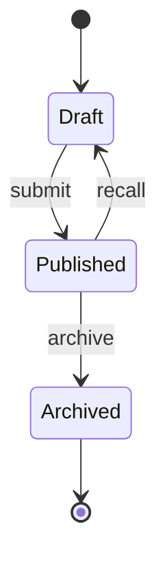

# D3 — Interaction & Flow（交互流程层）

> **5D Atlas v9.0 · D3/5**
> **目的**: 把 IA 的内容, 用**正确的人 / 在正确的时机 / 完成正确的动作**串成可验证的旅程。
> **失败模式**: 只画 happy path, 不画 error path / edge case —— 上线后用户走一半掉坑。

---

## 0. 本层回答的核心问题

| # | 问题 | 不回答的后果 |
|---|---|---|
| Q1 | **关键旅程有哪些** | 资源分散到任何流程都做一点 |
| Q2 | **每个旅程的状态机是什么** | 步骤遗漏 / 异常路径未覆盖 |
| Q3 | **失败兜底是什么** | 错误路径让用户走死胡同 |
| Q4 | **输入如何校验** | 错误数据进入下游,排查耗时 |
| Q5 | **如何撤销 / 重做** | 用户怕错, 宁愿不操作 |
| Q6 | **可访问性的交互约束** | 屏读 / 色盲 / 运动障碍用户卡死 |

---

## 1. 关键旅程清单 (Journey Inventory)

只列**对 D1 NSM 直接贡献**的旅程, ≤ 7 条。

```markdown
## Journey 1 — [persona + 目标 + 终点状态]
- Persona: 来自 D1.2
- 起点: ___
- 终点: 看得见的状态变化 (例如 "任务已发布")
- NSM 贡献: ___
- 频次: 日 / 周 / 月
- 关键时长预算: ≤ ___ 秒

## Journey 2 — ___
...
```

**判据**: 每个旅程必须能与 D1 的 NSM 画箭头,否则就是装饰流程, 该砍。

---

## 2. 旅程规格 (Journey Spec)

每条旅程写一份规格, **所有旅程同一格式**:

```markdown
## J-1: [journey name]
### 触发
- 入口 (≥3, per D2): ___
- 前置状态: 用户必须满足 ___
- 时间窗 (若有): 周一-周五 9-18 / 全时

### 步骤 (state machine)
1. [S1] 用户点击 "新建任务"
2. [S2] 表单展开 (默认焦点: 标题)
3. [S3] 校验通过 → 创建
4. [S4] 列表刷新 + 新任务高亮

### 错误路径
- E1: 网络断开 → S3 失败 → 显示"重试 / 离线编辑"
- E2: 标题为空 → 提交禁用 + 提示
- E3: 权限不足 → 隐藏入口 + 不报"权限错误"

### 撤销 / 重做
- 5 秒内可撤销: 显示 toast "已发布 [撤销]"
- 5 秒后不可撤销但可编辑 / 归档

### 数据
- 上行 payload: ___
- 下行 payload: ___

### 监控
- 转化率 = 进入 / 完成
- 错误率 = 错误路径 / 进入
- 时长 P50 / P95

### A11y
- 键盘可达: Tab 顺序
- 屏读: aria-live 触发
- 色盲: 红绿色不作为唯一信号
```

---

## 3. 状态机规范 (State Machine Spec)

每个有状态的对象 (任务 / 文档 / 评论) 必画状态机:

### 3.1 一张图



### 3.2 转移矩阵

| 当前态 | 触发事件 | 守卫条件 | 下一态 | 副作用 |
|---|---|---|---|---|
| Draft | submit | 标题非空 | Published | 创建时间戳 |
| Published | recall | 距发布 < 24h | Draft | 删除时间戳 |
| Published | archive | NSM 正常 | Archived | 不可检索 |

**判据**:
- 每个转移都有**守卫条件**,无"无脑态变"。
- 副作用**有审计**,否则合规检查挂。

---

## 4. 表单设计 (Form Discipline)

```markdown
## 输入字段
- 必填 vs 可选: 必填 ≤ 7 项 (per D2 出口判据)
- 类型: 文本 / 选择 / 日期 / 文件
- 默认值: 大多数用户的合理默认
- placeholder: 引导但不替代 label

## 校验
- 即时校验: 字符数 / 格式
- 提交前校验: 必填 / 跨字段
- 校验文案: 在哪错就显示在哪, 不在全局

## 防呆
- 不可逆操作二次确认
- 撤销窗口 (per §2)
- 键入即存 (草稿)
```

**判据**: 任何"删 / 推 / 付 / 发送"都必给 undo, 不可 undo 必二次确认。

---

## 5. 失败兜底 (Error Path Discipline)

| 错误类别 | 表现 | 兜底策略 |
|---|---|---|
| 网络 | 请求超时 | 自动重试 + 离线草稿 |
| 业务 | 对象不存在 | 提示 + 返回上一路径 |
| 权限 | 403 | 不暴露"为什么错", 引导登录 |
| 数据 | 提交失败 | 保留输入 + 显示错误字段 |
| 系统 | 5xx | 全局兜底页 + 错误码 + 反馈入口 |

**判据**: 每条状态机都要列错误路径,**无错误路径 = 不通过 D3**。

---

## 6. 撤销与重做 (Undo)

| 操作类型 | 可撤销窗口 | 替代方案 |
|---|---|---|
| 发送 / 发布 | 5-10 秒 toast | 编辑 / 撤回 |
| 删除 | 30 天回收站 | 申请恢复 |
| 付费 | 通常不可撤销 | 退款流程 |
| 设置变更 | 全部可回退 | 保留历史版本 |

---

## 7. 可访问性交互 (A11y Interaction)

| 维度 | 约束 | 验证方式 |
|---|---|---|
| 键盘 | 所有功能 Tab 可达;Esc 关闭 | 自动化 + 真人 5 用户 |
| 屏读 | 动态变更触发 aria-live | NVDA / VoiceOver 实测 |
| 色盲 | 状态非颜色单一信号 | 色盲模拟器 |
| 运动障碍 | 动效可减弱 (prefers-reduced-motion) | CSS 查询 + 设置 |
| 触觉 | 触控目标 ≥ 44×44 px | 设计稿检查 |

---

## 8. D3 出口判据 (Exit Criteria)

未通过即**禁止进入 D4**:

- [ ] 关键旅程清单 ≤ 7 条, 每条可画到 D1 NSM
- [ ] 每条旅程有 happy / error 路径
- [ ] 每个对象有状态机图 + 转移矩阵
- [ ] 表单必填 ≤ 7 项, 不可逆操作必给 undo
- [ ] 错误兜底覆盖 5 类错误
- [ ] A11y 5 维度有自动化或真人验证
- [ ] 监控指标在上线可埋点

---

## 9. 已知缺口 (Known Gaps)

| 缺口 | 影响 | 补足方式 |
|---|---|---|
| A11y 真人验证缺 | 部分用户不可用 | 上线前找 5 个真人 |
| 错误路径覆盖率 < 100% | 上线后才发现 | 混沌工程演练 |
| 表单字段 > 7 项 | 完成率低 | 拆步 / 默认值 |
| 撤销窗口经验值 | 误删救援成本 | A-B 测试 5s/10s/30s |

---

## 10. 接口与下游

| 输出物 | 给 D4 | 给 D5 |
|---|---|---|
| 旅程规格 | 关键页面截图 / 微交互 | 埋点 schema |
| 状态机 | 状态 chip 样式 | 数据库 enum + 转移函数 |
| 表单规格 | 字段分组 / 错误样式 | API schema / 校验逻辑 |
| A11y 规格 | 焦点样式 / 屏读文案 | ARIA + 测试 |

---

## 附录 A: 一页交付物

```markdown
# 关键旅程 (≤7 条)
1. J-1: ___
2. J-2: ___

# 状态机清单
| 对象 | 状态数 | 转移数 |
|---|---|---|
| 任务卡 | 4 | 6 |

# 错误兜底覆盖
- 网络 ✅ / 业务 ✅ / 权限 ✅ / 数据 ✅ / 系统 ✅

# A11y 验证
- 键盘 ✅ / 屏读 ⏳ / 色盲 ✅ / 运动 ⏳ / 触觉 ✅
```
