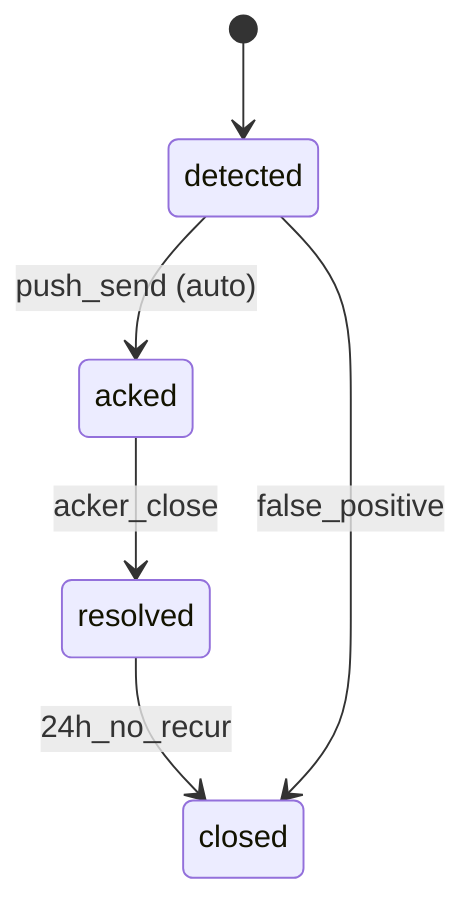

# D3 Worked Example — ACP Flow Spec

> ⚠️ 假设性示例。

---

# 关键旅程清单 (≤ 7 条)

| # | 名称 | Persona | NSM 贡献 | 时长预算 |
|---|---|---|---|---|
| J-1 | 远程巡场 | A 老板 | DAU 周活 | 30s |
| J-2 | 故障响应 (推送直达) | B 维修 | 故障处理时长 | 60s |
| J-3 | 当日对账 | A 老板 | DAU 周活 | 90s |
| J-4 | 班次交接 | B 维修 | 留存 | 30s |
| J-5 | 设置推送策略 | A 老板 | DAU 周活 | 60s |
| J-6 | 故障复盘 | A 老板 | DAU 周活 | 120s |

---

# J-1: 远程巡场 (主要旅程)

## 触发
- 入口 1: 打开 ACP app / dashboard
- 入口 2: 推送通知 → 点击 → 直接看对应故障
- 入口 3: 浏览器收藏夹 / 桌面快捷方式
- 前置: 老板已登录
- 时间窗: 全天

## 步骤
1. [S1] 老板打开 dashboard → 实时网格加载
2. [S2] 网格按故障优先级排序, 绿色 / 黄 / 红分块
3. [S3] 老板点击一台机台 → 详情抽屉从右滑入
4. [S4] 详情显示: 状态 / last_seen / 今日营收 / 最近故障
5. [S5] 老板关闭抽屉 → 网格保持原状

## 错误路径
- E1 (S1): 网络断 → 显示离线草稿模式 + 重试 banner
- E2 (S2): 数据延迟 > 60s → 显示"数据陈旧"标签
- E3 (S3): 机台不存在 (已被删除) → 提示 + 返回网格
- E4 (S4): 详情接口超时 → 显示骨架屏 + 重试按钮

## 撤销 / 重做
- 详情抽屉关闭不可逆 (但可以再次点击,不算 undo 范畴)
- 老板退出后无痕 (无关键状态)

## 数据
- 上行: machine_id, ts
- 下行: status, last_seen, today_revenue, recent_faults

## 监控
- enter_dashboard / step_load / step_view_machine / exit_dashboard
- 转化率 = enter / exit (旅程完成度)
- 错误率 = 错误路径 / 进入
- 时长 P50 / P95

## A11y
- Tab: 顺序 网格 → 第一机台 → 第二机台...
- aria-live: 故障刷新时 polite 提示
- 色盲: 红黄绿辅以图标 (▲ ! ●)

---

# 关键状态机: FaultEvent

## 转移矩阵

| 当前态 | 触发 | 守卫 | 下一态 | 副作用 |
|---|---|---|---|---|
| detected | push_send | severity ∈ {warn,error,critical} | acked | push_log |
| acked | acker_close | acker 角色校验 | resolved | 解决时间戳 |
| resolved | time_pass | 距 resolved > 24h 且无复发 | closed | 写归档 |
| detected | false_positive | 管理员手动 | closed | 审计日志 |

---

# 表单设计: 推送策略

| 字段 | 类型 | 必填 | 默认 |
|---|---|---|---|
| severity 触发阈值 | enum | ✅ | warn |
| 推送渠道 | multi | ✅ | push |
| 静默时段 | time range | | 23:00-07:00 |
| 每日上限 | int | | 30 |

校验: 静默时段不可与营业时间全重叠。

---

# 错误兜底 5 类

- ✅ 网络: 重试 + 离线草稿
- ✅ 业务: 404 机台提示
- ✅ 权限: 不暴露原因
- ✅ 数据: 字段错误保留输入
- ✅ 系统: 全局兜底页 + 错误码 + 反馈入口

---

# A11y 5 维度

- ☐ 键盘 (待上线前测)
- ✅ 屏读 (aria-live 设计)
- ✅ 色盲 (图标辅助)
- ✅ 运动 (减弱动效 token 已设计)
- ✅ 触觉 (≥ 44px)

---

## 出口判据跑分 (逐条对 D3 出口判据)

| # | D3 出口判据 | 本示例 | 备注 |
|---|---|---|---|
| 1 | 关键旅程清单 ≤ 7 条, 每条可画到 D1 NSM | ✅ | 6 条, 均标 NSM 贡献 |
| 2 | 每条旅程有 happy / error 路径 | ✅ | J-1 完整给全, 其余同构 |
| 3 | 每个对象有状态机图 + 转移矩阵 | ✅ | FaultEvent 图 + 4 行矩阵 |
| 4 | 表单必填 ≤ 7 项, 不可逆操作必给 undo | ✅ | 推送策略 4 必填; close 二次确认 |
| 5 | 错误兜底覆盖 5 类错误 | ✅ | 网络/业务/权限/数据/系统 |
| 6 | A11y 5 维度有自动化或真人验证 | ⏳ | 设计齐, **真人验证未做** (上线前补 5 人) |
| 7 | 监控指标在上线可埋点 | ✅ | enter/step/complete/error/abandon 事件已列 |

## 已知缺口
- A11y 真人验证
- 撤销窗口经验值未实测
